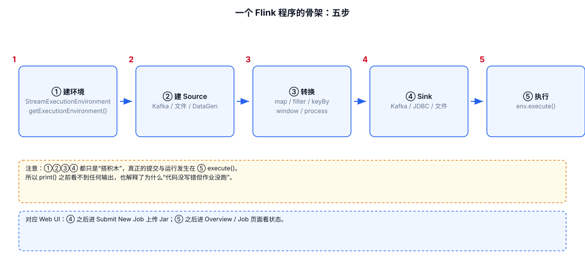
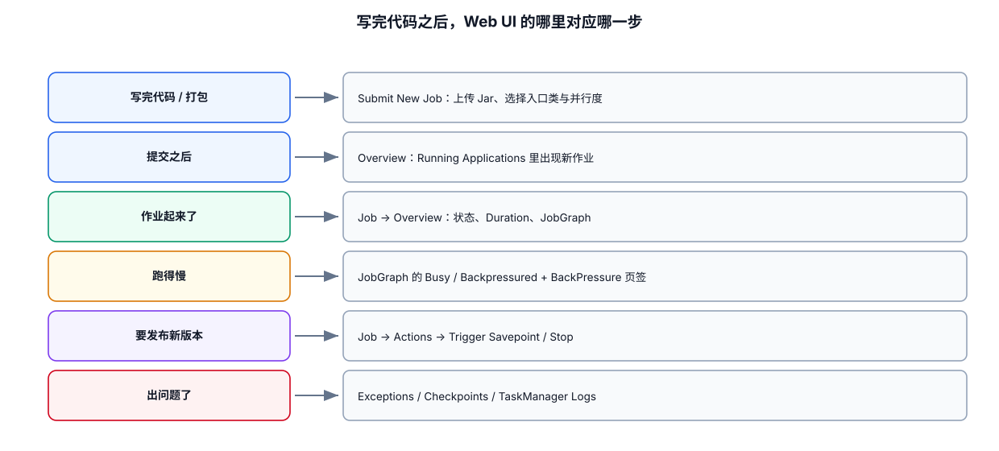

# 01｜基础使用：Flink DataStream 开发模板


---

# 1.  Flink 模板




```java
import org.apache.flink.api.common.eventtime.WatermarkStrategy;
import org.apache.flink.api.common.functions.MapFunction;
import org.apache.flink.api.common.serialization.SimpleStringSchema;
import org.apache.flink.connector.base.DeliveryGuarantee;
import org.apache.flink.connector.kafka.sink.KafkaRecordSerializationSchema;
import org.apache.flink.connector.kafka.sink.KafkaSink;
import org.apache.flink.connector.kafka.source.KafkaSource;
import org.apache.flink.connector.kafka.source.enumerator.initializer.OffsetsInitializer;
import org.apache.flink.streaming.api.datastream.DataStream;
import org.apache.flink.streaming.api.datastream.SingleOutputStreamOperator;
import org.apache.flink.streaming.api.environment.StreamExecutionEnvironment;

public class OrderAmountJob {

    public static void main(String[] args) throws Exception {

        // =============================================================
        // 第 1 步：创建执行环境
        // =============================================================
        // getExecutionEnvironment() 会根据运行上下文自动判断：
        // 本地直接跑 → 本地执行环境；提交到集群 → 集群执行环境。
        // 所以同一份代码既能本地调试，也能直接提交上线。
        StreamExecutionEnvironment env =
                StreamExecutionEnvironment.getExecutionEnvironment();

        // Job 级默认并行度：没有单独设置并行度的算子，都用这个值。
        // 生产环境要结合 Kafka 分区数、CPU、State 大小、Sink 吞吐一起定，
        // 一般从「Kafka 分区数」起步，而不是凭感觉写 4 或 8。
        env.setParallelism(4);

        // =============================================================
        // 第 2 步：创建 Source —— 从 Kafka 读原始数据
        // =============================================================
        KafkaSource<String> kafkaSource = KafkaSource.<String>builder()
                // Kafka Broker 地址。生产环境建议写多个，避免单个地址连不上。
                .setBootstrapServers("kafka01:9092,kafka02:9092")

                // 订阅的 Topic，可以一次订阅多个。
                .setTopics("order-topic")

                // 消费者组：同一组内的多个并行实例会自动分摊 Topic 的分区。
                .setGroupId("flink-order-job")

                // 启动位置。
                // earliest：从最早的数据开始（适合回跑历史）；
                // latest  ：只消费启动之后的新数据（适合只关心增量）。
                // 注意：一旦开启了 Checkpoint，恢复时会优先用快照里的 offset，
                //      这里的设置只在「第一次启动」时生效。
                .setStartingOffsets(OffsetsInitializer.earliest())

                // 反序列化：只把 Kafka message 的 value 读成 String。
                // 如果要用 key 或元数据，换成 KafkaRecordDeserializationSchema。
                .setValueOnlyDeserializer(new SimpleStringSchema())

                .build();

        // fromSource 是 Flink 2.x 接入 Source 的入口。
        // 第三个参数是算子在 Web UI 上显示的名字，排查问题时非常有用，建议一定要写。
        DataStream<String> source = env.fromSource(
                kafkaSource,
                // 这一步先不用事件时间，所以给一个不生成 Watermark 的策略；
                // 后面要做窗口时，再换成 forBoundedOutOfOrderness(...)。
                WatermarkStrategy.noWatermarks(),
                "kafka-order-source"
        );

        // =============================================================
        // 第 3 步：Transformation —— 过滤 → 判断 → 计算 → 分组计数
        // =============================================================
        // 3.1 过滤：把明显不合法的数据挡在门外。
        //     filter 接收一个返回 boolean 的表达式，返回 false 的记录被丢弃。
        SingleOutputStreamOperator<String> valid = source
                .filter(value -> value != null && value.contains(","))
                // 算子级并行度：只覆盖这个 filter，其它算子仍用 Job 默认的 4。
                .setParallelism(2)
                // name + uid：name 是给 Web UI 看的，uid 是给 Checkpoint 恢复用的。
                // 有状态算子一旦上线，uid 不能再改，否则老快照恢复不回来。
                .name("filter-valid")
                .uid("filter-valid");

        // 3.2 解析 + if 判断：把 "u001,100" 这种字符串变成 (userId, amount)。
        DataStream<Order> orders = valid
                .map(new MapFunction<String, Order>() {
                    @Override
                    public Order map(String value) throws Exception {
                        // 按逗号切分，parts[0] 是用户 ID，parts[1] 是金额。
                        String[] parts = value.split(",");
                        String userId = parts[0];
                        long amount = Long.parseLong(parts[1]);

                        // if 判断：金额小于等于 0 视为异常单，统一按 0 处理。
                        // 真实项目里可以在这里打日志、走 side output 分流，
                        // 也可以直接抛异常让作业失败——取决于业务能不能容忍脏数据。
                        if (amount <= 0) {
                            amount = 0L;
                        }

                        // 返回构造好的业务对象。
                        return new Order(userId, amount);
                    }
                })
                .name("parse-order")
                .uid("parse-order");

        // 3.3 计算：把金额乘以 2（示例业务逻辑，换成任何计算都可以）。
        DataStream<Order> doubled = orders
                .map(order -> new Order(order.getUserId(), order.getAmount() * 2))
                .name("double-amount")
                .uid("double-amount");

        // 3.4 分组计数：按 userId 分组，把组内的 amount 累加起来。
        //     keyBy 会按 key 的哈希做一次重新分区（也就是一次 Shuffle），
        //     之后相同 userId 的记录都会落到同一个并行实例上。
        DataStream<Order> totalPerUser = doubled
                .keyBy(Order::getUserId)
                // sum("amount") 按字段名累加；也可以写 sum(1)，1 是字段下标。
                // 这里只是最简单的分组聚合，复杂逻辑用 reduce / process 代替。
                .sum("amount")
                .name("sum-by-user")
                .uid("sum-by-user");

        // =============================================================
        // 第 4 步：创建 Sink —— 把结果写回 Kafka
        // =============================================================
        // 写 Kafka 之前先把对象转成字符串，所以先做一次 map。
        DataStream<String> result = totalPerUser
                .map(order -> order.getUserId() + "," + order.getAmount())
                .name("to-string")
                .uid("to-string");

        KafkaSink<String> kafkaSink = KafkaSink.<String>builder()
                // 目标 Kafka 地址。
                .setBootstrapServers("kafka01:9092,kafka02:9092")

                // 定义「写哪个 Topic」以及「怎么把一个 String 变成 Kafka 的字节」。
                .setRecordSerializer(
                        KafkaRecordSerializationSchema.builder()
                                .setTopic("order-total-topic")
                                .setValueSerializationSchema(new SimpleStringSchema())
                                .build()
                )

                // 投递语义：
                // AT_LEAST_ONCE    不丢，但故障恢复后可能重复，需要下游能按主键幂等；
                // EXACTLY_ONCE     需要 Kafka 事务 + 打开 Checkpoint，代价是延迟更高。
                .setDeliveryGuarantee(DeliveryGuarantee.AT_LEAST_ONCE)

                .build();

        // Sink 的并行度可以和上游不同：写 Kafka 时通常对齐下游 Topic 的分区数更划算。
        result
                .sinkTo(kafkaSink)
                .name("kafka-order-total-sink")
                .uid("kafka-order-total-sink")
                .setParallelism(4);

        // =============================================================
        // 第 5 步：execute 提交 Job
        // =============================================================
        // 到这一步为止，上面所有算子只是"画了一张图纸"——没有一条数据真正流动。
        // execute() 才是点火：把 JobGraph 提交给集群并开始运行。
        // 字符串是这个 Job 的名字，会显示在 Web UI 和 CLI 的作业列表里。
        env.execute("order-amount-job");
    }

    /**
     * 业务对象（POJO）。
     * Flink 要求：public 类 + public 无参构造方法 + 可访问的字段或 getter/setter，
     * 否则会退化成通用的序列化方式，性能和兼容性都更差。
     */
    public static class Order {

        private String userId;
        private Long amount;

        // 无参构造方法：Flink 反序列化时要用。
        public Order() {
        }

        public Order(String userId, Long amount) {
            this.userId = userId;
            this.amount = amount;
        }

        public String getUserId() {
            return userId;
        }

        public void setUserId(String userId) {
            this.userId = userId;
        }

        public Long getAmount() {
            return amount;
        }

        public void setAmount(Long amount) {
            this.amount = amount;
        }
    }
}
```

## 1.1 这五步在代码里的位置

| 步骤 | 做什么 | 对应代码 |
|---|---|---|
| ① 创建执行环境 | 拿到 `StreamExecutionEnvironment`，设置 Job 默认并行度 | `getExecutionEnvironment()` + `env.setParallelism(4)` |
| ② 创建 Source | 连 Kafka，把消息读成 `DataStream` | `KafkaSource.builder()` + `env.fromSource(...)` |
| ③ Transformation | 过滤 → 判断 → 计算 → 分组计数 | `filter` / `map` / `keyBy` + `sum` |
| ④ 创建 Sink | 把结果写回 Kafka | `KafkaSink.builder()` + `sinkTo(...)` |
| ⑤ execute | 真正提交 Job | `env.execute("order-amount-job")` |

## 1.2 两个并行度层级：算子级覆盖 Job 级

```text
env.setParallelism(4)             → Job 默认值：所有没单独设置的算子都用它
.filter(...).setParallelism(2)    → 只覆盖这一个算子
result.sinkTo(...).setParallelism(4) → Sink 也可以单独设
```

```text
算子级 parallelism
       ↓ 覆盖
Environment 默认 parallelism
```

所以「Job 默认并行度」只是兜底值，真正决定某个算子跑几个并行实例的，是它自己有没有 `setParallelism`。


---
# 2. `map`：一条数据转换成一条数据

## 2.1 Lambda 写法

```java
DataStream<Integer> numbers = env.fromData(1, 2, 3, 4);

DataStream<Integer> result = numbers.map(
        value -> value * 10
);
```

语法：

```text
stream.map(value -> output)

value：当前输入元素
output：当前输入对应的输出元素
```

类型变化：

```text
DataStream<T>
    ↓ map(Function<T, R>)
DataStream<R>
```

例如：

```text
String → Integer
Order → OrderDTO
JSON String → User
```

---

## 2.2 使用匿名内部类

当 Lambda 已经无法表达复杂逻辑时，可以写成显式 Function：

```java
DataStream<Integer> result = numbers.map(
        new MapFunction<Integer, Integer>() {

            @Override
            public Integer map(Integer value) throws Exception {
                // value：一条输入记录。
                // map()：必须返回一条输出记录。
                return value * 10;
            }
        }
);
```

需要导入：

```java
import org.apache.flink.api.common.functions.MapFunction;
```

### 为什么有时候推荐匿名类

```text
1. 业务逻辑复杂时更容易加注释。
2. 可以定义成员变量。
3. 需要 open() / close() 时可以进一步使用 RichFunction。
```

---

## 2.3 `map` 和 `process` 怎么选

两者都能做到“一条进一条出”，但能力和代价完全不同：map 简单、好测；process 能拿到状态和定时器。

### map：只做转换

```java
stream.map(value -> convert(value));
```

适合**输入一条、输出一条的纯粹转换**：

```text
String → Order
JSON 字符串 → 业务对象
金额单位换算
字段拼接、脱敏、格式统一
```

特点：拿不到状态、拿不到定时器、拿不到事件时间，但写起来最短、也最容易测。

### process：需要“上下文”时才用

```java
stream.process(new ProcessFunction<...>() {
    @Override
    public void processElement(...) {
        // 复杂逻辑
    }
});
```

只要出现下面任何一条，就必须用 process：

```text
要按时间触发（超时提醒、延时输出）  → Timer
要保存每个 Key 的中间状态            → State
一条输入要产出 0 条或 N 条           → Collector 调多次 / 调 0 次
要把异常数据分流到另一条流            → Side Output
要拿到当前事件时间、水位线            → ctx.timestamp()
规则动态变化、需要任意 Java 分支      → 复杂逻辑
```

### 选择顺序（从简到繁）

```text
能 map / filter / flatMap 解决  → 就用它们，代码最短、最好测
需要 Key 内累加                 → keyBy + reduce / aggregate
上面都不够用                    → 才上 process
```

不要为了“能力更强”而所有地方都使用 ProcessFunction。简单转换使用 map / filter / flatMap 更容易阅读、测试和维护。

---
# 3. `flatMap`：一条数据转换成 0～N 条

## 3.1 拆字符串

```java
DataStream<String> sentences = env.fromData(
        "flink kafka hive",
        "java flink"
);

DataStream<String> words = sentences.flatMap(
        (String value, Collector<String> out) -> {

            // 第一步：切分输入数据。
            String[] items = value.split("\\s+");

            // 第二步：逐个输出。
            // 每调用一次 out.collect()，就产生一条结果。
            for (String item : items) {
                if (!item.isBlank()) {
                    out.collect(item);
                }
            }
        }
);
```

需要：

```java
import org.apache.flink.util.Collector;
```

### 与 map 的根本区别

```text
map：
A → B
必须产生一个结果

flatMap：
A → 0 个结果
A → 1 个结果
A → N 个结果
```

---

# 4. `filter`：过滤数据

```java
DataStream<User> adults = users.filter(
        user -> user.getAge() >= 18
);
```

语法：

```text
filter(value -> boolean)
```

返回值必须是 `boolean`：

```text
true  → 保留
false → 丢弃
```

## 4.1 多条件

```java
DataStream<User> result = users.filter(user ->
        user.getUserId() != null
                && !user.getUserId().isBlank()
                && user.getAge() != null
                && user.getAge() >= 18
);
```

### 注意空指针

```java
// 不安全：user.getAge() 可能为 null。
user -> user.getAge() >= 18

// 更安全：
user -> user.getAge() != null && user.getAge() >= 18
```

生产数据通常不是理想数据，因此过滤和解析逻辑要明确处理：

```text
null
空字符串
非法格式
缺失字段
异常数值
```

---

# 5. 算子链式调用

最常见的写法：

```java
DataStream<String> result = source
        // 1. 过滤非法输入。
        .filter(value -> value != null && !value.isBlank())

        // 2. 去除首尾空格并转小写。
        .map(String::trim)
        .map(String::toLowerCase)

        // 3. 只保留长度大于 2 的数据。
        .filter(value -> value.length() > 2);
```

这种写法适合简单逻辑。

如果一条链已经包含大量业务分支，不要为了“链式写法”把所有逻辑塞在一个 lambda 中，应拆成命名函数 / Function / ProcessFunction，方便测试和排错。

---

# 6. `keyBy`：

整个 DataStream API 可以按 keyBy 一刀切成两半，先把这个分界搞清楚。

## 6.0 keyBy 作用

**调用 keyBy 之前**，你手上是一个「普通 DataStream」：

```text
DataStream<T>
```

这时候 Flink 只把数据当成一串普通的记录，**不知道任何业务主键**。
所以在普通 DataStream 上，你能做的只有"逐条转换"类的算子：map / filter / flatMap。

**调用 keyBy 之后**，拿到的是「KeyedStream」：

```java
KeyedStream<T, K> keyedStream = stream.keyBy(...);
```

这里的 `K` 就是 Key 的类型（比如按 `userId` 分组，K 就是 `String`）。
KeyedStream 和普通 DataStream 有两个本质区别：

```text
① 数据被重新分区（一次 shuffle）
   按 Key 的哈希取模，把相同 Key 的记录路由到同一个并行实例。
   结果是：同一个 Key 的数据，一定落在同一个 Subtask 上。

② 从此可以"按 Key 记账"
   只有 KeyedStream 才提供 Key 级的状态、定时器、窗口和聚合算子。
```

"之后就可以基于 Key 使用"指的就是下面这些**只有 KeyedStream 才有**的能力：

```text
Keyed State            每个用户 / 每个订单各存一份互不干扰的状态
KeyedProcessFunction   带状态、带定时器的逐条处理
Keyed Window           按 Key 分别切窗口
Reduce / Aggregate     在每个 Key 内部做滚动聚合
```

**一句话：`keyBy` 本身不做聚合，它只负责"分区 + 打上 Key 的标记"。**
真正把多条数据合成一条的，是后面的 `reduce` / `aggregate` / 窗口 / `process`。
## 6.1 按一个字段 KeyBy

```java
DataStream<Order> orders = ...;

KeyedStream<Order, String> keyedOrders = orders
        .keyBy(Order::getUserId);
```

语法：

```text
keyBy(KeySelector<T, K>)

T：输入类型
K：Key 的类型
```

`Order::getUserId` 本质上就是：

```java
order -> order.getUserId()
```

---

## 6.2 多个字段一起分组

### 什么时候需要组合 Key

只有一个字段做分组时，直接用 `keyBy(Order::getUserId)` 就够了。
但有些统计必须**两个字段一起看**，例如：

```text
"每个用户在每个商品上的累计金额"  → Key 应该是 userId + itemId
"每台设备每种指标的最新值"        → Key 应该是 deviceId + metricName
```

只用 userId 分组，会把同一个用户在商品 A、商品 B 上的金额混在一起；
只按 itemId 分组，又会把不同用户混在一起。所以必须把两个字段**合成一个 Key**。

### 用对象做 Key

多字段分组的正确写法是：**定义一个只有字段和 getter/setter 的小类当 Key**。

```java
/** 组合 Key：userId + itemId。 */
public class UserItemKey implements Serializable {

    private String userId;
    private String itemId;

    // Flink 反序列化时要用无参构造方法。
    public UserItemKey() {
    }

    public UserItemKey(String userId, String itemId) {
        this.userId = userId;
        this.itemId = itemId;
    }

    public String getUserId() {
        return userId;
    }

    public void setUserId(String userId) {
        this.userId = userId;
    }

    public String getItemId() {
        return itemId;
    }

    public void setItemId(String itemId) {
        this.itemId = itemId;
    }

    // ===== 这两个方法是重点：Flink 靠它们判断“是不是同一个 Key” =====
    // hashCode()：决定这条数据被分到哪个并行实例；
    // equals()  ：决定两条数据是不是同一个 Key（reduce / 状态都依赖它）。
    // 只重写其中一个，或者写错了，会出现“数据跑到了同一个实例、却没被合并”这类诡异问题。
    @Override
    public boolean equals(Object o) {
        if (this == o) {
            return true;
        }
        if (o == null || getClass() != o.getClass()) {
            return false;
        }
        UserItemKey that = (UserItemKey) o;
        return Objects.equals(userId, that.userId)
                && Objects.equals(itemId, that.itemId);
    }

    @Override
    public int hashCode() {
        return Objects.hash(userId, itemId);
    }

    @Override
    public String toString() {
        return userId + "," + itemId;
    }
}
```

用的时候直接 new 出来当 Key：

```java
KeyedStream<Order, UserItemKey> keyed = orders
        .keyBy(order -> new UserItemKey(
                order.getUserId(),
                order.getItemId()
        ));
```

为什么不要用 `"a" + "_" + "b"` 这种字符串拼接当 Key：

```text
{"a_b", "c"} 和 {"a", "b_c"} 拼出来都是 "a_b_c"
→ 两个本来不同的组合被当成同一个 Key，统计结果就错了
```

---
# 7. `reduce`：keyby 后聚合

## 7.1 reduce 到底在做什么

`reduce` 的作用是：**把同一个 Key 上的多条数据，聚合成一条。**

它**必须跟在 `keyBy` 后面**——没有 keyBy 就没有“组”的概念：

```text
keyBy(userId)       → 先把同一个用户的数据分到同一个并行实例
    ↓
reduce(合并规则)     → 该用户每来一条，就和“上次的累计结果”合并一次
```

和 SQL 的 `GROUP BY` 对比最直观：

```text
SQL:   SELECT user_id, SUM(amount) FROM t GROUP BY user_id
       → 数据全部到齐后一次性算出结果，只输出一行。

Flink: keyBy(user_id).reduce((acc, cur) -> acc + cur)
       → 增量执行：每来一条就更新一次累计值，并立刻往下游发一条更新。
```

**所以：`reduce` ≈ GROUP BY 的流式版本，但输出行为不一样。**

SQL 的 GROUP BY 只输出最终结果；Flink 的 reduce **每来一条数据就输出一次**，
前面几次都是中间结果。用下面的例子最能看出来：

```text
u001: 100    → 输出 total=100
u001: 300    → 输出 total=400
u001: 50     → 输出 total=450   ← 这才是最终结果
```

如果下游只想保留每个 Key 的最新值，可以按主键 upsert 覆盖写入数据库；
或者改用 `process()`，自己决定什么时候输出（见第 8 节）。

---

例：统计每个用户累计消费。

```java
// 用 POJO：字段有名字，一眼能看懂。
DataStream<Order> orders = env.fromElements(
        new Order("u001", 100L),
        new Order("u002", 200L),
        new Order("u001", 300L),
        new Order("u001", 50L)
);

DataStream<Order> total = orders
        // 第一步：按 userId 分区。
        .keyBy(Order::getUserId)

        // 第二步：每个 Key 独立执行 reduce。
        .reduce((acc, current) ->
                // acc     ：这个 Key 之前累计得到的结果。
                // current ：这个 Key 新到的一条。
                // 返回值  ：新的累计结果，会被保存下来等下一调用。
                new Order(acc.getUserId(), acc.getAmount() + current.getAmount())
        );
```
逻辑类似：

```text
u001: 100
u001: 100 + 300 = 400
u001: 400 +  50 = 450
```

### 什么时候适合 Reduce

```text
求和
最大值
最小值
计数
简单累计值
```

### 什么时候不适合

```text
需要完整窗口数据
需要 Timer
需要访问复杂 State
需要同时输出主流和异常流
需要复杂条件状态机
```

这时应该考虑 Window / ProcessFunction / State。

---

# 8. `ProcessFunction`：需要状态和定时器时用它

## 8.1 它是用来做什么的

前面的 map / filter / flatMap 都是**无状态**的：来一条处理一条，处理完就忘。
ProcessFunction 是 Flink 里**最底层的处理入口**，它多给你三样东西：

```text
① 状态（State）    每个 Key 可以记住之前的数据
                  例如“这个用户上一次下单是什么时候”

② 定时器（Timer）  注册一个“多少毫秒后触发”的回调
                  例如“10 秒还没支付就提醒”，无需自己起线程

③ 上下文（Context）当前时间、水位线、当前 Key、侧输出（Side Output）
```

所以判断标准很简单：

```text
只是转换、过滤、拆条             → map / filter / flatMap
要在 Key 内做滚动聚合            → keyBy + reduce / aggregate
要记住状态、要按时间触发、要分流  → ProcessFunction
```

一句话：**reduce 只能“两条合并成一条”，而 ProcessFunction 能“记住过去、等待将来”。**

---

## 8.2 最小模板


```java
DataStream<String> result = source.process(
        new ProcessFunction<String, String>() {

            @Override
            public void processElement(
                    String value,
                    Context ctx,
                    Collector<String> out
            ) throws Exception {

                // value：当前输入记录。
                // ctx：当前处理上下文。
                // out：主输出。

                out.collect(value.toUpperCase());
            }
        }
);
```

### 三个参数记忆

```text
value
    当前数据

ctx
    当前上下文：时间、Timer、Side Output 等

out
    主输出 Collector
```

---

# 9. `RichFunction`：需要生命周期时使用

很多业务逻辑需要初始化资源，例如：

```text
数据库连接
HTTP Client
配置
本地缓存
Metrics
```

这类场景可以使用 RichFunction。

## 9.1 `RichMapFunction`

> 版本提示：下面示例用的是 Flink 2.x 的 `open(OpenContext)`；
> 本项目实际用的 Flink 1.15 要写成 `open(Configuration parameters)`。

```java
DataStream<String> result = source.map(
        new RichMapFunction<String, String>() {

            private transient SomeClient client;

            @Override
            public void open(OpenContext parameters) throws Exception {
                // open()：算子实例开始处理数据前调用。
                // 适合初始化连接、客户端、缓存、Metric 等资源。
                client = new SomeClient();
            }

            @Override
            public String map(String value) throws Exception {
                // 数据正式进入算子后，逐条调用。
                return client.transform(value);
            }

            @Override
            public void close() throws Exception {
                // close()：算子实例关闭时调用。
                // 释放需要显式关闭的资源。
                if (client != null) {
                    client.close();
                }
            }
        }
);
```

### 为什么资源通常不要在 `map()` 中初始化

错误思路：

```java
@Override
public String map(String value) {
    SomeClient client = new SomeClient();
    return client.transform(value);
}
```

这样每条数据都可能重复创建客户端。

更合理：

```text
算子实例启动
    ↓
open()
    ↓
初始化一次
    ↓
连续处理多条数据
    ↓
close()
    ↓
释放资源
```

### `transient`

如果成员变量是外部客户端、连接对象等通常不应该被 Flink 序列化，可以考虑：

```java
private transient SomeClient client;
```

然后在 `open()` 中重新初始化。

---

# 10. `union`：同类型流合并

```java
DataStream<String> sourceA = ...;
DataStream<String> sourceB = ...;
DataStream<String> sourceC = ...;

DataStream<String> result = sourceA.union(sourceB, sourceC);
```

特点：

```text
输入类型相同
不会自动去重
```

例如：

```text
Kafka Topic A ─┐
Kafka Topic B ─┼→ union → 后续处理
Kafka Topic C ─┘
```

### 易错点：union 不去重

---

# 11. `connect`：两条流“配对”处理，但类型可以不同

## 11.0 它到底解决什么问题

典型场景是：**一条是主数据流，另一条是“规则 / 配置 / 维表”流，
主数据要参考另一条流里的信息才能决定怎么处理。**

举个具体例子：

```text
主流：订单流        order-topic   → 每笔订单都要判断“要不要拦截”
配置流：风控规则流  rule-topic    → 运营随时改规则，比如“金额 > 1000 拦截”

需求：订单来了要按“当前最新规则”判断，规则变了要立刻生效。
```

这种需求用 `union` 做不到：

```text
union 要求两条流类型相同，只是把它们首尾相接合并成一条流；
合并之后没人分得清哪条是订单、哪条是规则，也无法让订单去“查”规则。
```

`connect` 解决的正是这一点：

```text
union
→ 要求类型相同
→ 合并成同一种流，后续按同一条逻辑处理
→ 不保留“这两条数据来自不同流”的信息

connect
→ 允许类型不同（Order 和 UserConfig）
→ 交出 ConnectedStreams，两条流各自走各自的处理方法
  （processElement1 处理第一条，processElement2 处理第二条）
→ 可以在同一个算子里共享状态，实现“用规则流影响主流”
```

一句话：**`union` 是“把两股水汇成一股”，`connect` 是“让两个人坐在一起对话”。**

两个最容易踩的点：

```text
① connect 之后必须用双输入函数（CoMap / CoFlatMap / CoProcessFunction），
   不能再用普通的 map / filter。

② connect ≠ Join
   connect 不保证“两条流里相同 Key 的数据会相遇”，它只保证两条流进同一个算子。
   只有配合 keyBy + 状态，才能自己实现配对；
```
**所以如果需求本身就是“按 Key 和时间范围做匹配”，直接用 Interval Join 更省事**
## 11.1 基础模板

```java
DataStream<Order> orders = ...;
DataStream<UserConfig> configs = ...;

ConnectedStreams<Order, UserConfig> connected =
        orders.connect(configs);
```

进一步：

```java
DataStream<String> result = connected.process(
        new CoProcessFunction<Order, UserConfig, String>() {

            @Override
            public void processElement1(
                    Order order,
                    Context ctx,
                    Collector<String> out
            ) throws Exception {
                // Order 流进入这里。
                out.collect("order=" + order.getUserId());
            }

            @Override
            public void processElement2(
                    UserConfig config,
                    Context ctx,
                    Collector<String> out
            ) throws Exception {
                // UserConfig 流进入这里。
                out.collect("config=" + config.getUserId());
            }
        }
);
```

### 重要

```text
connect ≠ Join

connect 只是把两条流交给同一个双输入处理逻辑。

如果必须满足：
- 相同 Key
- 时间范围
- 匹配条件

则应使用专门的 Join / Interval Join 等方案。
```

---

# 12. Broadcast State 基础模式（广播流）

典型场景：

```text
主事件流：订单
配置流：风控规则

规则数据量小
规则需要传播到每个并行实例
```

基本结构：

```text
Rule Stream
    ↓ broadcast()
BroadcastStream<Rule>
    ↓ connect()
Order Stream ──────────→ KeyedBroadcastProcessFunction
```

### 代码骨架

```java
// 1. 定义 Broadcast State 的描述信息。
MapStateDescriptor<String, Rule> ruleState =
        new MapStateDescriptor<>(
                "rule-state",
                String.class,
                Rule.class
        );

// 2. 把规则流广播到每个并行实例。
BroadcastStream<Rule> rules = ruleStream.broadcast(ruleState);

// 3. 主流 + 广播流连接。
DataStream<Result> result = orderStream
        .keyBy(Order::getUserId)
        .connect(rules)
        .process(new KeyedBroadcastProcessFunction<
                String,
                Order,
                Rule,
                Result
        >() {

            @Override
            public void processElement(
                    Order order,
                    ReadOnlyContext ctx,
                    Collector<Result> out
            ) throws Exception {

                // 主流侧读取广播状态。
                Rule rule = ctx.getBroadcastState(ruleState)
                        .get(order.getRuleId());

                if (rule != null) {
                    out.collect(check(order, rule));
                }
            }

            @Override
            public void processBroadcastElement(
                    Rule rule,
                    Context ctx,
                    Collector<Result> out
            ) throws Exception {

                // 广播数据进入这里。
                // Broadcast State 的写操作在 Context 中完成。
                ctx.getBroadcastState(ruleState)
                        .put(rule.getRuleId(), rule);
            }
        });
```

### 适合

```text
小型规则表
配置中心同步后的规则流
黑名单
白名单
动态规则
```

### 不适合

```text
超大维表
每个 Subtask 保存完整副本会带来明显内存开销
```

---

# 13. 基本分区方式

## 13.1 `keyBy`

```java
stream.keyBy(Event::getUserId);
```

语义：

```text
相同 Key
   ↓
相同逻辑分区
   ↓
适合 Keyed State / Keyed Process
```

---

## 13.2 `shuffle`

```java
stream.shuffle();
```

含义：

```text
把数据随机打散到下游并行实例。
```

适合：

```text
需要随机分散数据
```

不适合：

```text
需要保证相同 Key 在一起
```

因为它破坏了这种 Key 聚合前提。

---

## 13.3 `rebalance`

```java
stream.rebalance();
```

目标是让数据更均衡地分发到下游并行实例。

常见场景：

```text
上游并行实例负载明显不均
下游计算任务希望重新均衡输入
```

不要把它当成“万能数据倾斜解决方案”。如果倾斜来自 `keyBy` 后的热点 Key，重新设计 Key 往往才是根本解决方法。

---

## 13.4 `broadcast`

```java
BroadcastStream<Rule> broadcast = ruleStream.broadcast(descriptor);
```

语义：

```text
一条规则
    ↓
每个下游并行实例都收到
```

---

# 14. 并行度与算子链的基础认知

一个 Job 可以粗略理解为：

```text
Source
  ↓
Operator
  ↓
Operator
  ↓
Sink
```

每个算子可以有自己的并行度：

```text
Source parallelism = 4
Map parallelism    = 8
Sink parallelism   = 4
```

因此不能只看 Job 的一个 `parallelism` 数字判断任务实际运行方式。

## 14.1 推荐写法

```java
env.setParallelism(4);

DataStream<Result> result = source
        .map(...)
        .filter(...)
        .setParallelism(8);
```

含义：

```text
默认并行度：4

当前 filter / map 链上最终设置的算子：8
```

实际任务是否发生数据重分区，还与上游/下游算子之间的分区方式、Operator Chain 等因素有关。

后续专题：

```text
10-专题原理/02-Operator与Task.md
10-专题原理/03-数据交换与Network.md
```

---

# 15. 一个完整基础 Demo：Source → Transform → KeyBy → Process → Sink

下面这个模板适合保存下来作为日常 DataStream 起步模板。

```java
import org.apache.flink.api.common.functions.MapFunction;
import org.apache.flink.api.common.functions.OpenContext;
import org.apache.flink.streaming.api.datastream.DataStream;
import org.apache.flink.streaming.api.datastream.KeyedStream;
import org.apache.flink.streaming.api.environment.StreamExecutionEnvironment;
import org.apache.flink.streaming.api.functions.ProcessFunction;
import org.apache.flink.util.Collector;

public class BasicDataStreamJob {

    public static void main(String[] args) throws Exception {

        // =========================================================
        // Step 1. 创建执行环境
        // =========================================================
        StreamExecutionEnvironment env =
                StreamExecutionEnvironment.getExecutionEnvironment();

        // Job 默认并行度。
        // 实际生产值应根据 Source、CPU、State、Sink 等资源决定。
        env.setParallelism(2);

        // =========================================================
        // Step 2. 创建 Source
        // =========================================================
        // Demo 使用 fromData()。
        // 生产场景替换为 KafkaSource / CDC / Filesystem 等真正 Source。
        DataStream<String> source = env.fromData(
                "u001,100",
                "u002,200",
                "u001,300",
                "bad-data"
        );

        // =========================================================
        // Step 3. 过滤非法输入
        // =========================================================
        DataStream<String> valid = source.filter(value -> {
            // 基础格式检查：必须至少存在一个逗号。
            return value != null && value.contains(",");
        });

        // =========================================================
        // Step 4. String → Order
        // =========================================================
        DataStream<Order> orders = valid.map(
                new MapFunction<String, Order>() {
                    @Override
                    public Order map(String value) throws Exception {
                        // value 例：u001,100
                        // 第一步：按逗号切分。
                        String[] parts = value.split(",");

                        // 第二步：解析字段。
                        String userId = parts[0];
                        Long amount = Long.parseLong(parts[1]);

                        // 第三步：构造业务对象。
                        return new Order(userId, amount);
                    }
                }
        );

        // =========================================================
        // Step 5. 按 userId 分区
        // =========================================================
        KeyedStream<Order, String> keyedOrders =
                orders.keyBy(Order::getUserId);

        // =========================================================
        // Step 6. Process
        // =========================================================
        // 本例只演示逐条处理，不展开 State / Timer。
        DataStream<String> result = keyedOrders.process(
                new ProcessFunction<Order, String>() {
                    @Override
                    public void processElement(
                            Order order,
                            Context ctx,
                            Collector<String> out
                    ) throws Exception {
                        // 将业务对象转换成输出字符串。
                        out.collect(
                                order.getUserId()
                                        + " => "
                                        + order.getAmount()
                        );
                    }
                }
        );

        // =========================================================
        // Step 7. Sink
        // =========================================================
        // print() 只用于 Demo / 调试。
        // 生产环境应替换为 KafkaSink、JDBC、Filesystem 等。
        result.print("RESULT");

        // =========================================================
        // Step 8. 提交 Job
        // =========================================================
        // 没有 execute()，上面的 DataStream API 只是构建了执行计划。
        env.execute("basic-datastream-job");
    }

    // =============================================================
    // 业务对象
    // =============================================================
    public static class Order {
        private String userId;
        private Long amount;

        public Order() {
        }

        public Order(String userId, Long amount) {
            this.userId = userId;
            this.amount = amount;
        }

        public String getUserId() {
            return userId;
        }

        public Long getAmount() {
            return amount;
        }
    }
}
```

### 这个 Demo 对应的结构

```text
String Source
    ↓
filter
    ↓
map
    ↓
keyBy(userId)
    ↓
process
    ↓
print Sink
```

---

# 16. 一个更接近生产的结构

生产项目不要把所有代码都堆在 `main()`。

建议拆成：

```text
JobMain
├── SourceFactory
├── Transformation / Business Logic
├── SinkFactory
└── Config
```

例如：

```java
public class OrderJob {

    public static void main(String[] args) throws Exception {
        // Step 1：创建环境。
        StreamExecutionEnvironment env =
                StreamExecutionEnvironment.getExecutionEnvironment();

        // Step 2：加载配置。
        JobConfig config = JobConfig.load(args);

        // Step 3：创建 Source。
        DataStream<Order> orders = OrderSources.create(env, config);

        // Step 4：业务处理。
        DataStream<Result> result = OrderPipeline.process(
                orders,
                config
        );

        // Step 5：创建 Sink。
        OrderSinks.write(result, config);

        // Step 6：统一提交 Job。
        env.execute(config.getJobName());
    }
}
```

这样做的目的不是追求“工程形式”，而是把几个变化频率不同的东西分开：

```text
Source 变化
业务逻辑变化
Sink 变化
配置变化
```

后续接 Kafka、HBase、JDBC 时，可以直接替换 Source/Sink 层，而不需要重写整个 Job。

---

# 17. 常见错误写法

## 17.1 忘记 `execute()`

```java
DataStream<String> result = source.map(...);
result.print();

// 没有 env.execute()
```

后果：程序可能只构建执行图而没有真正提交 Job。

正确：

```java
result.print();
env.execute("job-name");
```

---

## 17.2 把 `keyBy` 当成数据库 `GROUP BY`

```java
stream.keyBy(Event::getUserId);
```

这不是“立即计算每个 userId 的一行结果”。

它的主要作用是：

```text
重新分区
    ↓
相同 Key 进入同一个逻辑分区
    ↓
后续 State / Process / Window 可以按 Key 处理
```

---

## 17.3 该用 `flatMap` 却使用 `map`

错误思路：

```java
stream.map(value -> value.split(","));
```

结果类型会变成：

```text
DataStream<String[]>
```

如果目标是：

```text
A,B,C
 ↓
A
B
C
```

应该使用 `flatMap`。

---

## 17.4 在 `map()` 中频繁创建外部连接

错误：

```java
.map(value -> {
    // 每条数据都创建连接。
    Client client = new Client();
    return client.query(value);
})
```

通常应该：

```text
RichFunction.open()
    ↓
初始化 Client
    ↓
map() 重复使用
```

但外部系统调用是否适合直接放进同步 `map()`，还要进一步考虑吞吐、并发和超时问题；高并发外部查询通常应该进一步学习 Async I/O。

---

# 18. Lambda 与匿名 Function 怎么选

| 情况 | 推荐 |
|---|---|
| 一行简单转换 | Lambda |
| 简单 filter | Lambda |
| 简单 keyBy | Lambda / 方法引用 |
| 逻辑超过几行 | 匿名类或独立 Function |
| 需要 `open()` / `close()` | RichFunction |
| 需要 State / Timer / Side Output | ProcessFunction |
| 需要双流处理 | CoProcessFunction |
| 需要 Broadcast State | KeyedBroadcastProcessFunction |

---

# 19. 基础 API 的选择树

```text
现在要写一个算子
│
├── 只是修改字段？
│      └── map
│
├── 一条数据拆成多条？
│      └── flatMap
│
├── 只需要过滤？
│      └── filter
│
├── 需要按 Key 处理？
│      └── keyBy
│          │
│          ├── 简单累加？
│          │     └── reduce / aggregate
│          │
│          └── 复杂业务逻辑？
│                └── process
│
├── 两个同类型流合并？
│      └── union
│
├── 两个不同类型流协同处理？
│      └── connect
│
├── 小规则/配置流广播？
│      └── broadcast
│
└── 需要 Event Time / 窗口？
       └── Timestamp + Watermark + Window
```


---

# 20. 本篇最小记忆表

| 概念 | 一句话记忆 |
|---|---|
| `DataStream<T>` | 一条 T 类型的数据流 |
| `map` | 1 → 1 |
| `flatMap` | 1 → 0/N |
| `filter` | true 保留，false 丢弃 |
| `keyBy` | 相同 Key 分到同一逻辑分区 |
| `reduce` | Key 内滚动累计 |
| `process` | 自定义逐条处理，可扩展到 State/Timer/Side Output |
| `union` | 合并同类型流 |
| `connect` | 连接两种类型的流，协同处理 |
| `broadcast` | 把小流复制到每个下游并行实例 |
| `setParallelism` | 设置当前算子并行度 |
| `env.setParallelism` | 设置默认并行度 |
| `execute` | 真正提交 Job |

---

# 21. 官方文档入口

- Apache Flink 官方文档：<https://nightlies.apache.org/flink/flink-docs-stable/>
- DataStream API：<https://nightlies.apache.org/flink/flink-docs-stable/docs/dev/datastream/>
- DataStream Operators：<https://nightlies.apache.org/flink/flink-docs-stable/zh/docs/dev/datastream/operators/overview/>
- Parallel Execution：<https://nightlies.apache.org/flink/flink-docs-stable/docs/dev/datastream/execution/parallel/>
- Kafka Connector：<https://nightlies.apache.org/flink/flink-docs-stable/docs/connectors/datastream/kafka/>

---

# 22. 配套 Web UI 证据




