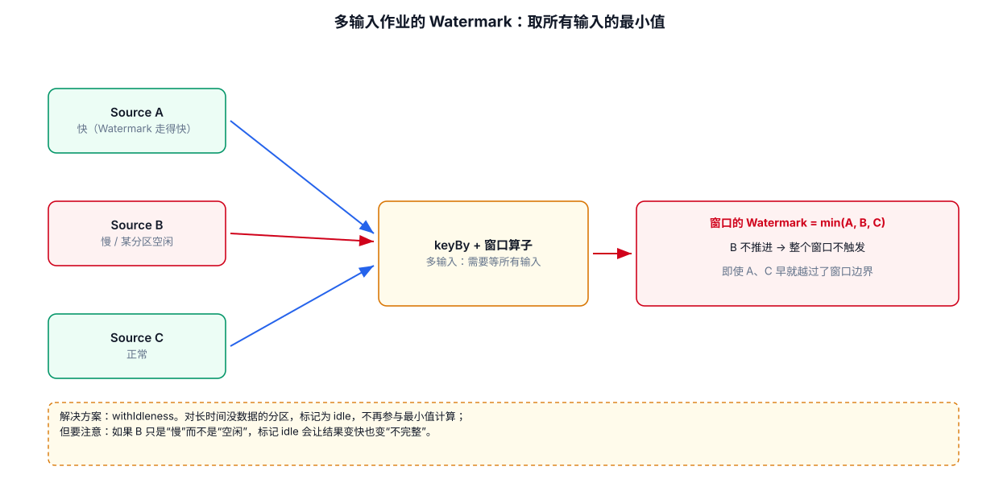
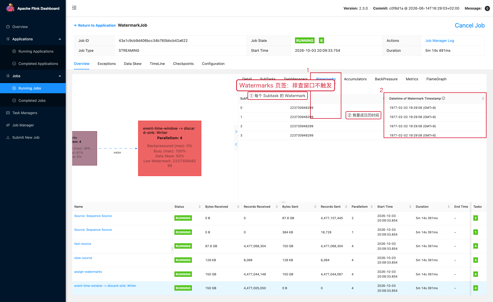

# 02-02｜Watermark

> 用途：窗口、Event Time Timer、迟到数据处理的基础。

---



## 1. Watermark 是什么

Watermark 可以理解成：

```text
“在当前处理进度下，我认为事件时间早于某个时间点的数据已经基本到齐。”
```

例如：

```text
当前 Watermark = 10:00:00
```

通常意味着系统已经允许基于事件时间推进到 `10:00:00`。

Watermark 本质上表示 Event Time 的处理进度；窗口和 Event Time Timer 会根据 Watermark 判断是否应该触发。

---

## 2. 最常用的 Watermark 写法

```java
WatermarkStrategy<Order> strategy =
        WatermarkStrategy
                // 允许最多 10 秒乱序。
                .<Order>forBoundedOutOfOrderness(Duration.ofSeconds(10))

                // 指定事件时间字段。
                .withTimestampAssigner((order, timestamp) ->
                        order.getEventTime()
                );//order 就是数据，timestamp就是时间字段

DataStream<Order> timedStream =
        source.assignTimestampsAndWatermarks(strategy);
```

---

## 3. `forBoundedOutOfOrderness`

```java
forBoundedOutOfOrderness(Duration.ofSeconds(10))
```

参数：

```text
Duration.ofSeconds(10)
    → 最大乱序程度
```

不要理解成：

```text
每条数据固定等待 10 秒
```

正确理解是：Watermark 生成器根据已经观测到的最大事件时间和允许乱序程度，估计事件时间进度。

---

## 4. `withTimestampAssigner`

```java
.withTimestampAssigner((event, recordTimestamp) -> {
    return event.getEventTime();
})
```

参数：

```text
event
    当前数据对象

recordTimestamp
    上游已有的时间戳；通常业务代码直接从 event 中提取时间即可

return
    当前事件的事件时间，单位毫秒
```

例如：

```java
// 如果业务时间是 Unix 秒级时间戳：
.withTimestampAssigner((event, ts) -> event.getEventTime() * 1000L);
```

注意单位。

```text
10 位 Unix 时间戳 → 通常是秒
13 位 Unix 时间戳 → 通常是毫秒
```

不要直接把秒级时间戳当毫秒使用。

---

## 5. Kafka 多分区场景为什么特别需要关注 Watermark

假设 Kafka 有 3 个分区：

```text
Partition 0 → Watermark 10:10
Partition 1 → Watermark 10:08
Partition 2 → Watermark 10:09
```

下游算子收到多个输入分区时，事件时间进度受最慢的输入约束。官方调试文档也明确指出，`currentInputWatermark` 是输入 Watermark 中的低值。

因此：

```text
某个 Kafka Partition 长时间没有数据
        ↓
该分区 Watermark 不推进
        ↓
下游最小 Watermark 不推进
        ↓
窗口可能迟迟不触发
```

---

## 6. Source 空闲时使用 `withIdleness`

如果某些 Source 分区可能长时间没有数据，可以配置空闲检测：

```java
WatermarkStrategy<Order> strategy =
        WatermarkStrategy
                .<Order>forBoundedOutOfOrderness(Duration.ofSeconds(10))

                // 某个 Source 分区超过 1 分钟没有数据，认为它暂时 idle。
                // 这样不会因为这个没有数据的分区长期阻塞整体 Watermark。
                .withIdleness(Duration.ofMinutes(1))

                .withTimestampAssigner((order, ts) ->
                        order.getEventTime()
                );
```

### 注意

`withIdleness()` 不是“丢弃这个分区的数据”。

它解决的是：

```text
没有数据的分区
    → 不应该无限期阻塞整体 Watermark
```

---


## 7.  单 Key 级有严格业务时序依赖（如订单状态机）
如果你的业务要求某个特定实体（例如订单 A）的状态变更流：
```text
创建 -> 支付 -> 发货 
```
必须严格有序消费。

正确处理方式：
### 7.1 写入同一个 kafka 分区
在 Kafka 生产者端保障（最关键）：在发送数据到 Kafka 时，以业务 ID（如 order_id）作为 Kafka 消息的 Key。
这样同一个实体的所有变更必定写入同一个 Kafka 分区，单分区内天然保证严格 FIFO 有序。

### 7.2 在 Flink 消费端使用 keyBy：

```Java
stream.keyBy(Order::getOrderId)
      .process(new KeyedProcessFunction<...>() { ... });
```
同一个 Key 无论来自哪个分区，都会哈希路由到同一个并发 Task 内按到达顺序处理。

---

## 7. Watermark 如何与窗口配合

例如：

```text
窗口：[10:00, 10:05)

Watermark < 10:05
    → 窗口通常还不能按 Event Time 正常触发

Watermark ≥ 10:05
    → 窗口达到触发条件
```

Flink 的窗口会根据 Window Assigner 和 Watermark 判断哪些窗口应该触发。

---

## 8. 如何排查“窗口迟迟不出结果”

这一节按「**先确认现象 → 再上 Web UI 分层看 → 最后改代码**」的顺序走，每一步都写清楚看哪里、看到什么算什么。

### 8.1 第一步：怎么知道“窗口没出结果”

窗口算完的结果最终一定要写到 Sink，所以**最直接的判断就是下游没有数据**：

```text
下游是 print()      → 控制台一行都没打印
下游是 Kafka Sink   → 目标 topic 收不到消息（用 kafka-console-consumer 确认）
下游是数据库         → 表里没有新增行
```

但「下游没数据」有三种完全不同的原因，**必须先分清是哪一种**，否则会查错方向：

| 现象 | 说明 | 下一步去看哪里 |
|---|---|---|
| 窗口算子 `Records Received = 0` | 数据根本没进到窗口 | Source / 上游算子（不是 Watermark 的问题） |
| `Records Received > 0` 且 `Records Sent = 0` | 数据进来了，但窗口一直不触发 | **Watermark**（本文重点） |
| `Records Sent > 0` 但下游仍没数据 | 窗口结果发出去了，卡在 Sink | Sink / 外部系统（见 08 章） |

这三个数字在 JobGraph 的算子节点上直接写着，**不用点进去就能看到**，是最快的分诊方式。

### 8.2 第二步：Web UI 按顺序看三个地方

**① JobGraph：确认数据到底进没进窗口算子**

```text
Job 页面 → Overview → JobGraph
       → 找到你的窗口算子（名字通常带 window / aggregate）
       → 看节点上写的 Records Received / Records Sent
```

- `Records Received = 0`：问题在 Source 或上游，**先别查 Watermark**。
- `Records Received > 0` 且 `Records Sent = 0`：继续第 ② 步。

**② 点开窗口算子 → `Watermarks` 页签：看 Watermark 推不推进**

这是排查窗口问题**最关键的一步**。页签里每个 Subtask 一行：



读法（数字是毫秒时间戳，页签里同时给了可读时间）：

```text
① 先记下当前每个 Subtask 的 Watermark 和“换算成的时间”
② 等 30 秒，点右上角刷新，再记一次
③ 对比两次结果 —— 这就是判断依据
```

| 两次对比的结果 | 结论 | 去哪里改 |
|---|---|---|
| 所有 Subtask 都在往前推进 | Watermark 正常，问题在别处 | 检查窗口大小、允许延迟、Sink |
| **个别 Subtask 停在原地** | 这一路输入拖住了整体 | 见 8.3 情况 B |
| **全部停滞不动** | 没有数据推进事件时间 | 见 8.3 情况 A |
| 显示 `No Watermark` | 这个算子压根没用事件时间 | 检查有没有真的 `assignTimestampsAndWatermarks` |

> 为什么「个别落后」也会让整个窗口不触发：
> 窗口这类多输入算子取的是**所有输入 Watermark 的最小值**。
> 只要有一路不推进，最小值就不动，窗口就永远等不到触发条件。

**③ 点 `Metrics` 页签：把 Watermark 画成曲线，看趋势更直观**

```text
算子抽屉 → Metrics → Add Metric → 选择 currentInputWatermark
```

一条平直的横线 = Watermark 停了；阶梯状上升 = 正常推进。

顺便再加两个指标一起看：

```text
numRecordsIn            数据有没有进来
numRecordsOut           窗口有没有往外发
currentInputWatermark   事件时间推进到哪了
```

### 8.3 第三步：根据 Watermark 的表现定位原因

**情况 A：全部 Subtask 都不推进**

```text
原因 1：Source 压根没有数据                  → 看 Source 的 numRecordsIn
原因 2：时间戳字段是 null 或 0                → 见 8.4 的调试代码
原因 3：时间戳单位搞错了（秒当毫秒）          → 水位线会停在 1970 年附近
原因 4：assignTimestampsAndWatermarks 没接上 → 见 8.4(4)
```

**情况 B：个别 Subtask 长期落后**

```text
原因 1：某个 Kafka 分区数据特别少或干脆没有  → 加 withIdleness（见 8.4(1)）
原因 2：某个分区数据本身就慢                → 看 Source 各 Subtask 的 Records In
原因 3：上游有数据倾斜，个别实例被压住      → 见 07-02 数据倾斜
```

**情况 C：Watermark 正常推进，但窗口还是不触发**

```text
原因 1：窗口还没结束 —— 事件时间必须越过窗口右边界才会触发
原因 2：允许乱序设置得太大 —— Watermark 被压低了很多
原因 3：写的是 ProcessingTime 窗口，却在看 Watermark（两者无关）
原因 4：窗口大小算错了，比如把 1 分钟写成了 1 小时
```

### 8.4 需要改代码时，改什么

**（1）给 Source 加空闲检测**（对应情况 B 的原因 1）

```java
WatermarkStrategy<Order> strategy =
        WatermarkStrategy
                .<Order>forBoundedOutOfOrderness(Duration.ofSeconds(10))
                // 某个分区超过 1 分钟没有数据，就不再让它拖住整体 Watermark。
                .withIdleness(Duration.ofMinutes(1))
                .withTimestampAssigner((order, ts) -> order.getEventTime());
```

**（2）打印每条数据的 event_time 和当前 Watermark**（最有效的调试手段）

在 Watermark 之后接一个 `ProcessFunction`，把两个值一起打出来：

```java
DataStream<Order> timed = source.assignTimestampsAndWatermarks(strategy);

timed
        .process(new ProcessFunction<Order, String>() {
            @Override
            public void processElement(
                    Order order, Context ctx, Collector<String> out) {

                // currentWatermark()：这个算子当前的水位线，
                // 等于所有输入 Watermark 里最小的那个。
                long watermark = ctx.timerService().currentWatermark();
                long eventTime = order.getEventTime();

                out.collect("eventTime=" + eventTime
                        + " (" + Instant.ofEpochMilli(eventTime) + ")"
                        + "  watermark=" + watermark
                        + "  事件时间领先水位线=" + (eventTime - watermark) + "ms");
            }
        })
        .print("DEBUG");
```

看到什么说明什么问题：

```text
eventTime 是 0 或 null              → TimestampAssigner 没取到值
eventTime 落在 1970-01-01 附近      → 时间戳单位错了（秒当成了毫秒）
eventTime 领先水位线且差值越来越大   → Watermark 跟不上，窗口迟迟不闭合
watermark = Long.MIN_VALUE          → 还没有数据被 Watermark 生成器处理过
```

**（3）把“迟到数据”接出来看**（判断数据是不是被当成迟到数据丢掉了）

```java
// 侧输出标签：接住“窗口已经触发之后才到”的数据。
OutputTag<Order> lateTag = new OutputTag<Order>("late-data") {};

SingleOutputStreamOperator<Result> result = timed
        .keyBy(Order::getUserId)
        .window(TumblingEventTimeWindows.of(Duration.ofMinutes(1)))
        // 允许迟到 2 分钟：窗口触发后，2 分钟内的数据还能再更新一次结果。
        .allowedLateness(Duration.ofMinutes(2))
        // 超过 allowedLateness 的数据进侧输出，而不是静默消失。
        .sideOutputLateData(lateTag)
        .aggregate(new MyAggregateFunction());

result.print("RESULT");

// 侧输出单独打印 —— 如果这里一直有输出，说明数据在“迟到”，不是没触发。
result.getSideOutput(lateTag).print("LATE");
```

> 版本提示：`TumblingEventTimeWindows.of(...)` 在 Flink 1.15 里接收 `Time`，
> 2.x 改成 `Duration`，本文按 2.x 写；用 1.15 时换成 `Time.minutes(1)`。

**（4）确认 Watermark 真的接到了 Source 上**

最常见的低级错误是：策略定义了，但没传给 `fromSource`：

```java
// 错误：strategy 定义了却没用上，流里根本没有 Watermark
DataStream<Order> stream = env.fromSource(kafkaSource,
        WatermarkStrategy.noWatermarks(),   // ← 这里必须是 strategy
        "kafka-source");
```

```java
// 正确：把 strategy 交给 fromSource
DataStream<Order> stream = env
        .fromSource(kafkaSource, strategy, "kafka-source");
```

### 8.5 排查清单（照着走一遍）

```text
□ 1. 下游真的没数据吗？（print / Kafka topic / 数据库都确认过）
□ 2. JobGraph 上窗口算子 Records Received 是多少？
     = 0  → 查 Source，别查 Watermark
     > 0  → 继续往下
□ 3. Watermarks 页签：刷新两次，数值有没有变？
     全都不动 → 情况 A；个别不动 → 情况 B；都在推进 → 情况 C
□ 4. Metrics 加 currentInputWatermark，看是不是一条平线
□ 5. 用 8.4(2) 的调试代码打印 eventTime 与 watermark，确认时间戳单位
□ 6. 用 8.4(3) 的侧输出确认数据是不是被当成迟到数据
□ 7. 多输入作业：确认是不是某一路 Source 没数据（加 withIdleness）
```

### 8.6 最快的三个“一键判断”

```text
Watermark 一直显示 No Watermark  → 没用事件时间，检查 assignTimestampsAndWatermarks
Watermark 停在 0 / 1970 年附近   → 时间戳单位错了（秒当毫秒）
个别 Subtask 不动、其余正常推进   → 那一路输入拖住了整体，加 withIdleness 或修数据源
```

---
## 9. 常见错误

### 错误 1：Watermark 设置太小

例如真实数据可能晚到 2 分钟，却只允许 5 秒乱序。

结果：大量数据变成 late data。

### 错误 2：Watermark 设置得过大

结果：

```text
延迟降低不了
窗口迟迟不触发
状态保存时间变长
```

### 错误 3：以为 Watermark 是全局固定时间

不同 Source Subtask 可以独立生成 Watermark；下游算子会受到输入中较慢 Watermark 的影响。

---

## 10. 相关文档

- [02-04｜窗口聚合](./04-窗口聚合.md)
- [10-08｜Watermark 与 EventTime](../10-专题原理/08-Watermark与EventTime.md)
- [09-07｜延迟升高与 Watermark 停滞](../09-故障排查/07-延迟升高与Watermark停滞.md)
- [10-09｜Window 生命周期与 Timer](../10-专题原理/09-Window生命周期与Timer.md)

---

## 11.  Web UI 


Web UI 的 Watermarks 页签：逐 Subtask 对比 Watermark

