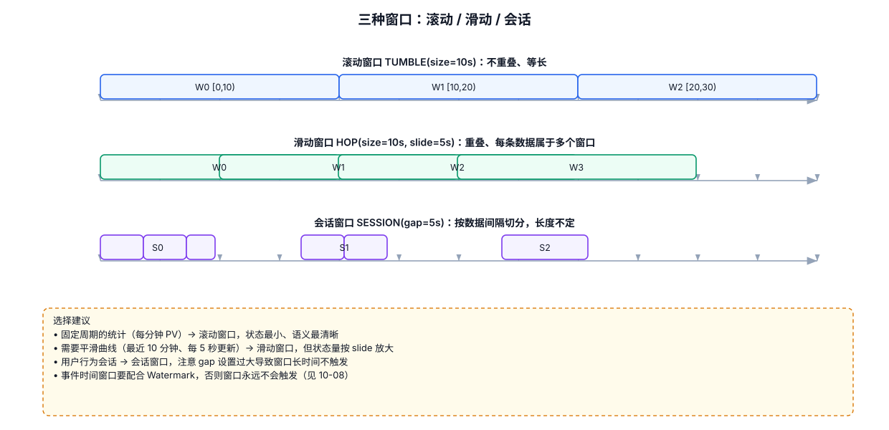
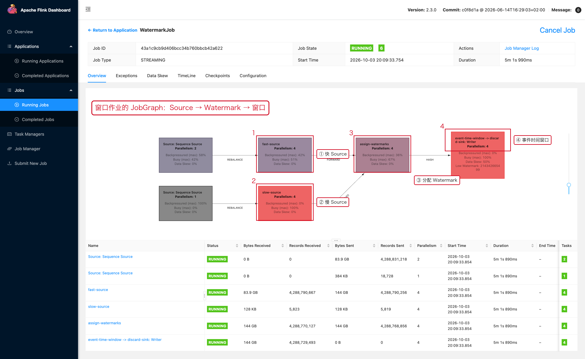

# 02-04｜窗口聚合

> 用途：窗口已经划分完成后，选择 `reduce`、`aggregate` 或 `ProcessWindowFunction`。

---



## 1. 三种常见窗口计算方式

```text
ReduceFunction
    → 最简单的增量聚合

AggregateFunction
    → 自定义累加器，适合复杂聚合

ProcessWindowFunction
    → 可以访问窗口上下文，适合需要窗口信息的场景
```

窗口函数不会自动统计；必须明确指定计算逻辑。

---

## 2. `reduce`

场景：计算窗口内最大值、最小值、求和等。

例如计算每个用户 5 分钟最大订单金额：

```java
DataStream<Order> result = source
        // 第 1 步：按照用户分区。
        .keyBy(Order::getUserId)

        // 第 2 步：划分 5 分钟事件时间窗口。
        .window(TumblingEventTimeWindows.of(Time.minutes(5)))

        // 第 3 步：每收到一条数据，就把它和当前聚合结果进行 reduce。
        // 这样不需要等窗口结束才把所有原始数据完整保存到用户代码中。
        .reduce((left, right) -> {
            // 保留金额更大的订单。
            return left.getAmount() >= right.getAmount()
                    ? left
                    : right;
        });
```

### `reduce` 的语义

```text
reduce(oldValue, newValue)
        ↓
返回新的聚合结果
```

### 适合

```text
sum
max
min
“保留最新值”的简单聚合
```

### 限制

如果需要：

```text
订单数 + 金额总和 + UV
```

建议使用 `AggregateFunction`，因为它可以定义自己的 Accumulator。

---

## 3. `AggregateFunction`

### 3.1 需求

统计窗口内：

```text
订单数量
订单金额总和
平均金额
```

Accumulator：

```text
count
sum
```

最终结果：

```text
sum / count
```

完整示例：

```java
public class AvgOrderAmount
        implements AggregateFunction<
                Order,              // 输入类型
                AvgAccumulator,     // 中间累加器
                Double              // 输出类型
        > {

    @Override
    public AvgAccumulator createAccumulator() {
        // 创建一个空的累加器。
        return new AvgAccumulator();
    }

    @Override
    public AvgAccumulator add(
            Order value,
            AvgAccumulator accumulator) {
        // 每进入一条订单，就更新累加器。
        accumulator.count++;
        accumulator.sum += value.getAmount();
        return accumulator;
    }

    @Override
    public Double getResult(AvgAccumulator accumulator) {
        // 窗口触发时，根据累加器计算最终结果。
        if (accumulator.count == 0) {
            return 0.0;
        }
        return accumulator.sum / accumulator.count;
    }

    @Override
    public AvgAccumulator merge(
            AvgAccumulator a,
            AvgAccumulator b) {
        // 某些窗口场景需要合并多个累加器。
        a.count += b.count;
        a.sum += b.sum;
        return a;
    }
}
```

累加器：

```java
public class AvgAccumulator {
    long count;
    long sum;
}
```

使用：

```java
SingleOutputStreamOperator<Double> result = source
        .keyBy(Order::getUserId)
        .window(TumblingEventTimeWindows.of(Time.minutes(5)))
        .aggregate(new AvgOrderAmount());
```

---

## 4. `ProcessWindowFunction`

需要访问窗口本身的信息时使用。

例如输出：

```text
userId
windowStart
windowEnd
count
```

```java
public class WindowInfoFunction
        extends ProcessWindowFunction<
                Order,              // 输入类型
                String,             // 输出类型
                String,             // Key 类型
                TimeWindow          // Window 类型
        > {

    @Override
    public void process(
            String key,
            Context context,
            Iterable<Order> elements,
            Collector<String> out) {

        // 第 1 步：读取窗口边界。
        long start = context.window().getStart();
        long end = context.window().getEnd();

        // 第 2 步：统计窗口内数据量。
        long count = 0;
        for (Order order : elements) {
            count++;
        }

        // 第 3 步：输出窗口信息。
        out.collect(
                "userId=" + key
                        + ",start=" + start
                        + ",end=" + end
                        + ",count=" + count
        );
    }
}
```

使用：

```java
source
        .keyBy(Order::getUserId)
        .window(TumblingEventTimeWindows.of(Time.minutes(5)))
        .process(new WindowInfoFunction());
```

### 注意

直接使用 `ProcessWindowFunction` 时，逻辑更直观，但如果业务可以使用增量聚合，不应无脑把所有窗口数据都通过 `Iterable` 做一次全量扫描。

---

## 5. Aggregate + ProcessWindowFunction

实际生产里常用的组合是：

```text
AggregateFunction
    → 负责增量统计

ProcessWindowFunction
    → 负责窗口元信息 / Key / 上下文
```

例如：

```java
source
        .keyBy(Order::getUserId)
        .window(TumblingEventTimeWindows.of(Time.minutes(5)))
        .aggregate(
                new AvgOrderAmount(),
                new ProcessWindowFunction<
                        Double,
                        String,
                        String,
                        TimeWindow
                >() {

                    @Override
                    public void process(
                            String key,
                            Context context,
                            Iterable<Double> values,
                            Collector<String> out) {

                        Double avg = values.iterator().next();

                        out.collect(
                                key
                                        + ",window=" + context.window().getStart()
                                        + ",avg=" + avg
                        );
                    }
                }
        );
```

这样可以避免把整个窗口的原始数据都交给业务代码处理，同时又能拿到窗口上下文。

---

## 6. 怎么选

| 需求 | 推荐 |
|---|---|
| Sum / Max / Min | `reduce` |
| 自定义统计指标 | `AggregateFunction` |
| 需要窗口开始/结束时间 | `ProcessWindowFunction` |
| 既要高效聚合又要窗口上下文 | `AggregateFunction + ProcessWindowFunction` |

---

## 7. 常见错误

### 错误 1：窗口里只需要求和，却保存全部原始数据

优先考虑增量聚合。

### 错误 2：把窗口大小当成聚合逻辑

Window 负责“分组时间范围”，Function 负责“怎么算”。

### 错误 3：Sliding Window 设置了很小的 Slide，却没有评估计算量

一个事件可能进入多个窗口，应结合数据量和窗口参数评估状态与计算成本。

---

## 8. Web UI



窗口作业的 JobGraph：Source → Watermark → 窗口

