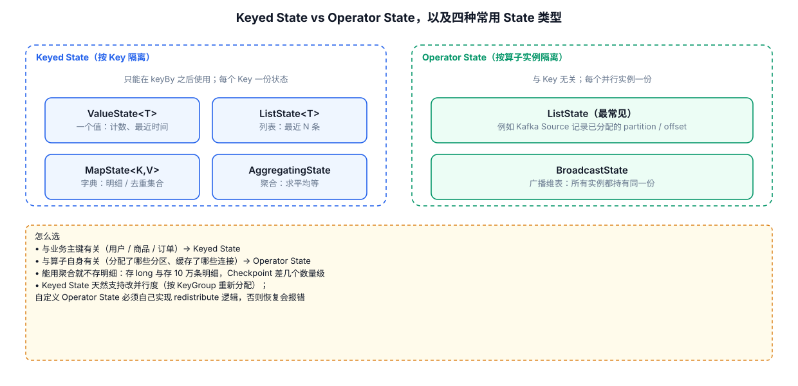

# 03-02｜Keyed State：ValueState / ListState / MapState

> 用途：需要在不同 Key 之间独立保存历史信息时，直接复制对应模板。

---



## 1. ValueState

### 1.1 最小模板

```java
public class CountFunction
        extends KeyedProcessFunction<String, Event, Long> {

    // transient：运行时由 Flink 初始化，避免把运行时句柄作为普通对象序列化。
    private transient ValueState<Long> countState;

    @Override
    public void open(OpenContext openContext) {
        // 1. 创建 StateDescriptor。
        // 第一个参数：State 名称。
        // 第二个参数：状态值类型。
        ValueStateDescriptor<Long> descriptor =
                new ValueStateDescriptor<>(
                        "count",
                        Long.class
                );

        // 2. 从 RuntimeContext 获取 Keyed State。
        countState = getRuntimeContext().getState(descriptor);
    }

    @Override
    public void processElement(
            Event event,
            Context ctx,
            Collector<Long> out) throws Exception {

        // 3. 读取当前 Key 对应的状态。
        Long count = countState.value();

        // 4. 首次访问时初始化。
        if (count == null) {
            count = 0L;
        }

        // 5. 更新。
        count++;
        countState.update(count);

        // 6. 输出当前 Key 的累计值。
        out.collect(count);
    }
}
```

---

## 2. ListState

### 2.1 保存最近 N 条数据

简单版本：

```java
private transient ListState<Event> historyState;
```

初始化：

```java
@Override
public void open(OpenContext openContext) {
    ListStateDescriptor<Event> descriptor =
            new ListStateDescriptor<>(
                    "history",
                    Event.class
            );

    historyState = getRuntimeContext().getListState(descriptor);
}
```

写入：

```java
@Override
public void processElement(
        Event event,
        Context ctx,
        Collector<String> out) throws Exception {

    // 直接向 ListState 添加一条数据。
    historyState.add(event);

    // 读取当前 Key 的全部历史数据。
    for (Event oldEvent : historyState.get()) {
        // 处理历史数据。
    }
}
```

### 2.2 “最近 N 条”不要无限 add

如果业务要求只保留最近 100 条，必须显式控制容量。

一种简单方式：读取 → 截断 → update。

```java
List<Event> history = new ArrayList<>();

for (Event oldEvent : historyState.get()) {
    history.add(oldEvent);
}

history.add(event);

// 保留最近 100 条。
if (history.size() > 100) {
    history = history.subList(
            history.size() - 100,
            history.size()
    );
}

historyState.update(history);
```

注意：这个写法在状态较大时会带来读写成本。生产场景需要结合数据量和 State Backend 评估。

---

## 3. MapState

### 3.1 初始化

```java
private transient MapState<String, Long> itemCountState;

@Override
public void open(OpenContext openContext) {
    MapStateDescriptor<String, Long> descriptor =
            new MapStateDescriptor<>(
                    "item-count", // State 名称
                    String.class,  // Map Key 类型
                    Long.class     // Map Value 类型
            );

    itemCountState = getRuntimeContext().getMapState(descriptor);
}
```

### 3.2 更新 MapState

```java
@Override
public void processElement(
        Event event,
        Context ctx,
        Collector<String> out) throws Exception {

    String itemId = event.getItemId();

    // 读取当前 item 的累计次数。
    Long count = itemCountState.get(itemId);

    if (count == null) {
        count = 0L;
    }

    // 更新 item 对应的计数。
    itemCountState.put(itemId, count + 1);
}
```

MapState 逻辑上类似：

```text
当前 Key = user001

MapState：
itemA → 10
itemB → 20
itemC → 5
```

因此 `KeyedStream + MapState` 常用于两层 Key 的场景。

---

## 4. 遍历 MapState

```java
for (Map.Entry<String, Long> entry : itemCountState.entries()) {
    String itemId = entry.getKey();
    Long count = entry.getValue();

    // 处理 itemId / count
}
```

只需要 Key：

```java
for (String itemId : itemCountState.keys()) {
    // ...
}
```

只需要 Value：

```java
for (Long count : itemCountState.values()) {
    // ...
}
```

---

## 5. State 的 `clear()`

### ValueState

```java
countState.clear();
```

### ListState

```java
historyState.clear();
```

### MapState

```java
itemCountState.clear();
```

清理应该和业务生命周期绑定，而不是因为“暂时用不到”就随意删除。

---

## 6. `ValueState` vs `ListState` vs `MapState`

| 需求 | 推荐 |
|---|---|
| 一个 Key 一个值 | `ValueState` |
| 一个 Key 保存多个相同结构的数据 | `ListState` |
| 一个 Key 下还需要按 ID 查找 | `MapState` |
| `user → item → count` | `MapState` |
| 最近 N 条记录 | `ListState`，但必须控制大小 |

---

## 7. State 无限增长是常见问题

危险写法：

```java
historyState.add(event);
```

但业务没有：

```text
长度上限
TTL
clear()
窗口边界
```

那么状态会随任务运行持续增长。

常见解决方法：

```text
1. 限制条数
2. TTL
3. 按窗口管理
4. 处理完成后 clear
5. 重新设计业务状态结构
```

---

## 8. Keyed State 的核心记忆方式

```text
keyBy(userId)
      ↓
u001 / u002 / u003
      ↓
每个 Key 都拥有自己的一份 State
```

不要把 `ValueState` 理解成“整个任务只有一个变量”。

---

## 9. 配套 Web UI 证据


有状态算子的 SubTasks：每个实例的输入与输出

