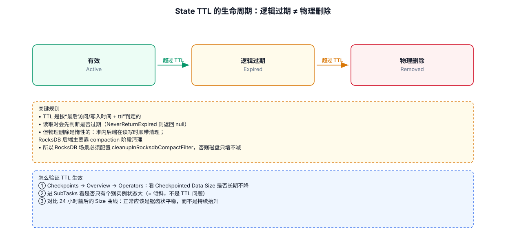
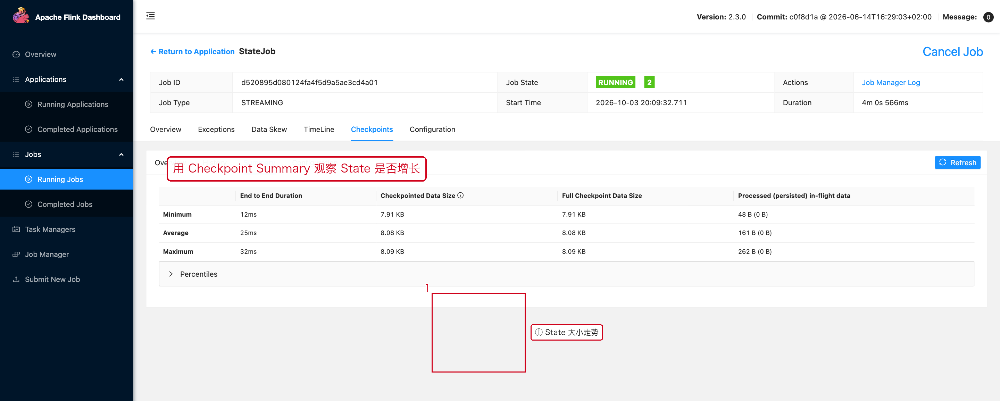

# 03-04｜State TTL

> 用途：状态有明确生命周期，或者不能无限保留时使用。

---



## 1. 为什么需要 TTL

典型场景：

```text
记录用户最近 30 分钟行为
缓存维表 1 小时
用户去重状态保留 24 小时
Session 状态保留 2 小时
```

如果只创建 State 而不清理：

```text
数据持续进入
    ↓
State 持续增长
    ↓
状态越来越大
    ↓
Checkpoint 成本增加
```

Flink 的 Keyed State 支持 TTL。

---

## 2. ValueState + TTL

```java
import org.apache.flink.api.common.state.StateTtlConfig;
import org.apache.flink.api.common.state.ValueState;
import org.apache.flink.api.common.state.ValueStateDescriptor;

import java.time.Duration;

@Override
public void open(OpenContext openContext) {

    // 第 1 步：创建 TTL 配置。
    StateTtlConfig ttlConfig =
            StateTtlConfig
                    // 状态有效期：1 小时。
                    .newBuilder(Duration.ofHours(1))

                    // 每次创建或写入状态时刷新 TTL。
                    .setUpdateType(
                            StateTtlConfig.UpdateType.OnCreateAndWrite
                    )

                    // 已过期状态不返回给用户代码。
                    .setStateVisibility(
                            StateTtlConfig.StateVisibility.NeverReturnExpired
                    )

                    .build();

    // 第 2 步：定义 State。
    ValueStateDescriptor<Long> descriptor =
            new ValueStateDescriptor<>(
                    "user-count",
                    Long.class
            );

    // 第 3 步：启用 TTL。
    descriptor.enableTimeToLive(ttlConfig);

    // 第 4 步：获取 Keyed State。
    countState = getRuntimeContext().getState(descriptor);
}
```

官方文档说明，State TTL 当前基于 Processing Time。TTL 配置不会保存到 Checkpoint / Savepoint 中，而是当前 Job 的配置。

---

## 3. `UpdateType`

常见选项：

```text
OnCreateAndWrite
    → 创建 / 写入时刷新 TTL

OnReadAndWrite
    → 读取 / 写入时都刷新 TTL
```

业务上要先明确：

```text
“1小时没有写入”过期？

还是

“1小时没有被访问”过期？
```

两者语义不同。

---

## 4. `StateVisibility`

常见：

```java
StateTtlConfig.StateVisibility.NeverReturnExpired
```

含义：

```text
状态已经过期
    ↓
即使底层数据还没有被物理清理
    ↓
用户代码也不应该读取到它
```

官方文档明确区分了“逻辑过期”和“物理清理”。

---

## 5. TTL 不等于立即删除

不要写成：

```text
TTL = 1小时
→ 1小时整时刻状态物理删除
```

TTL 的重点是控制状态的有效性与清理机制；实际物理清理方式和 State Backend 有关。

---

## 6. TTL vs `clear()`

| 场景 | 方法 |
|---|---|
| 业务明确知道状态已经结束 | `clear()` |
| 业务没有明确结束事件，按时间自然过期 | TTL |
| 两者都有 | TTL + 必要时主动 `clear()` |

例如：

```text
订单支付完成
    → 立即 clear

用户长期未活动
    → TTL 自动失效
```

---

## 7. TTL 常见坑

### 坑 1：把 TTL 当 Event Time 机制

当前 TTL 基于 Processing Time，不是业务 Event Time。

### 坑 2：TTL 设置得太长

状态依然可能很大。

### 坑 3：TTL 设置得太短

会导致业务逻辑读取不到仍然需要的数据。

### 坑 4：只看逻辑过期，不考虑 State 总量

TTL 不是替代状态建模的工具。

---

## 8. 版本注意

Flink 2.2.0 起，官方已经支持已有 State 在启用 / 禁用 TTL 之间进行兼容迁移；因此当前版本下这类变更的兼容性比旧版本更好，但生产环境仍应先验证 Savepoint / Checkpoint 恢复。

---

## 9. 配套 Web UI 证据



用 Checkpoint Summary 观察 State 是否增长

