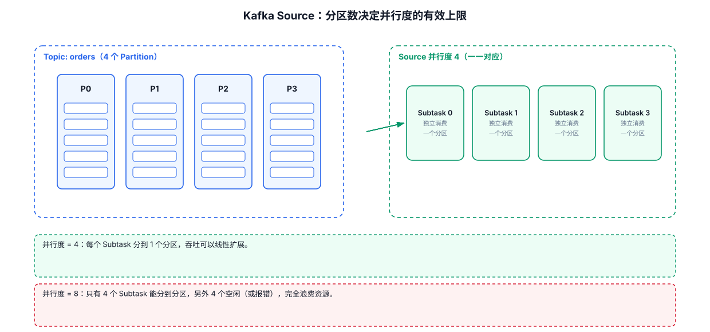
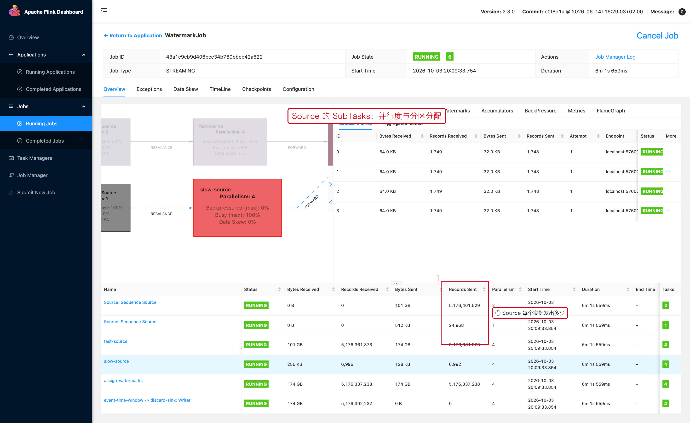

# 04-02｜Kafka Source

> 用途：Flink 通过新版 DataStream Kafka Connector 消费 Kafka。

官方 Flink 2.3 Kafka 文档使用 `KafkaSource` Builder，并通过 `env.fromSource(...)` 接入 DataStream。

---



## 1. 最小模板

```java
import org.apache.flink.api.common.eventtime.WatermarkStrategy;
import org.apache.flink.connector.kafka.source.KafkaSource;
import org.apache.flink.connector.kafka.source.enumerator.initializer.OffsetsInitializer;
import org.apache.flink.api.common.serialization.SimpleStringSchema;

KafkaSource<String> kafkaSource = KafkaSource.<String>builder()
        // Kafka Broker 地址。
        .setBootstrapServers("kafka01:9092,kafka02:9092")

        // 要订阅的 Topic。
        .setTopics("order-topic")

        // Kafka Consumer Group。
        .setGroupId("flink-order-job")

        // 从最早可消费 Offset 开始。
        .setStartingOffsets(OffsetsInitializer.earliest())

        // 只把 Kafka message value 反序列化成 String。
        .setValueOnlyDeserializer(new SimpleStringSchema())

        .build();

DataStream<String> source = env.fromSource(
        kafkaSource,

        // 如果后续不使用 Event Time，可以先使用 noWatermarks。
        WatermarkStrategy.noWatermarks(),

        // Web UI 中显示的 Source 名称。
        "kafka-source"
);
```

这是官方 2.3 Kafka Source 的基本使用方式。

---

## 2. `setBootstrapServers`

```java
.setBootstrapServers(
        "kafka01:9092,kafka02:9092"
)
```

作用：

```text
告诉 Kafka Consumer 初始应该连接哪些 Broker 获取集群元数据。
```

不要只配置单个 Broker 作为生产环境唯一入口，通常提供多个地址提高连接时的可用性。

---

## 3. `setTopics`

订阅固定 Topic：

```java
.setTopics(
        "order-topic",
        "payment-topic"
)
```

表示订阅多个 Topic。

Topic Pattern 等订阅模式需要根据具体业务场景选择。KafkaSource 官方支持 Topic 列表、Pattern 和 Partition 等多种订阅方式。

---

## 4. `setGroupId`

```java
.setGroupId("flink-order-job")
```

作用：指定 Kafka Consumer Group。

生产环境不要随意修改 Group ID：

```text
Group ID 变化
    ↓
Kafka 会把它视为新的 Consumer Group
    ↓
Offset 行为可能发生变化
```

因此：

```text
开发环境：dev-order-job
测试环境：test-order-job
生产环境：prod-order-job
```

避免多个完全独立的 Job 误用同一个 Group ID。

---

## 5. Starting Offset

### 从最早开始

```java
.setStartingOffsets(
        OffsetsInitializer.earliest()
)
```

### 从最新位置开始

```java
.setStartingOffsets(
        OffsetsInitializer.latest()
)
```

### 指定时间点

具体方式可根据 Connector 版本使用 `OffsetsInitializer.timestamp(...)` 等 API。

重要：**Starting Offset 主要决定初始启动位置；任务正常运行后的消费进度由 Kafka Offset + Flink Checkpoint 等机制共同决定。**

Kafka Connector 文档也将 Starting Offset 和 Consumer Offset Committing 分为独立配置项。

---

## 6. Value Deserializer

常见：

```java
.setValueOnlyDeserializer(
        new SimpleStringSchema()
)
```

代表：

```text
Kafka value
    ↓
String
```

如果 Kafka 中是 JSON：

```text
Kafka String
    ↓
JSON Parser
    ↓
Order
```

建议把“消息反序列化”和“业务 JSON 解析”分层，不要把大量业务逻辑塞进 Deserializer。

---

## 7. Kafka Source + Event Time

```java
WatermarkStrategy<Order> strategy =
        WatermarkStrategy
                .<Order>forBoundedOutOfOrderness(
                        Duration.ofSeconds(10)
                )
                .withTimestampAssigner(
                        (order, timestamp) -> order.getEventTime()
                );

DataStream<Order> orders = env.fromSource(
        kafkaSource,
        strategy,
        "order-source"
);
```

如果 Kafka 数据可能乱序，Source 层通常就是生成 Timestamp / Watermark 的位置。Kafka Connector 文档也单独提供了 Event Time / Watermarks 与 Idleness 相关配置说明。

---

## 8. Kafka Partition 与 Source Parallelism

假设：

```text
Topic：order-topic
Partition：12
```

通常可以从：

```text
Source 并行度
≈ 业务吞吐需求
+ Partition 数量
+ 单 Partition 消费能力
```

开始评估。

不要机械理解成：

```text
12 Partition
→ 必须 parallelism = 12
```

也不要设置明显大于 Partition 数量的 Source 并行度后就认为一定提高吞吐。实际有效消费并行度受 Kafka Partition 数量限制。

---

## 9. Source 延迟排查

看到 Source 端延迟上涨：

```text
1. Kafka Partition 是否存在热点？
2. Partition 数量是否成为吞吐上限？
3. Source Subtask 是否负载不均？
4. Kafka Broker 是否有 IO / 网络问题？
5. Flink Source 是否被下游反压？
6. Consumer 是否出现重平衡？
```

不要看到 Kafka Lag 就直接提高 Flink Parallelism。

---

## 10. 常见错误

### 错误 1：把 Starting Offset 当成持续消费位置

启动位置和运行过程中的 Offset 提交不是一回事。

### 错误 2：只看 Flink 并行度，不看 Kafka Partition

Kafka Partition 是实际消费并行性的关键限制因素之一。

### 错误 3：开发、测试、生产使用同一 Consumer Group

容易互相影响 Offset 和消费行为。

### 错误 4：Source 已经反序列化为 String，又在业务代码反复做无意义转换

应该明确：

```text
Kafka value
→ String / byte[]
→ 业务对象
```

在哪里做一次转换即可。

---

## 11. 配套 Web UI 证据



Source 的 SubTasks 页面

