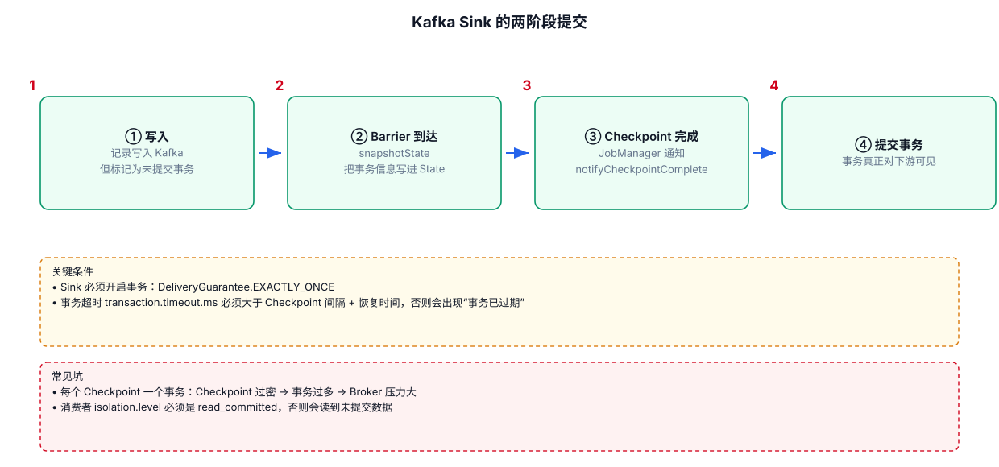
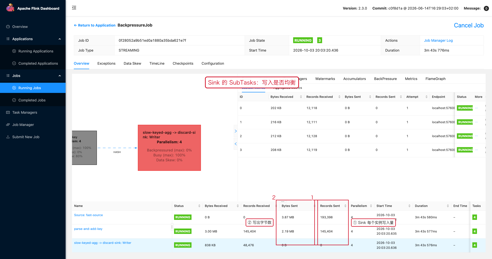

# 04-03｜Kafka Sink

> 用途：把 DataStream 写回 Kafka，并根据业务需要选择至少一次或 Exactly-Once。

Flink 2.3 Kafka Connector 提供 `KafkaSink` Builder。官方文档同时说明 Kafka Producer 可以提供至少一次和 Exactly-Once 投递语义，Exactly-Once 需要事务型 Producer。

---



## 1. 最小模板：At-Least-Once

```java
import org.apache.flink.connector.base.DeliveryGuarantee;
import org.apache.flink.connector.kafka.sink.KafkaRecordSerializationSchema;
import org.apache.flink.connector.kafka.sink.KafkaSink;
import org.apache.flink.api.common.serialization.SimpleStringSchema;

KafkaSink<String> kafkaSink = KafkaSink.<String>builder()
        // 第 1 步：Kafka Broker 地址。
        .setBootstrapServers("kafka01:9092,kafka02:9092")

        // 第 2 步：定义每条 Flink 数据如何转换成 Kafka Record。
        .setRecordSerializer(
                KafkaRecordSerializationSchema.builder()
                        .setTopic("result-topic")
                        .setValueSerializationSchema(
                                new SimpleStringSchema()
                        )
                        .build()
        )

        // 第 3 步：至少一次投递。
        .setDeliveryGuarantee(
                DeliveryGuarantee.AT_LEAST_ONCE
        )

        // 第 4 步：构建 Sink。
        .build();

// 第 5 步：把结果流接到 Kafka Sink。
result.sinkTo(kafkaSink);
```

---

## 2. Record Serializer

核心作用：

```text
Java 对象
    ↓
Kafka ProducerRecord
    ↓
bytes
```

例如 String：

```java
.setValueSerializationSchema(
        new SimpleStringSchema()
)
```

自定义对象则需要自己的 SerializationSchema。

---

## 3. 指定 Kafka Key

如果业务希望 Kafka 按用户等业务 Key 分区，应为 Record Serializer 设置 Key：

```java
KafkaRecordSerializationSchema.<Order>builder()
        .setTopic("order-result")
        .setKeySerializationSchema(
                order -> order.getUserId().getBytes(StandardCharsets.UTF_8)
        )
        .setValueSerializationSchema(
                new OrderSerializationSchema()
        )
        .build();
```

这样 Kafka Producer 可以根据业务 Key 计算 Partition。

### 为什么需要 Key

例如：

```text
user001 的订单
user001 的支付
user001 的退款
```

如果都使用同一个 Kafka Key，那么 Kafka 可以让相同 Key 的消息进入同一 Partition，从而保留该 Partition 内的顺序关系。

注意：Kafka 的顺序保证是 Partition 内有序，不是整个 Topic 全局有序。

---

## 4. Exactly-Once

典型配置结构：

```java
KafkaSink<String> sink = KafkaSink.<String>builder()
        .setBootstrapServers("kafka01:9092")
        .setRecordSerializer(...)

        // Kafka 事务型 Exactly-Once。
        .setDeliveryGuarantee(
                DeliveryGuarantee.EXACTLY_ONCE
        )

        // 为事务 Producer 设置唯一的事务 ID 前缀。
        .setTransactionalIdPrefix("order-job-")

        .build();
```

同时 Job 需要启用 Checkpoint，因为端到端 Exactly-Once 依赖 Flink 的一致性快照机制。

不要理解为：

```text
EXACTLY_ONCE
    = KafkaSink 一配置就万事大吉
```

需要一起看：

```text
Source 一致性
Checkpoint
Kafka Transaction
Sink 提交
失败恢复
下游消费语义
```

官方文档明确指出，端到端 Exactly-Once 需要 Sink 参与 Checkpoint 机制。

---

## 5. At-Least-Once vs Exactly-Once

| 语义 | 特点 | 代价 |
|---|---|---|
| At-Least-Once | 不容易丢，但可能重复 | 简单、吞吐通常较高 |
| Exactly-Once | 事务语义下保证端到端一致性 | 配置与运行成本更高 |

生产是否需要 Exactly-Once，应看业务能否接受重复，以及下游是否支持幂等 / Upsert。

---

## 6. Kafka Sink 生产设计

写 Kafka 前先确认：

```text
1. Topic
2. Partition Key
3. 序列化格式
4. Delivery Guarantee
5. 是否依赖 Checkpoint
6. 下游能否接受重复
7. Producer 是否需要自定义配置
```

---

## 7. 常见错误

### 错误 1：没有业务 Key 却认为消息一定保持顺序

Kafka 默认没有 Topic 全局顺序。

### 错误 2：Exactly-Once 和业务幂等混为一谈

Kafka Sink 的事务保证解决的是 Kafka Producer 相关的一致性问题；不能自动让其他外部副作用变成 Exactly-Once。

### 错误 3：启用 Exactly-Once 却没有正确配置 Checkpoint

需要把整个故障恢复链路一起检查。

### 错误 4：Transactional ID 前缀配置重复

不同并发 Producer / 不同 Job 之间需要避免不合理的事务标识冲突。

---

## 8. 配套 Web UI 证据



Sink 的 SubTasks 页面：检查写入是否均衡

