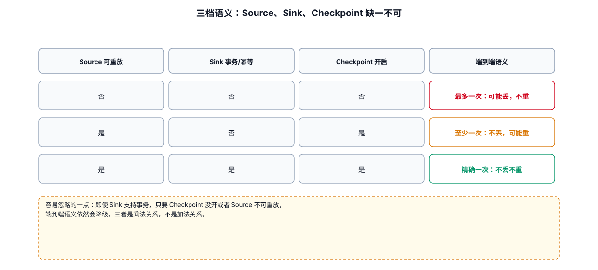

# 04-05｜Source / Sink 语义与易错点

> 用途：遇到“丢数据、重复数据、Offset 对不上、Sink 重复写入”等问题时，先从这里排查。

---



## 1. 先区分三个概念

不要混淆：

```text
Flink State Exactly-Once

        ≠

Source 消费 Exactly-Once

        ≠

端到端业务 Exactly-Once
```

Flink 官方把 Source 状态更新和 Sink 端到端投递分别讨论。Source 需要参与快照，端到端 Exactly-Once 还要求 Sink 参与 Checkpoint / 提交机制。

---

## 2. Kafka Offset 与 Checkpoint

简化理解：

```text
Kafka Message
    ↓
Kafka Source
    ↓
Flink Process
    ↓
State
    ↓
Checkpoint
```

如果 Source 参与一致性快照，那么恢复时可以根据快照中的消费进度恢复 Source 状态，而不是简单依赖“最后一次普通 Offset 提交”。

因此：

```text
Checkpoint
    = Flink 故障恢复边界

Kafka Commit Offset
    = Kafka Consumer 的 Offset 管理机制
```

两者相关，但不是同一个概念。

---

## 3. 为什么可能出现重复数据

典型故障：

```text
处理了一批消息
    ↓
还没形成成功 Checkpoint
    ↓
Task 失败
    ↓
从上一次成功 Checkpoint 恢复
    ↓
这批数据重新处理
```

这本身并不一定意味着 Flink 出错；是否最终看到重复，取决于：

```text
Source
State
Checkpoint
Sink
业务幂等
```

---

## 4. 为什么可能出现数据丢失

应该分层排查：

```text
Kafka 中到底有没有数据？
        ↓
Flink Source 有没有成功读取？
        ↓
Source 是否过滤 / 解析失败？
        ↓
中间算子有没有丢弃？
        ↓
Sink 有没有写成功？
        ↓
下游查询方式是否正确？
```

不要一看到下游少数据就直接认为 Kafka 丢数据。

---

## 5. Source 常见问题

```text
Kafka Partition 不均
Consumer Group 配错
Starting Offset 配错
Topic 配错
Deserializer 失败
Watermark 不推进
Source 被反压
Broker 网络异常
```

---

## 6. Sink 常见问题

```text
Sink 吞吐不足
外部系统限流
数据库连接不足
批量参数不合理
事务未正确提交
重复写入
幂等 Key 设计错误
序列化失败
```

---

## 7. Source / Sink 并行度的思考方式

不是：

```text
机器很多
→ Parallelism 越大越好
```

而是：

```text
上游 Partition 数
        ↓
Source 并行度
        ↓
中间算子并行度
        ↓
Shuffle
        ↓
Sink 并行度
        ↓
外部系统吞吐 / 并发限制
```

每一层都应该有对应的瓶颈分析。

---

## 8. 端到端 Exactly-Once 检查清单

如果业务要求端到端 Exactly-Once，至少检查：

```text
□ Source 是否参与 Checkpoint
□ Checkpoint 是否稳定成功
□ State 是否可正确恢复
□ Sink 是否支持事务 / 幂等
□ Sink 是否参与 Checkpoint
□ 外部系统是否真正接受对应事务语义
□ 下游读取方式是否正确
□ 重启后是否验证过重复 / 丢失场景
```

不要只检查一项：

```text
“我已经打开 checkpoint，所以一定 exactly-once。”
```

这是典型错误理解。

---

## 9. 生产验收建议

上线前主动制造：

```text
1. Job 重启
2. TaskManager 故障
3. Checkpoint 失败后恢复
4. Sink 临时不可用
5. Kafka 短暂网络抖动
6. 数据重复发送
7. 数据乱序
8. 外部系统超时
```

然后验证：

```text
最终业务结果
是否重复
是否丢失
是否可以恢复
恢复耗时
```

---

## 10. 相关文档

- [04-02｜Kafka Source](./02-KafkaSource.md)
- [04-03｜Kafka Sink](./03-KafkaSink.md)
- [08-04｜Checkpoint 运维](../08-生产运维/04-Checkpoint.md)
- [09-05｜数据重复](../09-故障排查/05-数据重复.md)
- [09-06｜数据丢失](../09-故障排查/06-数据丢失.md)
- [10-10｜ExactlyOnce 与一致性](../10-专题原理/10-ExactlyOnce与一致性.md)

---

## 11. 配套 Web UI 证据


Checkpoint Configuration 决定了语义能否成立

