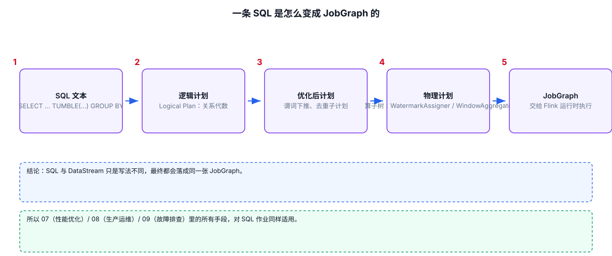

# 05-01｜Flink SQL 基础模板

> 目标：忘记 Flink SQL 语法时，可以直接复制模板，再替换表名、字段和连接器配置。
>
> 本篇只覆盖最常用的 SQL/DDL/DML 写法。复杂 Join、Window TVF、Temporal Join、CDC 等拆到后续文档。

---



## 1. Flink SQL 的基本组成

一个最常见的实时 SQL Job 可以理解为：

对应 SQL：

```sql
-- 1. 注册 Source 表。
CREATE TABLE source_table (
    id BIGINT,
    name STRING,
    amount DECIMAL(18, 2)
) WITH (
    'connector' = '...'
);

-- 2. 注册 Sink 表。
CREATE TABLE sink_table (
    id BIGINT,
    name STRING,
    amount DECIMAL(18, 2)
) WITH (
    'connector' = '...'
);

-- 3. 写入 Sink。
INSERT INTO sink_table
SELECT
    id,
    name,
    amount
FROM source_table
WHERE amount > 0;
```

核心步骤固定为：

```text
1. CREATE TABLE 注册输入
2. CREATE TABLE 注册输出
3. SELECT 编写转换逻辑
4. INSERT INTO 把结果写出
```

---

## 2. `CREATE TABLE`

最常见结构：

```sql
CREATE TABLE orders (
    order_id BIGINT,
    user_id BIGINT,
    amount DECIMAL(18, 2),
    status STRING,
    event_time TIMESTAMP_LTZ(3)
) WITH (
    'connector' = '...'
);
```

### 字段定义语法

```sql
字段名 数据类型 [约束/属性]
```

例如：

```sql
user_id BIGINT
amount DECIMAL(18, 2)
status STRING
```

常见类型：

| SQL 类型 | 常见用途 |
|---|---|
| `STRING` | 字符串、JSON 文本 |
| `INT` | 普通整数 |
| `BIGINT` | ID、时间戳、计数 |
| `DOUBLE` | 浮点计算 |
| `DECIMAL(p,s)` | 金额、精确小数 |
| `BOOLEAN` | true/false |
| `TIMESTAMP(3)` | 无时区时间戳 |
| `TIMESTAMP_LTZ(3)` | 带本地时区语义的时间戳 |
| `ARRAY<T>` | 数组 |
| `MAP<K,V>` | Map |
| `ROW<...>` | 嵌套结构 |

生产场景中金额优先使用 `DECIMAL`，不要直接用 `DOUBLE` 做金额累计。

---

## 3. 主键语法

```sql
CREATE TABLE users (
    user_id BIGINT,
    name STRING,

    -- NOT ENFORCED 表示 Flink 不负责检查数据库层面的唯一性。
    PRIMARY KEY (user_id) NOT ENFORCED
) WITH (
    'connector' = '...'
);
```

### `NOT ENFORCED` 是什么

它不是说“这个字段一定唯一”，而是告诉 Flink：

```text
业务/外部系统认为 user_id 是主键
        ↓
Flink 可以利用这个主键信息进行规划
        ↓
Flink 不额外扫描数据验证唯一性
```

因此不要把 `PRIMARY KEY ... NOT ENFORCED` 理解成 Flink 会帮你去重。

---

## 4. 临时视图：`CREATE TEMPORARY VIEW`

当中间结果需要被多个 SQL 使用时，可以注册 View。

```sql
CREATE TEMPORARY VIEW valid_orders AS
SELECT
    order_id,
    user_id,
    amount
FROM orders
WHERE amount > 0;

-- 后续 SQL 可以直接使用 View。
SELECT *
FROM valid_orders;
```

View 是逻辑定义，不等价于物理存储表。

---

## 5. 基础查询

### 选择字段

```sql
SELECT
    user_id,
    order_id,
    amount
FROM orders;
```

### 条件过滤

```sql
SELECT
    *
FROM orders
WHERE status = 'PAID'
  AND amount > 0;
```

### 字段别名

```sql
SELECT
    user_id,
    amount * 0.9 AS discount_amount
FROM orders;
```

### `CASE WHEN`

```sql
SELECT
    order_id,
    CASE
        WHEN amount >= 1000 THEN 'HIGH'
        WHEN amount >= 100 THEN 'MEDIUM'
        ELSE 'LOW'
    END AS amount_level
FROM orders;
```

---

## 6. 常见字符串与空值处理

```sql
SELECT
    TRIM(name) AS name,
    UPPER(status) AS status,
    COALESCE(name, 'UNKNOWN') AS safe_name
FROM users;
```

`COALESCE(a, b)`：

```text
a 非 NULL → 返回 a
 a 为 NULL → 返回 b
```

判断 NULL 必须使用：

```sql
WHERE name IS NULL
```

不要写：

```sql
WHERE name = NULL
```

---

## 7. `GROUP BY` 聚合

```sql
SELECT
    user_id,
    COUNT(*) AS order_cnt,
    SUM(amount) AS total_amount,
    AVG(amount) AS avg_amount,
    MAX(amount) AS max_amount
FROM orders
GROUP BY user_id;
```

规则：

```text
SELECT 中出现的非聚合字段
        ↓
通常必须出现在 GROUP BY 中
```

错误示例：

```sql
SELECT
    user_id,
    status,
    COUNT(*)
FROM orders
GROUP BY user_id;
```

`status` 没有聚合，也没有出现在 `GROUP BY` 中。

---

## 8. 多个 Sink

Flink SQL 支持一个 Job 中声明多个 `INSERT INTO`。

```sql
INSERT INTO sink_a
SELECT ...
FROM source_table;

INSERT INTO sink_b
SELECT ...
FROM source_table;
```

注意：多个 `INSERT` 是否形成一个统一执行 Pipeline，要结合 Planner 和执行配置查看执行计划，不要仅凭 SQL 文本判断资源开销。

---

## 9. 查看执行计划：`EXPLAIN`

开发时先看计划：

```sql
EXPLAIN
SELECT
    user_id,
    COUNT(*)
FROM orders
GROUP BY user_id;
```

常见用途：

```text
1. 是否真的用了预期的 Join
2. 是否出现意外的 Exchange / Shuffle
3. 是否存在完整排序
4. 是否发生字段类型转换
5. 优化器最终选择了什么算子
```

生产问题中，看到“SQL 看起来很简单但任务很重”时，优先检查 `EXPLAIN`。

---

## 10. 常见完整模板：Kafka → SQL → Kafka

> 连接器版本、依赖和参数以实际 Flink 版本文档为准。SQL 层核心写法保持不变。

```sql
-- ============================================================
-- Step 1：注册 Kafka Source
-- ============================================================
CREATE TABLE source_orders (
    order_id BIGINT,
    user_id BIGINT,
    amount DECIMAL(18, 2),
    status STRING,
    event_time TIMESTAMP_LTZ(3)
) WITH (
    'connector' = 'kafka',
    'topic' = 'orders',
    'properties.bootstrap.servers' = 'kafka01:9092,kafka02:9092',
    'properties.group.id' = 'flink-sql-orders',
    'scan.startup.mode' = 'group-offsets',
    'format' = 'json'
);

-- ============================================================
-- Step 2：注册 Kafka Sink
-- ============================================================
CREATE TABLE sink_orders (
    user_id BIGINT,
    total_amount DECIMAL(18, 2)
) WITH (
    'connector' = 'kafka',
    'topic' = 'user-order-summary',
    'properties.bootstrap.servers' = 'kafka01:9092,kafka02:9092',
    'format' = 'json'
);

-- ============================================================
-- Step 3：实时聚合并写入 Sink
-- ============================================================
INSERT INTO sink_orders
SELECT
    user_id,

    -- DECIMAL 做金额计算时显式保持精度。
    SUM(amount) AS total_amount
FROM source_orders
WHERE status = 'PAID'
GROUP BY user_id;
```

---

## 11. DDL / DML 常见区别

| 写法 | 作用 |
|---|---|
| `CREATE TABLE` | 注册表结构及连接器 |
| `CREATE TEMPORARY VIEW` | 注册逻辑视图 |
| `SELECT` | 查询/转换 |
| `INSERT INTO` | 写入结果表 |
| `EXPLAIN` | 查看执行计划 |
| `DESCRIBE` | 查看表结构 |
| `SHOW TABLES` | 查看当前库表 |

---

## 12. SQL 开发时最容易犯的错误

### 错误 1：把普通 `GROUP BY` 当成窗口聚合

```sql
GROUP BY user_id
```

这是持续聚合。对于高基数用户，状态可能持续增长。

需要有限时间范围时，应考虑 Window TVF。

### 错误 2：时间字段是普通 timestamp，却直接拿来做事件时间窗口

事件时间窗口需要正确的时间属性定义，不只是“有一个 timestamp 列”。

### 错误 3：把 Upsert/Changelog 结果写进只支持 Append 的 Sink

先确认结果表的数据变更模式，再确认 Sink 能不能接收：

```text
+I
-U
+U
-D
```

### 错误 4：字段名能查到，但结果类型不符合预期

尤其关注：

```text
INT / BIGINT
TIMESTAMP / TIMESTAMP_LTZ
DECIMAL 精度
NULLability
```

---

## 13. 快速选择

```text
只是过滤/清洗
    → SELECT / WHERE

分组累计
    → GROUP BY

固定时间范围统计
    → Window TVF + GROUP BY

两个流按 Key 关联
    → JOIN

按两个事件时间范围关联
    → Interval Join

查外部维表
    → Lookup Join / Temporal Join

MySQL 全量 + Binlog
    → CDC Connector
```

---

## 14. 配套 Web UI 证据


SQL 作业的 JobGraph：窗口算子清晰可见

