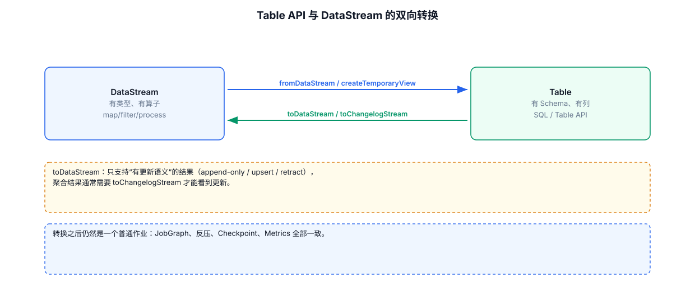

# 05-02｜Table / SQL 与 DataStream 互转

> 目标：DataStream 做复杂业务逻辑，SQL 做结构化 ETL，两套 API 在同一个 Job 中组合使用。

---



## 1. 为什么要混用两个 API

DataStream 更适合：

```text
State
Timer
自定义 ProcessFunction
复杂事件处理
外部系统异步调用
细粒度控制算子行为
```

Table / SQL 更适合：

```text
字段清洗
过滤
投影
Join
聚合
窗口 SQL
Connector DDL
```

典型结构：

```text
Kafka Source
   ↓
DataStream
   ↓
复杂 ProcessFunction
   ↓
DataStream
   ↓
Table / SQL
   ↓
Sink
```

或者反过来：

```text
SQL Source
   ↓
Table
   ↓
SQL 清洗
   ↓
DataStream
   ↓
自定义 ProcessFunction
```

---

## 2. 创建两个执行环境

```java
// Step 1：创建 DataStream 执行环境。
StreamExecutionEnvironment env =
        StreamExecutionEnvironment.getExecutionEnvironment();

// Step 2：基于同一个 env 创建 Table 环境。
// StreamTableEnvironment 是连接 DataStream API 和 Table API 的桥梁。
StreamTableEnvironment tableEnv =
        StreamTableEnvironment.create(env);
```

这样可以在同一个 Job 中使用两套 API。

---

## 3. DataStream → Table：最简单写法

假设已有：

```java
DataStream<Order> orders = ...;
```

其中：

```java
public static class Order {
    public long orderId;
    public long userId;
    public double amount;
    public Instant eventTime;

    public Order() {}

    public Order(long orderId, long userId, double amount) {
        this.orderId = orderId;
        this.userId = userId;
        this.amount = amount;
    }
}
```

转换：

```java
// 将 insert-only DataStream 解释为 Table。
// 字段可以从 Java 类型自动推导。
Table orderTable = tableEnv.fromDataStream(orders);
```

然后注册 View：

```java
// 给 Table 起一个 SQL 中可以引用的名字。
tableEnv.createTemporaryView("orders", orderTable);
```

SQL：

```java
Table resultTable = tableEnv.sqlQuery("""
        SELECT
            userId,
            SUM(amount) AS total_amount
        FROM orders
        GROUP BY userId
        """);
```

---

## 4. 用 `Schema` 定义字段和时间属性

当 SQL 需要正确使用事件时间时，不建议只依赖自动类型推导。

可以显式声明 Schema：

```java
Table orderTable = tableEnv.fromDataStream(
        orders,

        // $() 引用 DataStream 中的字段。
        // rowtime(...) 把 eventTime 声明成 Table API 的事件时间属性。
        Schema.newBuilder()
                .column("orderId", DataTypes.BIGINT())
                .column("userId", DataTypes.BIGINT())
                .column("amount", DataTypes.DOUBLE())
                // 将 DataStream 中的 eventTime 字段声明为 Table 的时间属性。
                .column("eventTime", DataTypes.TIMESTAMP_LTZ(3))
                // Watermark 决定事件时间窗口何时可以向前推进。
                .watermark(
                        "eventTime",
                        "eventTime - INTERVAL '5' SECOND"
                )
                .build()
);
```

> 实际项目中应根据 DataStream 类型、时间戳字段的 Java 类型以及 Flink 版本调整 Schema 写法。核心概念是：把字段、时间属性和 Watermark 明确告诉 Table Planner。

---

## 5. Table → DataStream

### 5.1 Append-only Table

如果结果只有新增数据，可以使用：

```java
DataStream<Row> resultStream =
        tableEnv.toDataStream(resultTable);
```

默认输出类型是 `Row`。

---

## 6. Table → 指定 Java 类型

例如结果需要转换成自己的 POJO：

```java
DataStream<UserAmount> resultStream =
        tableEnv.toDataStream(
                resultTable,
                UserAmount.class
        );
```

适合后续继续使用 DataStream 算子。

---

## 7. Changelog Table：不要误用 `toDataStream`

普通 `toDataStream()` 适合 insert-only Table。

但下面这种聚合：

```sql
SELECT
    user_id,
    COUNT(*)
FROM orders
GROUP BY user_id;
```

随着新数据到来，同一个 `user_id` 的 count 可能变化：

```text
+I user=1 count=1
-U user=1 count=1
+U user=1 count=2
-U user=1 count=2
+U user=1 count=3
```

这是 Changelog，而不是单纯的 Append-only。

这种情况下应根据结果语义选择：

```java
DataStream<Row> changelogStream =
        tableEnv.toChangelogStream(resultTable);
```

其中 Row 自带 `RowKind`，例如：

```java
resultStream.process(
        new ProcessFunction<Row, Row>() {
            @Override
            public void processElement(
                    Row row,
                    Context ctx,
                    Collector<Row> out) {

                // 查看这条变更属于 INSERT / UPDATE / DELETE。
                System.out.println(row.getKind());
                out.collect(row);
            }
        }
);
```

---

## 8. `RowKind` 的含义

常见类型：

```text
+I  INSERT
-U  UPDATE_BEFORE
+U  UPDATE_AFTER
-D  DELETE
```

理解方式：

```text
+I
→ 新增一行

-U +U
→ 把旧值替换为新值

-D
→ 删除旧值
```

这直接影响 Sink 是否能接住结果。

---

## 9. DataStream → Table → DataStream 完整模板

```java
// ============================================================
// Step 1：创建 DataStream 环境
// ============================================================
StreamExecutionEnvironment env =
        StreamExecutionEnvironment.getExecutionEnvironment();

// ============================================================
// Step 2：创建 Table 环境
// ============================================================
StreamTableEnvironment tableEnv =
        StreamTableEnvironment.create(env);

// ============================================================
// Step 3：创建 DataStream Source
// 实际项目这里通常替换成 KafkaSource / FileSource 等。
// ============================================================
DataStream<Order> orders = env.fromElements(
        new Order(1, 1001, 10.0),
        new Order(2, 1001, 20.0),
        new Order(3, 1002, 30.0)
);

// ============================================================
// Step 4：DataStream → Table
// ============================================================
Table orderTable = tableEnv.fromDataStream(orders);

// ============================================================
// Step 5：注册临时视图
// ============================================================
tableEnv.createTemporaryView("orders", orderTable);

// ============================================================
// Step 6：使用 SQL 进行结构化处理
// ============================================================
Table resultTable = tableEnv.sqlQuery("""
        SELECT
            userId,
            SUM(amount) AS total_amount
        FROM orders
        GROUP BY userId
        """);

// ============================================================
// Step 7：如果结果是 Changelog，转成 Changelog DataStream
// ============================================================
DataStream<Row> resultStream =
        tableEnv.toChangelogStream(resultTable);

// ============================================================
// Step 8：继续使用 DataStream API
// ============================================================
resultStream.print();

// ============================================================
// Step 9：提交整个 Flink Job
// ============================================================
env.execute("table-datastream-demo");
```

---

## 10. 最容易忘记的边界

### `fromDataStream()` 不会自动把所有时间语义带进 Table

需要用 Schema 明确声明时间属性和 Watermark。

### `toDataStream()` 不是万能转换

先判断 Table 是否是 insert-only：

```text
Insert-only
    → toDataStream

Changelog
    → toChangelogStream
```

### SQL 聚合结果很可能是 Changelog

尤其是无窗口的持续聚合，不要直接假定 Sink 只会收到新增数据。

### 转换本身有额外开销

DataStream 与 Table 之间切换需要做类型/内部数据结构转换。复杂 Pipeline 不要为了“看起来方便”在两套 API 之间频繁来回切换。

---

## 11. 配套 Web UI 证据


转换之后仍是普通作业，SubTasks 页面一致

