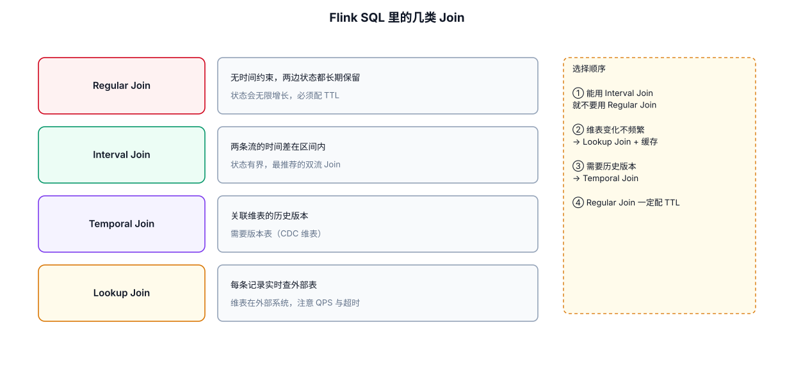
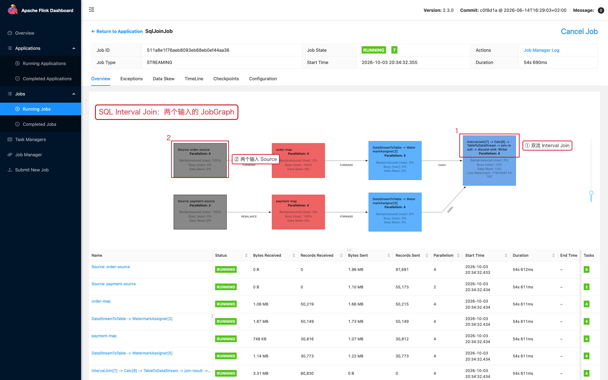

# 05-03｜Flink SQL Join

> 目标：根据数据关系和时间语义，快速选择 Regular Join、Interval Join、Temporal Join 或 Lookup Join。

---



## 1. 先判断你是哪一种 Join

```text
两个动态表按 Key 普通关联
    → Regular Join

两个事件流按 Key + 时间范围关联
    → Interval Join

事件需要关联“某个时间点上的维表版本”
    → Temporal Join

实时查询 MySQL / JDBC 等外部维表
    → Lookup Join
```

不要只根据 SQL 中是否出现 `JOIN` 判断方案。**真正决定方案的是数据更新方式、时间语义和状态生命周期。**

---

## 2. Regular Join

最基础写法：

```sql
SELECT
    o.order_id,
    o.user_id,
    u.name
FROM orders AS o
JOIN users AS u
ON o.user_id = u.user_id;
```

核心语义：

```text
左表发生变化 → 重新影响 Join 结果
右表发生变化 → 重新影响 Join 结果
```

对于持续更新的流，Flink 为保证结果正确性，需要保存足够的 Join 状态。

### 生产风险

高基数 + 长时间无界 Join 容易导致：

```text
历史数据持续进入
    ↓
Join State 持续增长
    ↓
Checkpoint 变大
    ↓
内存/磁盘/IO 压力增加
```

因此不能因为 SQL 很短，就认为 Join 很轻。

---

## 3. Inner Join / Left Join

### Inner Join

```sql
SELECT
    o.order_id,
    u.name
FROM orders AS o
JOIN users AS u
ON o.user_id = u.user_id;
```

没有匹配就不输出。

### Left Join

```sql
SELECT
    o.order_id,
    u.name
FROM orders AS o
LEFT JOIN users AS u
ON o.user_id = u.user_id;
```

左表必须保留，即使右侧暂时没有匹配。

---

## 4. 避免意外 Cross Join

危险写法：

```sql
SELECT *
FROM orders o
JOIN users u;
```

没有 Join 条件时，本质上是笛卡尔积。

正确：

```sql
SELECT *
FROM orders o
JOIN users u
ON o.user_id = u.user_id;
```

生产排查 SQL 资源暴涨时，优先检查 Join 条件是否完整。

---

## 5. Interval Join

适合：

```text
订单事件
    ↕
支付事件
```

只有在两个事件时间足够接近时才关联。

例如：

```sql
SELECT
    o.order_id,
    o.order_time,
    p.pay_time,
    p.amount
FROM orders AS o
JOIN payments AS p
ON o.order_id = p.order_id
AND p.pay_time BETWEEN
    o.order_time
    AND o.order_time + INTERVAL '10' MINUTE;
```

含义：

```text
先按照 order_id 匹配
        ↓
再要求 payment 时间在订单时间之后 10 分钟以内
```

Interval Join 与普通 Join 最大的不同是：

```text
有时间边界
    ↓
旧数据可以在保证正确性的前提下被清理
```

因此通常比无界 Regular Join 更适合有明确事件时间范围的场景。

---

## 6. Interval Join 的条件不要漏

常见有效形式：

```sql
l.time >= r.time
AND l.time < r.time + INTERVAL '10' MINUTE
```

或者：

```sql
l.time BETWEEN
    r.time - INTERVAL '10' SECOND
    AND r.time + INTERVAL '5' SECOND
```

通常需要：

```text
至少一个等值关联条件
+
时间范围条件
```

例如：

```sql
ON l.user_id = r.user_id
AND l.event_time BETWEEN
    r.event_time - INTERVAL '30' SECOND
    AND r.event_time + INTERVAL '30' SECOND
```

---

## 7. Temporal Join

Temporal Join 解决的是：

> **业务事件发生时，应该关联维表在那个时间点对应的版本。**

例如：

```text
订单发生时间：10:05

商品价格：
10:00 → 100元
10:03 → 120元
10:10 → 150元
```

订单在 10:05 发生，则应该关联 120 元版本，而不是当前的 150 元。

---

## 8. Processing Time Lookup Join

典型场景：实时事件 + MySQL 维表。

```sql
SELECT
    o.order_id,
    o.user_id,
    c.country
FROM orders AS o
LEFT JOIN customers FOR SYSTEM_TIME AS OF o.proc_time AS c
ON o.user_id = c.user_id;
```

这里最关键的是：

```sql
FOR SYSTEM_TIME AS OF o.proc_time
```

表示使用订单当前处理时间对应的维表版本/查询语义。

Lookup Join 常用于：

```text
Flink Source
    ↓
实时事件
    ↓
Lookup
    ↓
MySQL / JDBC / 外部维表
```

---

## 9. Lookup Join 的生产风险

SQL 看起来只有一次 Join：

```sql
... JOIN dimension ...
```

但运行时可能意味着：

```text
每条事件
   ↓
一次外部系统查询
```

假设：

```text
业务流量 = 100,000 records/s
```

如果每条数据都同步查询一次 MySQL，外部系统很容易先成为瓶颈。

需要考虑：

```text
Async I/O
Cache
批量查询
分区键
连接池
限流
超时
降级策略
```

SQL Lookup Join 并不意味着自动解决外部系统压力。

---

## 10. Join 选择表

| 场景 | 优先考虑 |
|---|---|
| 两张表一直关联 | Regular Join |
| 两个事件在时间范围内关联 | Interval Join |
| 需要按历史版本关联维表 | Event-Time Temporal Join |
| 实时查外部数据库维表 | Lookup Join |
| 小维表广播到所有 Subtask | Broadcast State / DataStream |

---

## 11. 排查 Join 变慢

按照顺序：

```text
1. 是否意外产生 Cross Join
2. Join Key 基数是否合理
3. 是否存在热点 Key
4. 是否是无界 Regular Join
5. Join State 是否持续增长
6. 是否是外部 Lookup 查询慢
7. 外部系统 QPS 是否已到上限
8. 是否出现严重数据乱序/延迟
```

---

## 12. 一个通用选择案例

需求：

```text
订单流：order_id、user_id、event_time
支付流：order_id、pay_time
```

要求：订单发生后 10 分钟内支付才能算有效支付。

应该优先考虑：

```text
Interval Join
```

而不是：

```text
无限期 Regular Join
```

因为业务本身已经定义了时间边界。

---

## 13. 配套 Web UI 证据



Interval Join 的 JobGraph：两个输入 Source

