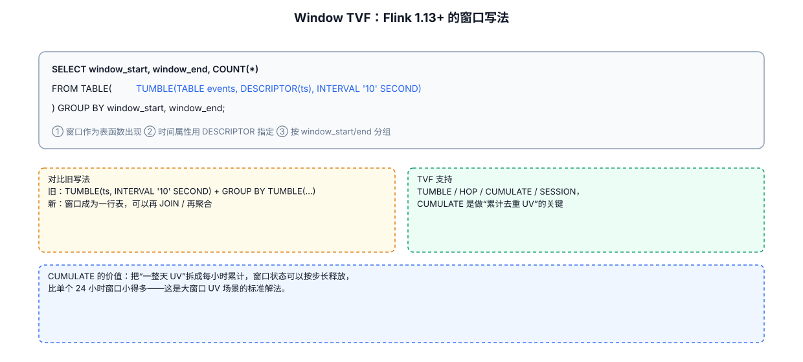
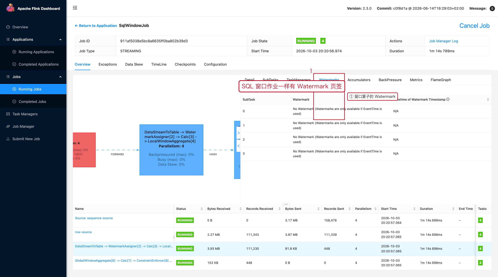

# 05-04｜Flink SQL Window TVF

> 目标：使用 SQL 做事件时间/处理时间窗口统计时，快速写出 TUMBLE、HOP、CUMULATE、SESSION 模板。

---



## 1. Window TVF 的基本结构

推荐把 SQL 窗口理解为两步：

```text
Step 1：用 Window TVF 给数据分配窗口
Step 2：GROUP BY window_start / window_end 做聚合
```

通用结构：

```sql
SELECT
    group_key,
    window_start,
    window_end,
    COUNT(*) AS cnt
FROM TABLE(
    TUMBLE(
        TABLE source_table,
        DESCRIPTOR(event_time),
        INTERVAL '5' MINUTES
    )
)
GROUP BY
    group_key,
    window_start,
    window_end;
```

---

## 2. TUMBLE：滚动窗口

适合：

```text
每5分钟统计一次
每1小时统计一次
每天统计一次
```

```sql
SELECT
    user_id,
    window_start,
    window_end,
    COUNT(*) AS order_cnt,
    SUM(amount) AS total_amount
FROM TABLE(
    TUMBLE(
        TABLE orders,
        DESCRIPTOR(event_time),
        INTERVAL '5' MINUTES
    )
)
GROUP BY
    user_id,
    window_start,
    window_end;
```

如果窗口大小是 5 分钟：

```text
[10:00, 10:05)
[10:05, 10:10)
[10:10, 10:15)
```

窗口之间不重叠。

---

## 3. HOP：滑动窗口

HOP 有两个时间参数：

```text
slide / hop：多久产生一次窗口
size：一个窗口持续多长时间
```

例如：

```text
每1分钟输出一次最近10分钟统计
```

```sql
SELECT
    user_id,
    window_start,
    window_end,
    COUNT(*) AS order_cnt
FROM TABLE(
    HOP(
        TABLE orders,
        DESCRIPTOR(event_time),
        INTERVAL '1' MINUTE,
        INTERVAL '10' MINUTES
    )
)
GROUP BY
    user_id,
    window_start,
    window_end;
```

因为：

```text
窗口大小 10 分钟
步长 1 分钟
```

同一条数据会进入多个窗口。

---

## 4. HOP 最容易写反

```sql
HOP(
    TABLE orders,
    DESCRIPTOR(event_time),
    INTERVAL '1' MINUTE,    -- Step：窗口推进 1 分钟
    INTERVAL '10' MINUTES   -- Size：窗口大小 10 分钟
)
```

不要把顺序记反。

---

## 5. CUMULATE：累积窗口

适合：

```text
每天从 00:00 开始
每小时输出一次当天累计值
```

```sql
SELECT
    window_start,
    window_end,
    COUNT(*) AS order_cnt
FROM TABLE(
    CUMULATE(
        TABLE orders,
        DESCRIPTOR(event_time),
        INTERVAL '1' HOUR,
        INTERVAL '1' DAY
    )
)
GROUP BY
    window_start,
    window_end;
```

会形成：

```text
00:00 → 01:00
00:00 → 02:00
00:00 → 03:00
...
00:00 → 24:00
```

适合日累计看板、阶段累计指标。

---

## 6. SESSION：会话窗口

SESSION 不需要固定窗口大小，而使用“无活动间隔”。

例如：

```text
同一个 user 10 分钟没有事件
→ 当前 Session 关闭
```

示意：

```sql
SELECT
    user_id,
    window_start,
    window_end,
    COUNT(*) AS event_cnt
FROM TABLE(
    SESSION(
        TABLE user_events,
        DESCRIPTOR(event_time),
        INTERVAL '10' MINUTES
    )
)
GROUP BY
    user_id,
    window_start,
    window_end;
```

Session Window 必须结合业务含义判断 gap 是否合理。

---

## 7. 事件时间窗口的前置条件

使用事件时间时，表中必须存在正确的时间属性。

DataStream 转 Table 时，可以通过 Schema 显式定义时间属性和 Watermark；SQL Source 则按 DDL 的时间属性配置。

概念上：

```text
普通 TIMESTAMP 列
    ≠
事件时间属性
```

不要看到：

```sql
event_time TIMESTAMP_LTZ(3)
```

就认为 Flink 已经把它当成 Event Time。

---

## 8. 窗口结果为什么通常比普通持续聚合更容易落到 Append Sink

窗口聚合有明确结束边界：

```text
窗口关闭
    ↓
最终聚合结果
    ↓
输出
```

而无限流的普通 `GROUP BY`：

```text
user=1 count=10
    ↓
来了新数据
    ↓
user=1 count=11
    ↓
继续更新
```

因此两者的更新语义不同。

---

## 9. 常见业务模板

### 每小时 GMV

```sql
SELECT
    window_start,
    window_end,
    SUM(amount) AS gmv
FROM TABLE(
    TUMBLE(
        TABLE paid_orders,
        DESCRIPTOR(event_time),
        INTERVAL '1' HOUR
    )
)
GROUP BY
    window_start,
    window_end;
```

### 每5分钟 TopN 的前置聚合

先做窗口聚合：

```sql
SELECT
    window_start,
    window_end,
    item_id,
    SUM(amount) AS sales
FROM TABLE(
    TUMBLE(
        TABLE orders,
        DESCRIPTOR(event_time),
        INTERVAL '5' MINUTES
    )
)
GROUP BY
    window_start,
    window_end,
    item_id;
```

TopN 通常在后续 SQL 中继续处理，不要在这一篇把 TopN 实现细节混进来。

---

## 10. 窗口排查 checklist

```text
1. 时间字段是不是正确的时间属性
2. Watermark 是否正常推进
3. 是 Event Time 还是 Processing Time
4. 窗口 size 是否正确
5. HOP 的 step / size 有没有写反
6. 是否存在严重乱序
7. 是否需要允许迟到数据
8. 窗口结果是不是 Changelog / Append
9. Sink 是否支持这种结果语义
```

---

## 11. 配套 Web UI 证据



SQL 窗口作业同样有 Watermarks 页签

