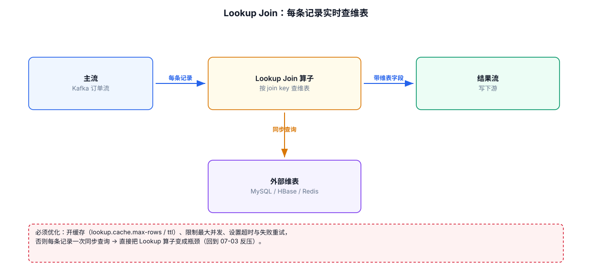
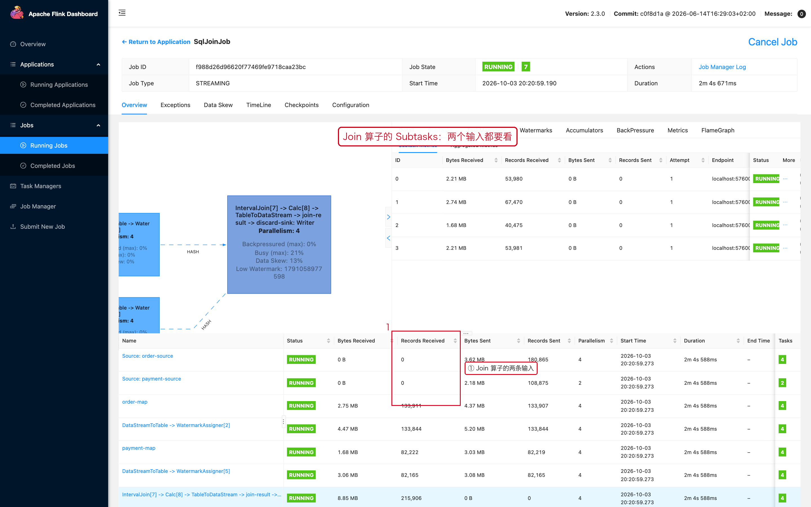

# 05-05｜Temporal Join 与 Lookup Join

> 目标：实时事实流需要关联会变化的维表时，区分“关联某一时刻的版本”和“实时查询当前外部维表”。

---



## 1. 先理解问题

假设：

```text
orders：订单事实流
users：用户维表
```

用户信息会变化：

```text
10:00 user=1 country=CN
10:30 user=1 country=JP
```

现在订单：

```text
10:20 order=1001 user=1
```

到底应该关联：

```text
CN
```

还是当前最新值：

```text
JP
```

取决于 Join 语义。

---

## 2. Processing-Time Lookup Join

典型场景：

```text
订单事件
    ↓
实时 Lookup
    ↓
MySQL / JDBC 维表
```

示例：

```sql
SELECT
    o.order_id,
    o.user_id,
    c.country
FROM orders AS o
LEFT JOIN customers
FOR SYSTEM_TIME AS OF o.proc_time AS c
ON o.user_id = c.user_id;
```

### 关键语法

```sql
FOR SYSTEM_TIME AS OF o.proc_time
```

它表示：

```text
以左侧订单记录的处理时间
作为这次维表查询的时间语义
```

---

## 3. JDBC Lookup Join 表定义模板

```sql
CREATE TABLE customers (
    user_id BIGINT,
    country STRING,
    level STRING,
    PRIMARY KEY (user_id) NOT ENFORCED
) WITH (
    'connector' = 'jdbc',
    'url' = 'jdbc:mysql://mysql01:3306/app',
    'table-name' = 'customers',
    'username' = 'flink',
    'password' = '***'
);
```

然后：

```sql
SELECT
    o.order_id,
    o.user_id,
    c.country,
    c.level
FROM orders AS o
LEFT JOIN customers
FOR SYSTEM_TIME AS OF o.proc_time AS c
ON o.user_id = c.user_id;
```

实际生产中还需要关注 JDBC 连接池、lookup cache、数据库容量以及索引。

---

## 4. 为什么 Lookup Join 一定要关注索引

假设：

```sql
ON o.user_id = c.user_id
```

MySQL 侧最好有：

```sql
CREATE INDEX idx_user_id
ON customers(user_id);
```

否则：

```text
每条 Flink 事件
    ↓
数据库查询
    ↓
全表扫描
```

外部数据库会快速成为瓶颈。

---

## 5. Event-Time Temporal Join

Event-Time Temporal Join 关注的是：

> 根据事实流事件发生的时间，找到维表在该时间点对应的版本。

常见于：

```text
价格变更记录
汇率历史
商品历史维度
用户等级历史
```

核心逻辑：

```text
事实 event_time = 10:20
        ↓
查找维表 10:20 时有效的版本
```

这种方案与简单的“查当前数据库值”不是一个语义。

---

## 6. Temporal Join 与 Lookup Join 的区别

| 对比项 | Lookup Join | Event-Time Temporal Join |
|---|---|---|
| 核心目的 | 查询外部维表 | 查询某时刻的版本 |
| 常见维表来源 | MySQL/JDBC | 版本化 Changelog / Temporal Table |
| 时间语义 | Processing Time 常见 | Event Time |
| 外部系统压力 | 需要重点关注 | 取决于 Source/State 设计 |
| 适合 | 当前维度补全 | 历史一致性 |

---

## 7. 什么时候不要使用普通 Join

需求：

```text
订单 → 用户维表
```

如果用户表只是一个外部数据库当前快照，而且只需要当前信息：

```text
优先考虑 Lookup Join
```

如果：

```text
订单发生在历史时间 T
必须找到 T 时刻用户/商品/价格状态
```

考虑 Temporal Join。

如果：

```text
两个事件流只需要匹配前后30秒
```

考虑 Interval Join。

---

## 8. Lookup Join 的缓存思路

高流量情况下：

```text
订单 10000 条/s
    ↓
全部打到 MySQL
    ↓
MySQL QPS 暴涨
```

可以考虑缓存：

```text
Flink
 ↓
Lookup Cache
 ↓ cache hit
直接返回

cache miss
 ↓
MySQL
```

但缓存带来新的问题：

```text
缓存多久？
维度更新后多久可见？
是否允许最终一致？
Cache 是否会造成热点？
```

因此缓存不是免费优化，而是一致性与容量之间的取舍。

---

## 9. Lookup Join 排查顺序

```text
外部数据库慢
    ↓
1. 查数据库 CPU / IO
2. 查 SQL 执行计划
3. 查 Join Key 是否有索引
4. 查 Flink lookup QPS
5. 查 cache hit rate
6. 查连接池是否耗尽
7. 查超时与重试
8. 查是否存在热点 Key
```

---

## 10. 设计时先问三个问题

```text
问题1：我要“当前维度”还是“历史版本”？

当前维度
→ Lookup Join

历史版本
→ Temporal Join
```

```text
问题2：两个流是按照时间范围匹配吗？

是
→ Interval Join
```

```text
问题3：Join 结果会不会无限增长？

会
→ 重新检查是否能增加时间边界、窗口或维表语义
```

---

## 11. 配套 Web UI 证据



Join 算子要同时看两条输入的消费情况

