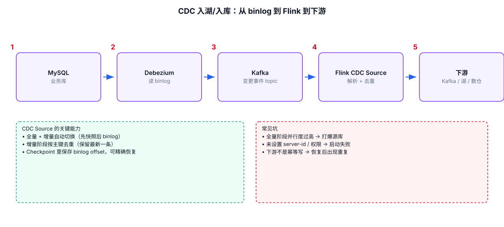

# 05-06｜CDC：数据库变更数据进入 Flink

> 目标：理解 CDC 在 Flink 中的使用方式，重点掌握 MySQL 全量快照 + Binlog 增量、Changelog 语义和下游 Upsert。
>
> 注意：Flink CDC 是独立于 Apache Flink 核心发行版的连接器/项目，Flink CDC 与 Flink 的版本兼容关系需要按具体 CDC 版本的官方矩阵确认。不要只看 Flink 主版本就直接选择 CDC 依赖。

---



## 1. CDC 到底是什么

传统 JDBC Source 更像：

```text
SELECT * FROM users
```

CDC 则关注：

```text
INSERT
UPDATE
DELETE
```

例如 MySQL：

```text
users
id=1 name=Alice
```

发生：

```sql
UPDATE users
SET name = 'Bob'
WHERE id = 1;
```

CDC 关注的是“发生了 UPDATE”，而不是只重新查询整个表。

---

## 2. MySQL CDC 常见生命周期

典型流程：

```text
MySQL
  ↓
Snapshot
  ↓
读取历史数据
  ↓
切换到 Binlog
  ↓
持续读取 INSERT / UPDATE / DELETE
  ↓
Flink Changelog
```

所以第一次启动时看到一批历史数据是正常的。

不要把：

```text
首次 Snapshot
```

误认为：

```text
业务数据库突然批量产生了这些 INSERT
```

---

## 3. SQL 中注册 MySQL CDC Source 的典型结构

```sql
CREATE TABLE orders (
    order_id BIGINT,
    user_id BIGINT,
    amount DECIMAL(18, 2),
    status STRING,
    update_time TIMESTAMP(3),

    -- CDC 表通常需要正确描述主键。
    PRIMARY KEY (order_id) NOT ENFORCED
) WITH (
    'connector' = 'mysql-cdc',
    'hostname' = 'mysql01',
    'port' = '3306',
    'username' = 'flink',
    'password' = '***',
    'database-name' = 'app',
    'table-name' = 'orders'
);
```

具体 connector artifact、版本以及数据库权限按照实际 Flink CDC 版本文档配置。

---

## 4. MySQL 需要具备什么条件

CDC 不是“给一个 JDBC URL 就能读取 Binlog”。

通常需要：

```text
1. MySQL 开启 Binlog
2. Binlog format / row image 满足 CDC 要求
3. Flink CDC 用户拥有必要复制权限
4. server-id 配置正确
5. 网络能够连接 MySQL
```

生产排障时，连接失败不要只查用户名密码。

---

## 5. UPDATE 为什么不是一条普通的新数据

对于主键：

```text
id=1, name=Alice
```

更新成：

```text
id=1, name=Bob
```

从 Changelog 角度可能表达为：

```text
-U [1, Alice]
+U [1, Bob]
```

这意味着下游必须理解更新语义。

---

## 6. 为什么 Append-only Sink 可能接不住 CDC

例如文件 Sink 更适合：

```text
+I
+I
+I
```

但 CDC 下游可能出现：

```text
+I
-U
+U
-D
```

如果下游没有更新/删除能力，就不能简单认为：

```text
INSERT INTO sink SELECT * FROM cdc_source;
```

一定能得到正确的最终数据。

---

## 7. CDC → Upsert Sink

常见结构：

```text
MySQL CDC
   ↓
Flink SQL
   ↓
Upsert Sink
```

要求：

```text
主键明确
    ↓
下游可以根据主键更新/删除
```

例如：

```sql
CREATE TABLE sink_users (
    user_id BIGINT,
    name STRING,
    level STRING,
    PRIMARY KEY (user_id) NOT ENFORCED
) WITH (
    'connector' = '...'
);

INSERT INTO sink_users
SELECT
    user_id,
    name,
    level
FROM users;
```

具体 Sink 是否支持 Upsert，要查看该连接器文档。

---

## 8. CDC + 实时清洗

```sql
CREATE VIEW valid_orders AS
SELECT
    order_id,
    user_id,
    amount,
    status
FROM orders
WHERE status <> 'CANCELLED';
```

但必须注意：

```text
CDC Source 是动态表
    ↓
WHERE 过滤后的结果仍然可能产生 Update / Delete
```

不要把 SQL View 当成 Append-only 流。

---

## 9. CDC 最容易踩的坑

### 坑 1：把 Snapshot 数据当成实时增量

首次启动时的大量数据可能来自 Snapshot。

### 坑 2：忽略 DELETE

数据库中的 DELETE 会传递到 CDC 结果中。

### 坑 3：忽略 UPDATE

同一个主键的数据可能被多次修改。

### 坑 4：没有主键

很多 Upsert 场景依赖主键确定一行的唯一身份。

### 坑 5：Flink / Flink CDC / Connector 版本不匹配

使用 CDC 前检查：

```text
Apache Flink 版本
Flink CDC 版本
MySQL Connector 版本
JDK 版本
```

### 坑 6：只测试 INSERT

生产测试至少覆盖：

```text
INSERT
UPDATE
DELETE
INSERT + UPDATE + DELETE 连续变化
重启恢复
Snapshot → Binlog 切换
```
