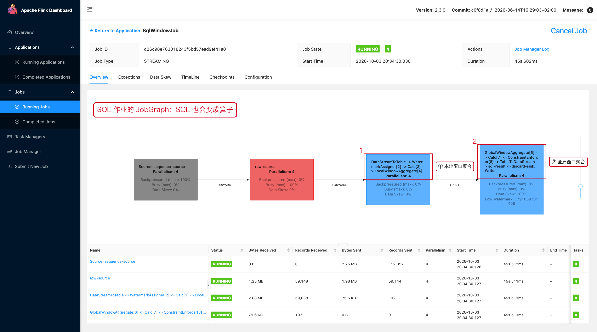

# 05-07｜Flink SQL 常见易错点

> 目标：SQL 能运行不代表语义正确。生产开发优先检查时间、Changelog、State、Join 和 Sink 兼容性。

---

## 1. `GROUP BY` 不等于窗口聚合

### 普通持续聚合

```sql
SELECT
    user_id,
    COUNT(*)
FROM orders
GROUP BY user_id;
```

特点：

```text
同一个 user_id 的结果不断更新
状态可能持续增长
```

### 窗口聚合

```sql
SELECT
    user_id,
    window_start,
    window_end,
    COUNT(*)
FROM TABLE(
    TUMBLE(
        TABLE orders,
        DESCRIPTOR(event_time),
        INTERVAL '5' MINUTES
    )
)
GROUP BY
    user_id,
    window_start,
    window_end;
```

窗口有明确时间边界。

---

## 2. `TIMESTAMP` 不等于 Event Time

错误认知：

```text
有一个 event_time 字段
→ Flink 自动知道它是事件时间
```

正确理解：

```text
字段只是字段
    ↓
需要把它定义成时间属性
    ↓
Watermark 才能参与时间运算
```

---

## 3. `WHERE` 后的数据量变小，不代表任务一定变轻

例如：

```sql
SELECT *
FROM orders
WHERE status = 'PAID';
```

过滤本身通常简单，但如果过滤发生在一个巨大 Join 之后：

```text
orders
   ↓
JOIN huge_table
   ↓
WHERE status='PAID'
```

可能已经产生了大量无效 Join 工作。

应检查能否把过滤尽量前置。

---

## 4. Join Key 上没有有效约束

错误：

```sql
ON a.user_id = b.user_id
AND a.category = b.category
```

但业务实际只需要 `user_id`。

反过来，如果业务需要双字段唯一匹配，却只写：

```sql
ON a.user_id = b.user_id
```

可能造成一对多、多对多膨胀。

检查：

```text
业务上的唯一键是什么？
Join 一侧是不是唯一？
是否真的允许一对多？
```

---

## 5. Lookup Join ≠ 免费维表

```text
100,000 events/s
×
1 次数据库查询/event
=
100,000 lookup/s
```

因此必须估算：

```text
Flink 输入 QPS
× lookup miss rate
× retry 次数
```

再与数据库容量比较。

---

## 6. `PRIMARY KEY NOT ENFORCED` ≠ 自动去重

```sql
PRIMARY KEY (user_id) NOT ENFORCED
```

主要是向 Planner/Sink 描述唯一键语义。

不能简单理解成：

```text
Flink 发现重复 user_id
→ 自动只留一条
```

数据去重应该使用明确的去重逻辑。

---

## 7. Changelog 一定要和 Sink 对得上

先问：

```text
这个结果会不会 UPDATE？
这个结果会不会 DELETE？
```

再问：

```text
Sink 能不能处理 UPDATE / DELETE？
```

如果结果是：

```text
+I / -U / +U / -D
```

但 Sink 只能追加，就需要重新设计下游。

---

## 8. SQL 很短，但 State 可能很大

例如：

```sql
SELECT
    user_id,
    COUNT(*)
FROM events
GROUP BY user_id;
```

SQL 只有几行，实际上是：

```text
每个 user_id
    ↓
维护持续聚合状态
    ↓
用户数持续增加
    ↓
State 持续增长
```

看 SQL 时，不只看 CPU 计算复杂度，也要问：

```text
状态保存多久？
Key 数量是多少？
窗口有没有边界？
有没有 TTL / 清理机制？
```

---

## 9. 时间条件写错一个边界，结果就可能不同

```sql
BETWEEN start_time AND end_time
```

和：

```sql
time >= start_time
AND time < end_time
```

在时间窗口设计中要明确边界语义。

推荐统一思考成：

```text
[start, end)
```

避免相邻窗口重复计算边界数据。

---

## 10. SQL 排查顺序

```text
1. DESCRIBE 表结构
2. 看时间属性 / Watermark
3. 看 Join 条件
4. 看 GROUP BY 是否无界
5. 看结果 Changelog 语义
6. 看 Sink 是否兼容
7. EXPLAIN 看执行计划
8. 再看并行度、Shuffle 和资源
```

---

## 11. 配套 Web UI 证据



SQL 作业出错时，先看 JobGraph 与 Exceptions

