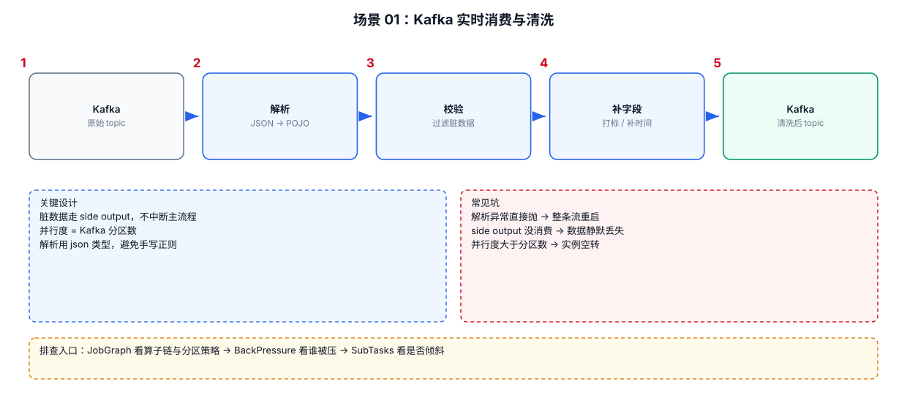
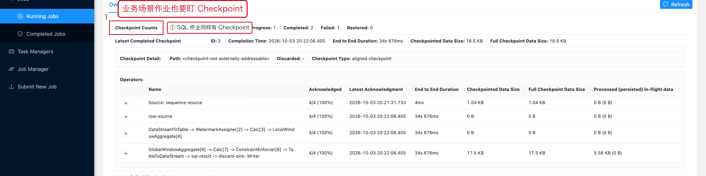

# 06-01｜Kafka 实时消费与清洗

> 场景：Kafka → Flink → 清洗 → Kafka / 下游系统。

---



## 1. 最常见数据链路

Kafka 原始 topic → 解析 JSON → 校验/清洗 → 补字段 → 写回下游 topic。
完整链路见本文顶部的示意图；下面逐段展开每一步的实现细节。


---

## 2. 通用 Java 结构

```java
// Step 1：创建 Flink 执行环境。
StreamExecutionEnvironment env =
        StreamExecutionEnvironment.getExecutionEnvironment();

// Step 2：创建 Kafka Source。
KafkaSource<String> source = KafkaSource.<String>builder()
        .setBootstrapServers("kafka01:9092,kafka02:9092")
        .setTopics("raw-events")
        .setGroupId("event-clean-job")
        .setStartingOffsets(OffsetsInitializer.earliest())
        .setValueOnlyDeserializer(new SimpleStringSchema())
        .build();

// Step 3：接入 DataStream。
DataStream<String> raw = env.fromSource(
        source,
        WatermarkStrategy.noWatermarks(),
        "kafka-source"
);

// Step 4：解析原始 JSON。
DataStream<Event> parsed = raw
        .map(new ParseEventFunction());

// Step 5：过滤非法数据。
DataStream<Event> valid = parsed
        .filter(event -> event != null && event.isValid());

// Step 6：按照业务 key 分区，后续有状态计算时通常从这里开始。
DataStream<Event> keyed = valid
        .keyBy(Event::getUserId);

// Step 7：接入业务处理逻辑。
DataStream<CleanEvent> result = keyed
        .process(new CleanEventProcessFunction());

// Step 8：连接 Sink。
result.sinkTo(buildKafkaSink());

// Step 9：提交 Job。
env.execute("kafka-clean-job");
```

---

## 3. Source 并行度怎么想

Kafka 最重要的一个关系：

```text
Kafka Partition
        ↓
Source Subtask 并行消费
```

如果：

```text
Topic = 12 partitions
Source parallelism = 4
```

通常意味着每个 Source Subtask 负责多个 Partition。

如果：

```text
Topic = 4 partitions
Source parallelism = 16
```

并不能凭空制造 16 个并行 Kafka Partition 消费能力，超过 Partition 数的 Source Subtask 可能处于空闲状态。

---

## 4. JSON 解析不要把异常直接打死整个 Job

错误方式：

```java
.map(json -> objectMapper.readValue(json, Event.class))
```

如果一条脏数据解析失败，可能导致算子异常，进而触发任务重启。

更常见的做法：

```text
正常数据 → 主流
非法数据 → Side Output / Dead Letter Topic
```

示例：

```java
public class ParseFunction
        extends ProcessFunction<String, Event> {

    private final OutputTag<String> dirtyTag =
            new OutputTag<String>("dirty") {};

    @Override
    public void processElement(
            String value,
            Context ctx,
            Collector<Event> out) {

        try {
            // Step 1：解析 JSON。
            Event event = parse(value);

            // Step 2：校验业务字段。
            if (!event.isValid()) {
                ctx.output(dirtyTag, value);
                return;
            }

            // Step 3：合法数据进入主流。
            out.collect(event);
        } catch (Exception e) {
            // Step 4：解析异常不要直接让整个算子失败。
            ctx.output(dirtyTag, value);
        }
    }
}
```

获取 Side Output：

```java
SingleOutputStreamOperator<Event> main =
        stream.process(new ParseFunction());

DataStream<String> dirty =
        main.getSideOutput(new OutputTag<String>("dirty") {});
```

---

## 5. 清洗逻辑建议分层

```text
Parse
 ↓
Schema Validate
 ↓
Normalize
 ↓
Business Validate
 ↓
Enrich
 ↓
Output
```

不要把所有逻辑塞进一个 500 行 `map()`。

生产代码更推荐：

```text
ParseFunction
ValidateFunction
NormalizeFunction
EnrichFunction
```

或者根据算子生命周期拆成独立类。

---

## 6. Kafka 实时任务排查清单

```text
消费延迟高
→ Kafka Lag
→ Source Records In
→ Source parallelism
→ Partition 是否倾斜

CPU 高
→ JSON 解析
→ 正则表达式
→ 序列化
→ 下游算子

数据重复
→ Checkpoint / Restart
→ Sink 语义
→ Kafka Offset
→ 业务侧重复消息

脏数据过多
→ Side Output 数量
→ 原始 Topic 数据质量
→ Schema 版本变化
```

---

## 7. 配套 Web UI 证据



业务作业同样要盯 Checkpoint

