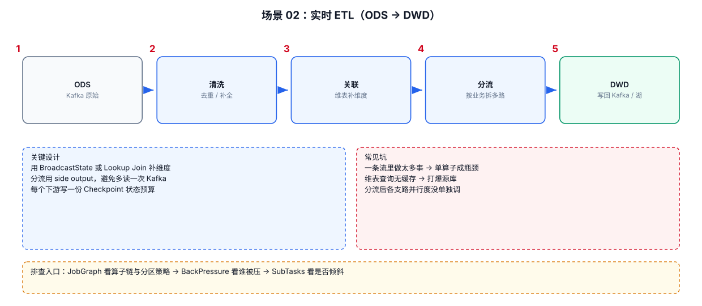

# 06-02｜实时 ETL

> 场景：从 Kafka 等 Source 获取事件，完成解析、过滤、字段补全、类型转换、标准化，然后写入明细层/下游 Topic。

---



## 1. 推荐的数据处理顺序

不要一开始就 `keyBy()`。如果后续没有 Keyed State / Keyed Process，需要先判断是否真的需要分区。

---

## 2. 通用 POJO

```java
public class UserEvent {
    public long userId;
    public long itemId;
    public String action;
    public long eventTime;

    public UserEvent() {}
}
```

---

## 3. 清洗模板

```java
DataStream<UserEvent> result = raw
        // Step 1：解析输入。
        .map(new ParseFunction())

        // Step 2：过滤解析失败的数据。
        .filter(Objects::nonNull)

        // Step 3：标准化字段。
        .map(event -> {
            event.action = event.action.toUpperCase(Locale.ROOT);
            return event;
        })

        // Step 4：过滤业务非法值。
        .filter(event -> event.userId > 0 && event.itemId > 0);
```

---

## 4. ETL 中为什么经常使用 `map()` 和 `filter()`

`map()`：

```text
1 input → 1 output
```

典型：

```text
JSON → POJO
POJO → 标准 POJO
金额单位转换
字段重命名
```

`filter()`：

```text
1 input → 0/1 output
```

典型：

```text
丢弃非法数据
只保留支付订单
只保留有效用户
```

如果一个输入可能产生多条输出，不要强行用 `map()`。

---

## 5. 一个输入拆多个输出：`flatMap()`

例如一条消息里包含多个 item：

```java
public class BatchEvent {
    public long userId;
    public List<Long> itemIds;
}
```

拆开：

```java
DataStream<ItemEvent> items = batchStream
        .flatMap((BatchEvent batch,
                  Collector<ItemEvent> out) -> {

            // Step 1：遍历一条输入中的多个 item。
            for (Long itemId : batch.itemIds) {
                // Step 2：一条输入可以输出多条结果。
                out.collect(
                        new ItemEvent(batch.userId, itemId)
                );
            }
        })
        // Step 3：显式告诉 Flink Lambda 的输入/输出类型。
        .returns(ItemEvent.class);
```

---

## 6. ETL 中不要随意 `keyBy`

例如：

```java
stream
    .map(...)
    .filter(...)
    .keyBy(UserEvent::getUserId)
    .map(...);
```

`keyBy()` 会产生数据重分区。

只有在后面需要：

```text
Keyed State
Timer
Keyed ProcessFunction
Keyed Window
按 Key 局部聚合
```

时才需要重点考虑。

---

## 7. ETL 里的字段校验

推荐明确区分：

```text
技术错误
→ 解析异常、Schema 错误

业务脏数据
→ user_id <= 0、金额负数、状态非法
```

两种数据不要混到一个错误出口。

可以设计：

```text
主流
 ├── valid
 ├── parse_error
 └── business_invalid
```

这样后续可以分别统计问题来源。

---

## 8. 生产 ETL 模板

```text
Kafka Raw
   ↓
Parse
   ├── parse_error → Error Topic
   ↓
Validate
   ├── invalid → Invalid Topic
   ↓
Normalize
   ↓
Dimension Enrichment
   ↓
DWD Kafka / Lakehouse / OLAP
```

这个结构适合大多数实时明细加工任务。
