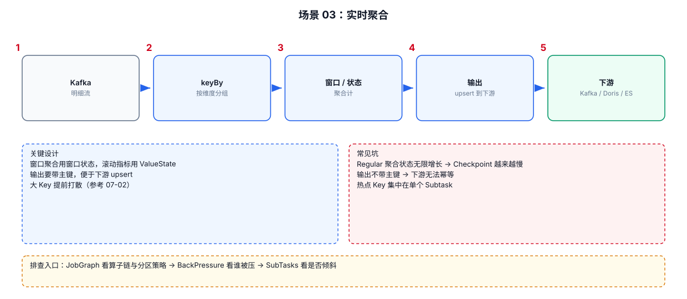

# 06-03｜实时聚合

> 场景：按 user/item/order 等 Key 实时做计数、求和、最大值、最小值、去重统计等。

---



## 1. 先区分“无界聚合”和“窗口聚合”

### 无界聚合

```text
按照 Key 一直累计
```

例如：

```text
每个用户累计订单数
```

需要考虑 State 长期增长。

### 窗口聚合

```text
每5分钟订单数
每1小时 GMV
```

窗口自然限制状态生命周期。

---

## 2. DataStream `reduce()`：最简单累计

```java
DataStream<Order> orders = ...;

DataStream<OrderAmount> result = orders
        // Step 1：按照 user_id 分组。
        .keyBy(Order::getUserId)

        // Step 2：同一个 user_id 的数据进入同一个逻辑 Key。
        // Step 3：reduce 每来一条数据就进行一次增量合并。
        .reduce((left, right) -> {
            return new OrderAmount(
                    left.getUserId(),
                    left.getTotalAmount() + right.getAmount()
            );
        });
```

`reduce()` 要求输入和输出类型一致或满足对应类型约束；具体泛型形式以所使用 API 为准。

---

## 3. `sum()`：简单求和

例如 POJO 不一定最方便，通常会先转换成 Tuple：

```java
DataStream<Tuple2<Long, Long>> userCounts = ...;

DataStream<Tuple2<Long, Long>> result = userCounts
        // Step 1：按照 user_id 分组。
        .keyBy(value -> value.f0)

        // Step 2：对第二个字段做累加。
        .sum(1);
```

生产复杂项目里更推荐明确的业务对象 + `AggregateFunction`，因为字段含义更清楚。

---

## 4. `AggregateFunction`：更通用

```java
public static class AvgAggregate
        implements AggregateFunction<Order, AvgAccumulator, Double> {

    @Override
    public AvgAccumulator createAccumulator() {
        // Step 1：创建每个 Key 的累计器。
        return new AvgAccumulator(0L, 0.0);
    }

    @Override
    public AvgAccumulator add(
            Order value,
            AvgAccumulator acc) {
        // Step 2：每来一条订单，就更新累计器。
        acc.count++;
        acc.sum += value.getAmount();
        return acc;
    }

    @Override
    public Double getResult(AvgAccumulator acc) {
        // Step 3：从累计状态计算最终结果。
        return acc.count == 0
                ? 0.0
                : acc.sum / acc.count;
    }

    @Override
    public AvgAccumulator merge(
            AvgAccumulator a,
            AvgAccumulator b) {
        // Step 4：窗口场景下可能需要合并多个累计器。
        return new AvgAccumulator(
                a.count + b.count,
                a.sum + b.sum
        );
    }
}
```

---

## 5. 聚合时优先使用增量计算

不推荐：

```text
每来一条数据
→ 把整个历史列表取出来
→ 重新 count / sum
```

更合理：

```text
sum_new = sum_old + value
```

这样 State 更小，CPU 也更稳定。

---

## 6. 高基数聚合的核心风险

例如：

```text
10亿 user_id
    ↓
每个 user 一个 State
```

即使单个 State 很小，总量也可能很大。

因此实时聚合开发时要问：

```text
Key 基数是多少？
状态保存多久？
是否有 TTL？
是否应该分窗口？
是否真的需要按这么细的 Key 聚合？
```

---

## 7. 聚合出现热点 Key

例如：

```text
user_id=0
```

占了总流量 30%。

则：

```text
keyBy(user_id)
    ↓
user_id=0
    ↓
固定落到一个 Subtask
    ↓
这个 Subtask 特别忙
```

增加并行度不一定解决问题，因为同一个 Key 仍然需要落到同一个 Key Group。

真正需要考虑的是：

```text
热点 Key 拆分
Key 加盐
两阶段聚合
特殊 Key 单独处理
```
