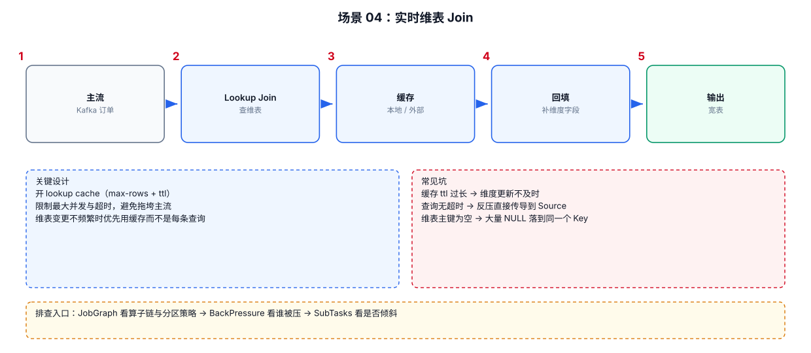

# 06-04｜实时维表 Join

> 场景：事实流需要补充商品、用户、地域、设备、店铺等维度信息。

---



## 1. 先判断维表大小和更新方式

```text
维表很小
    → Broadcast State

需要实时访问外部数据库
    → Async I/O / Lookup Join

维表变化通过流传播
    → Broadcast State / Changelog State

要求按照历史时间版本关联
    → Temporal Join
```

---

## 2. Broadcast State

适合：

```text
维表比较小
更新频率可接受
每个 Subtask 保存一份维表
```

结构：

```text
Dimension Stream
      ↓
Broadcast
      ↓
所有下游 Subtask

Fact Stream
      ↓
KeyedBroadcastProcessFunction
      ↓
Join / Enrich
```

---

## 3. Broadcast State 典型代码

```java
// Step 1：定义广播状态描述器。
MapStateDescriptor<String, Dimension> descriptor =
        new MapStateDescriptor<>(
                "dimension-state",
                Types.STRING,
                TypeInformation.of(Dimension.class)
        );

// Step 2：把维表更新流广播。
BroadcastStream<Dimension> broadcastDimension =
        dimensionStream.broadcast(descriptor);

// Step 3：事实流不广播，保留原有分区逻辑。
BroadcastConnectedStream<Event, Dimension> connected =
        eventStream.connect(broadcastDimension);

// Step 4：在 BroadcastProcessFunction 中读取维表并补充事实。
```

### 为什么不用普通 `MapState`

Broadcast State 有特殊的运行时语义：

```text
广播数据会复制到每个相关 Subtask
```

因此不需要每次事实事件都访问外部数据库。

---

## 4. Broadcast State 的核心限制

不要把巨大维表广播：

```text
100 GB 维表
    ↓
每个 Subtask 保存一份
    ↓
内存直接放大
```

更适合：

```text
商品类目规则
黑白名单
配置规则
小型用户标签
区域映射
```

---

## 5. Async I/O

外部查询属于典型 IO 场景：

```text
Flink Event
   ↓
请求 HBase / Redis / MySQL / HTTP
   ↓
等待网络
```

同步方式：

```text
Event A → 等待 10ms → Event B → 等待 10ms
```

异步方式：

```text
A ───────┐
B ───────┼→ 外部系统
C ───────┘
```

核心目标：在等待外部 IO 时，不让算子线程完全空等。

---

## 6. Async I/O 需要控制并发

概念模板：

```java
AsyncDataStream.unorderedWait(
        input,
        new AsyncRichFunction(),

        // 单次请求允许等待的最大时间。
        timeout,

        // 同时在飞请求数量上限。
        capacity
);
```

其中：

```text
timeout
→ 防止单请求无限挂起

capacity
→ 限制并发请求数
```

`capacity` 不是越大越好：

```text
capacity 太小 → Flink 吞吐受限
capacity 太大 → 下游数据库/服务被打爆
```

---

## 7. 生产维表查询需要缓存

常见模式：

```text
Event
 ↓
Local Cache
 ├── Hit → 直接返回
 └── Miss → 外部系统
```

需要定义：

```text
TTL
最大缓存条数
淘汰策略
空值是否缓存
异常是否缓存
更新传播策略
```

---

## 8. HBase 维表 Join

如果使用 HBase，尤其关注：

```text
RowKey 设计
Region 分布
热点 RowKey
网络 RTT
连接复用
批量查询
Async I/O
```

不要只看 Flink TaskManager 的 CPU：

```text
Flink 算子 CPU 正常
但 HBase lookup latency 很高
    ↓
整体吞吐仍然下降
```

---

## 9. 实时维表 Join 选择表

| 场景 | 方案 |
|---|---|
| 小维表，更新流可订阅 | Broadcast State |
| MySQL/JDBC 当前维度 | Lookup Join |
| HBase/Redis 高并发查询 | Async I/O + Cache |
| 需要历史版本 | Temporal Join |
| 维表超大，不适合广播 | 外部存储 Lookup |

---

## 10. 排查维表 Join 慢

```text
1. 查外部系统 RT
2. 查 Flink Async capacity
3. 查 timeout
4. 查 cache hit rate
5. 查连接池
6. 查热点 Key
7. 查外部系统 QPS
8. 查是不是同步 IO
```
