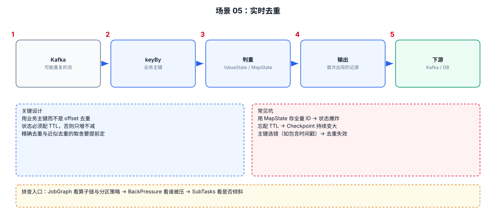

# 06-05｜实时去重

> 场景：Kafka 或业务流中可能重复出现同一业务事件，需要只处理一次或在一定时间范围内去重。

---



## 1. 先定义“重复”

不要直接写：

```text
按 user_id 去重
```

应该先定义业务唯一键：

```text
event_id
order_id
user_id + item_id + event_time
user_id + request_id
```

例如：

```text
event_id=ABC123
```

同一个 `event_id` 再次出现才是重复。

---

## 2. 无限去重 vs 有时间范围去重

### 无限去重

```text
见过 event_id
→ 永久不再处理
```

State 可能无限增长。

### 时间范围去重

```text
10:00 出现 event_id=A
10:10 再出现 A
```

如果只要求：

```text
10分钟内不重复
```

则可以让 State 使用 TTL 或窗口清理。

---

## 3. Keyed State 去重

```java
public class DedupFunction
        extends KeyedProcessFunction<String, Event, Event> {

    // 保存当前 key 是否已经出现过。
    private transient ValueState<Boolean> seenState;

    @Override
    public void open(OpenContext ctx) throws Exception {
        // Step 1：定义 State。
        ValueStateDescriptor<Boolean> descriptor =
                new ValueStateDescriptor<>(
                        "seen",
                        Boolean.class
                );

        // Step 2：从 RuntimeContext 获取 Keyed State。
        seenState = getRuntimeContext()
                .getState(descriptor);
    }

    @Override
    public void processElement(
            Event event,
            Context ctx,
            Collector<Event> out) throws Exception {

        // Step 3：读取当前 key 是否见过。
        Boolean seen = seenState.value();

        // Step 4：第一次出现才输出。
        if (seen == null || !seen) {
            out.collect(event);

            // Step 5：标记当前 key 已处理。
            seenState.update(true);
        }
    }
}
```

调用时：

```java
DataStream<Event> deduplicated = stream
        // 关键：去重 State 是按 Key 保存的。
        .keyBy(Event::getEventId)
        .process(new DedupFunction());
```

---

## 4. 为什么必须 `keyBy(eventId)`

因为 `ValueState` 是 Keyed State。

如果：

```text
keyBy(eventId)
```

那么：

```text
event_id=A
    ↓
固定落到某个 Key Group
    ↓
对应 State 记录 A 是否出现过
```

如果没有 `keyBy()`，不能直接用同样方式保存每个业务 ID 的独立状态。

---

## 5. 带 TTL 的去重

适合：

```text
同一个 event_id 在 1 小时内重复就丢弃
1 小时后重新出现可以接受
```

思路：

```java
StateTtlConfig ttlConfig = StateTtlConfig
        .newBuilder(Duration.ofHours(1))
        .setUpdateType(
                StateTtlConfig.UpdateType.OnCreateAndWrite
        )
        .build();
```

然后把 TTL 配置到 State Descriptor。

注意：TTL 是状态生命周期控制，不等同于“窗口结束瞬间删除”。

---

## 6. 业务去重与 Kafka Offset 去重不是一回事

### Kafka Offset

回答：

```text
这个 Kafka 消息位置有没有被消费确认？
```

### 业务 event_id

回答：

```text
这笔业务事件之前有没有处理过？
```

即使 Kafka Offset 管理正确，也可能存在：

```text
上游本身重复发送 event_id
```

因此生产系统通常需要从业务层定义幂等键。

---

## 7. Sink 也需要考虑幂等

即使 Flink 内部去重：

```text
Flink 输出一次
```

Sink 仍可能因为：

```text
Restart
Retry
Transaction
```

出现重复写入风险。

如果下游支持 Upsert：

```text
PRIMARY KEY = event_id
```

通常更容易建立最终幂等语义。

---

## 8. 去重排查清单

```text
1. 重复定义是什么
2. 去重 Key 是否正确
3. State 是否持续增长
4. 是否需要 TTL
5. Kafka 是否真的重复，还是 Sink 重复
6. Restart 后是否可能重新处理
7. Sink 有没有幂等键
8. 是否允许迟到事件重新到达
```
