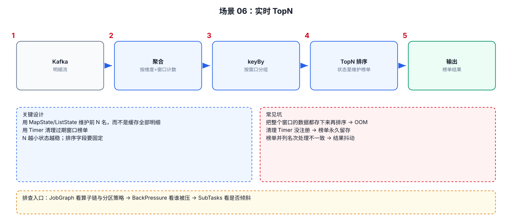

# 06-06｜TopN

> 场景：实时统计 Top 10 商品、Top 100 用户、某窗口内销售额最高的商品等。

---



## 1. TopN 先问一个问题

你要的是：

```text
全局 TopN
```

还是：

```text
每个窗口 TopN
```

还是：

```text
每个分类 TopN
```

还是：

```text
每个用户 TopN
```

不同粒度决定 State 的规模。

---

## 2. Flink SQL 常见窗口 TopN 结构

先计算窗口内指标：

```sql
CREATE VIEW window_sales AS
SELECT
    window_start,
    window_end,
    item_id,
    SUM(amount) AS sales
FROM TABLE(
    TUMBLE(
        TABLE orders,
        DESCRIPTOR(event_time),
        INTERVAL '5' MINUTES
    )
)
GROUP BY
    window_start,
    window_end,
    item_id;
```

然后按窗口做排名：

```sql
SELECT
    window_start,
    window_end,
    item_id,
    sales,
    ROW_NUMBER() OVER (
        PARTITION BY window_start, window_end
        ORDER BY sales DESC
    ) AS rn
FROM window_sales;
```

最后过滤：

```sql
SELECT
    window_start,
    window_end,
    item_id,
    sales
FROM (
    SELECT
        window_start,
        window_end,
        item_id,
        sales,
        ROW_NUMBER() OVER (
            PARTITION BY window_start, window_end
            ORDER BY sales DESC
        ) AS rn
    FROM window_sales
)
WHERE rn <= 10;
```

---

## 3. 为什么窗口 TopN 更常见

全局实时 TopN：

```text
数据持续进入
    ↓
排名持续变化
    ↓
状态长期保留
```

窗口 TopN：

```text
5分钟窗口
    ↓
窗口关闭
    ↓
产生最终 Top10
    ↓
旧窗口状态可以清理
```

如果业务允许窗口化，资源生命周期通常更容易控制。

---

## 4. `ROW_NUMBER()`、`RANK()`、`DENSE_RANK()`

### ROW_NUMBER

强制产生唯一顺序：

```text
100
90
90
80
↓
1
2
3
4
```

### RANK

并列排名跳号：

```text
100 → 1
90  → 2
90  → 2
80  → 4
```

### DENSE_RANK

并列排名不跳号：

```text
100 → 1
90  → 2
90  → 2
80  → 3
```

业务如果要求“严格只输出 N 条”，通常更容易使用 `ROW_NUMBER()`。

---

## 5. TopN 中必须定义稳定排序

例如：

```sql
ORDER BY sales DESC
```

如果 sales 相同，谁排名前面可能不稳定。

可以添加业务唯一字段作为第二排序条件：

```sql
ORDER BY
    sales DESC,
    item_id ASC
```

这样可以减少并列值导致的不确定性。

---

## 6. DataStream TopN 的核心结构

思路：

```text
keyBy(group)
   ↓
State 保存候选项
   ↓
新数据更新候选
   ↓
重新维护 TopN
```

如果 N 很小，可以考虑：

```text
PriorityQueue
```

而不是每次把所有历史数据排序。

复杂度从：

```text
O(M log M)
```

变成维护固定 N 候选的思路，例如：

```text
O(log N)
```

具体实现还要结合更新、删除、撤回语义。

---

## 7. TopN 常见性能问题

```text
TopN N 很大
    → 候选 State 大

Key 基数很高
    → 每个 Key 都有一份 TopN State

全局 TopN
    → 单点状态/单并行度瓶颈风险

排序字段频繁更新
    → 更新成本高
```

因此 TopN 不是“加一个 ROW_NUMBER 就结束”。
