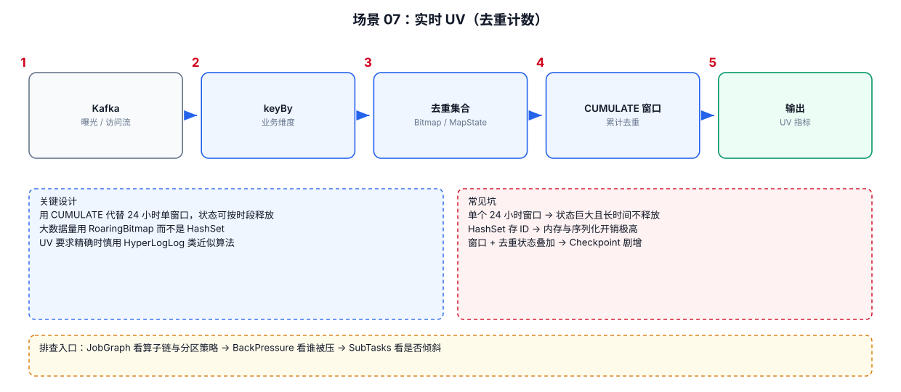

# 06-07｜实时 UV

> 场景：统计某个时间范围内去重用户数，例如每分钟、每小时、每天 UV。

---



## 1. UV 的本质

UV：

```text
Distinct(user_id)
```

如果直接：

```sql
COUNT(DISTINCT user_id)
```

需要关注：

```text
时间范围
Key 基数
状态大小
精确还是近似
```

---

## 2. 窗口 UV

例如每小时 UV：

```sql
SELECT
    window_start,
    window_end,
    COUNT(DISTINCT user_id) AS uv
FROM TABLE(
    TUMBLE(
        TABLE events,
        DESCRIPTOR(event_time),
        INTERVAL '1' HOUR
    )
)
GROUP BY
    window_start,
    window_end;
```

窗口可以限制状态生命周期。

---

## 3. 为什么 `COUNT(DISTINCT)` 可能很重

假设：

```text
一个小时 1 亿条事件
1000 万不同 user
```

精确去重意味着维护大量用户身份信息。

因此要考虑：

```text
精确 UV
```

还是：

```text
近似 UV
```

---

## 4. 精确 UV

适合：

```text
财务/结算类指标
数据量可控
必须严格准确
```

核心代价：

```text
保存大量 distinct key
```

---

## 5. 近似 UV

适合：

```text
大规模看板
趋势分析
允许少量误差
```

常见思路是基于基数估计的数据结构，例如 HyperLogLog 类算法。

优点：

```text
State 小
速度快
```

代价：

```text
存在估算误差
```

具体函数和 Connector 支持情况以当前 Flink SQL/函数版本为准。

---

## 6. UV 计算时不要忽略窗口边界

例如每天 UV：

```text
2026-10-01 00:00:00
≤ event_time <
2026-10-02 00:00:00
```

如果直接用 Processing Time 统计，业务结果可能与用户实际行为日期不同。

所以先确认：

```text
业务口径使用 Event Time 还是 Processing Time？
```

---

## 7. UV 排查

```text
UV 突然下降
→ Source 数据量是否下降
→ user_id 是否大量为空
→ 时间字段是否异常
→ Watermark 是否停止推进
→ 去重逻辑是否改变

UV 突然升高
→ 重复数据是否大量进入
→ user_id 生成逻辑是否变化
→ 数据分区/时间解析是否异常
```
