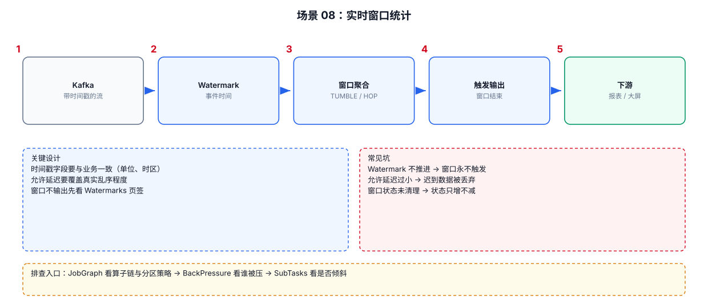

# 06-08｜实时窗口统计

> 场景：把 Event Time、Watermark、Window、Late Data 串成一个完整的生产统计模板。

---



## 1. 完整处理链路

带时间戳的流 → 分配 Watermark → 事件时间窗口聚合 → 窗口触发输出 → 写下游。
链路图见本文顶部；其中「Watermark 是否推进」是这条链路能不能出结果的关键前提。


---

## 2. Java DataStream 模板

```java
DataStream<Event> events = ...;

// Step 1：告诉 Flink 如何从业务字段提取事件时间。
WatermarkStrategy<Event> watermarkStrategy =
        WatermarkStrategy
                // 允许事件最多乱序 5 秒。
                .<Event>forBoundedOutOfOrderness(
                        Duration.ofSeconds(5)
                )

                // 从事件对象中提取 event_time。
                .withTimestampAssigner(
                        (event, recordTimestamp) ->
                                event.getEventTime()
                );

// Step 2：把时间语义赋给 DataStream。
DataStream<Event> timed =
        events.assignTimestampsAndWatermarks(
                watermarkStrategy
        );

// Step 3：按照业务 Key 分组。
DataStream<Event> keyed = timed
        .keyBy(Event::getUserId);

// Step 4：做事件时间窗口统计。
DataStream<Result> result = keyed
        .window(
                TumblingEventTimeWindows.of(
                        Time.minutes(5)
                )
        )
        .aggregate(new EventAggregateFunction());
```

> Window API 的具体类和推荐写法会随着 Flink 版本演进；新代码应同时参考当前版本 Window API 文档。这里重点记忆的是处理顺序：**timestamp → watermark → keyBy → window → aggregate**。

---

## 3. Watermark 不是“延迟 5 秒后处理”

```java
.forBoundedOutOfOrderness(Duration.ofSeconds(5))
```

更准确的理解：

```text
Flink 假设事件最多乱序 5 秒
    ↓
Watermark 大致反映系统认为不再等待更早事件的时间边界
```

不是：

```text
每条消息固定 sleep(5s)
```

---

## 4. 生产环境必须考虑空闲分区

如果 Kafka 有多个 Partition：

```text
Partition 0：持续有数据
Partition 1：持续有数据
Partition 2：长时间没数据
```

某些 Watermark 推进场景下，空闲 Partition 可能拖住整体 Watermark。

可以配置 Idle Timeout，让 Flink 把长时间无数据的输入分区视为暂时空闲。

示意：

```java
watermarkStrategy
        .withIdleness(Duration.ofSeconds(30));
```

---

## 5. 窗口没有结果怎么办

排查顺序：

```text
1. Source 是否有数据
2. event_time 是否正确
3. Watermark 是否推进
4. 是否存在一个 Partition 长时间没有推进
5. 窗口是否真的已经结束
6. 数据是否被过滤
7. 是否被 KeyBy 分到预期 Key
```

尤其是：

```text
数据明明进来了
但窗口一直不输出
```

优先检查 Watermark。

---

## 6. 配套 Web UI 证据


窗口不触发时，先看 Watermarks 页签

