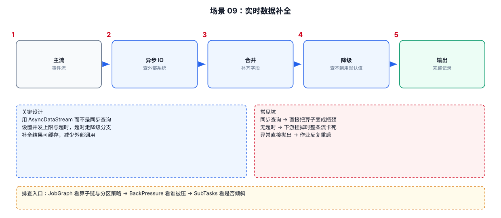

# 06-09｜实时数据补全

> 场景：原始事件字段不完整，需要从地域表、商品表、用户表、设备表等维度补齐字段。

---



## 1. 数据补全的三种常见方式

```text
小维表
→ Broadcast State

外部在线 KV / HBase / Redis
→ Async I/O

MySQL/JDBC 当前维度
→ Lookup Join
```

---

## 2. 补全流程模板

```text
Raw Event
   ↓
Parse
   ↓
Extract Dimension Key
   ↓
Dimension Lookup
   ↓
Merge
   ↓
Default Value
   ↓
Output
```

---

## 3. 补全失败怎么处理

不要简单写：

```java
if (dimension == null) {
    throw new RuntimeException();
}
```

生产业务通常需要区分：

```text
维度不存在
    → 默认值 / Missing Topic

查询超时
    → Retry / Fallback

连接异常
    → Retry / Fail Job

数据本身非法
    → Dead Letter
```

---

## 4. 默认值要明确

例如地域补全：

```java
String province = dimension == null
        ? "UNKNOWN"
        : dimension.getProvince();
```

不要默默把所有失败都变成：

```text
null
```

否则下游很难区分：

```text
真的没有地域
```

还是：

```text
Flink 查询失败
```

---

## 5. 查询结果缓存

高频维度 Key：

```text
item_id=10001
```

可能在短时间内重复出现几十万次。

可以考虑：

```text
Local Cache
    ↓ hit
Dimension

miss
    ↓
External Store
```

需要定义：

```text
TTL
Maximum Size
Eviction
Negative Cache
Cache Refresh
```

---

## 6. Negative Cache

如果一个 Key 确定不存在：

```text
item_id=999999999
```

每次都查数据库没有意义。

可以短时间缓存：

```text
999999999 → NOT_FOUND
```

这样可以避免恶意/异常 Key 持续打爆外部系统。

但 Negative Cache TTL 不宜过长，否则真实新增数据可能长时间不可见。

---

## 7. 补全链路出现延迟时

不要只看 Flink：

```text
Flink Operator
    ↓
Async Wait Queue
    ↓
External System
    ↓
Network
```

建议同时观察：

```text
请求 QPS
平均 RT
P95/P99
Timeout
Error Rate
Cache Hit Rate
In-flight Request 数
```

---

## 8. 数据补全的最终一致性问题

假设：

```text
10:00 商品 category=A
10:01 修改为 B
```

而：

```text
事件 10:00:30
维表查询 10:02
```

如果使用当前维表查询，可能补到：

```text
B
```

而业务可能希望：

```text
A
```

因此首先确认：

```text
补当前状态
```

还是：

```text
补事件发生时的历史状态
```

这决定 Lookup Join 和 Temporal Join 的选择。
