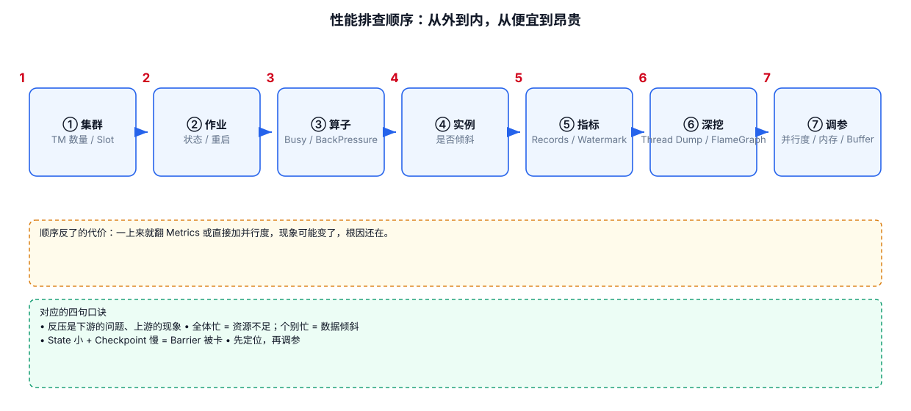
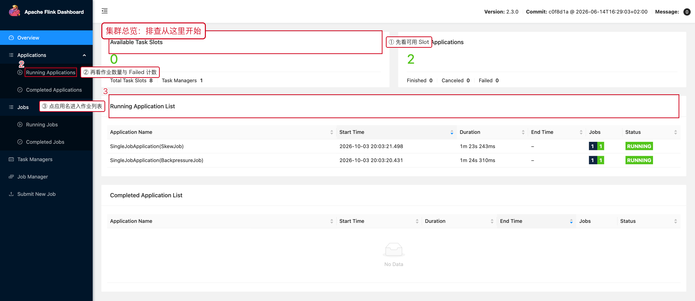

# 01 性能指标与排查顺序

> 目标：任务变慢时，用 Flink Web UI 从「集群 → 作业 → 算子 → 并行实例」逐层收敛，
> 先定位再改参数。
>
> 本文（以及 07、08 两个专题）所有截图都来自本机真实运行的 Flink 2.3.0 集群，
> 不是官方文档配图，也不是示意图。复现工程见
> [assets/ui/repro](../assets/ui/repro/README.md)。

---



## 1. 一句话结论

```text
性能问题不是"调参问题"，而是"定位问题"。
定位顺序：集群资源 → 作业状态 → 算子（JobGraph）→ 并行实例（Subtask）→ 指标/日志。
```

顺序颠倒的代价：一上来就打开 Metrics 翻几百个指标，或者直接加并行度、加内存，
现象可能暂时变化，但根因还在。

---

## 2. 第一步：集群有没有资源

先打开 `http://<jobmanager>:8081/#/overview`。



图里三个红框就是首轮要看的三处：

1. **Available Task Slots**：还剩几个可用的 Slot。这里是 4，说明集群还有余量。
2. **Running Applications**：有几个作业在跑、有没有 Failed 计数。
3. **Running Application List 里的 Application Name / Status**：点进去才到 Job 页面。

**怎么判断**

| 现象 | 含义 | 下一步 |
|---|---|---|
| Available Slots 长期为 0 | 资源被占满，新作业只能排队 | 看 TaskManager 数量、其它作业占用 |
| Task Managers = 0 | 集群没有可调度资源 | 先恢复 TaskManager，别改业务代码 |
| Failed 计数在涨 | 有作业在反复失败 | 直接进该作业的 Exceptions |

---

## 3. 第二步：JobGraph 上先找"可疑算子"

点作业名进入 Job 页面，默认就是 Overview。下半部分是 JobGraph，
**每个算子节点上直接写了三个关键指标**。


这张图是一个真实的"慢 Sink / 慢算子"现场，三处红框对应三件事：

1. **最上游 `Source: fast-source`：`Backpressured (max) = 100%`**。
   上游自己被压住了，但上游自己通常没问题。
2. **中间 `parse-and-add-key`：同样是 `Backpressured (max) = 100%`、`Busy (max) = 0%`**。
   Busy 为 0 说明它几乎没在算，只是在等下游——**反压确认无疑**。
3. **最下游 `slow-keyed-agg`：`Backpressured (max) = 0%`、`Busy (max) = 100%`**。
   它不被别人压，自己忙满，**它就是瓶颈**。

> **记住这句话：反压是"下游的问题、上游的现象"。**
> 谁 `Busy` 高就是谁慢；谁 `Backpressured` 高就是谁在等。

---

## 4. 三个核心指标（每个 Subtask 都有）

进入任一算子的抽屉页签，都能看到这三个指标：

| 指标 | 含义 | 高意味着 | 低意味着 |
|---|---|---|---|
| `busyTimeMsPerSecond` | 每秒真正在处理的时间 | 算子自己算得慢（CPU / 序列化 / 状态 / 同步 IO） | 算子没活干 |
| `backPressuredTimeMsPerSecond` | 每秒被下游顶住的时间 | 下游消费不过来 | 下游跟得上 |
| `idleTimeMsPerSecond` | 每秒空闲时间 | 上游没数据、Key 分布不均 | 输入充足 |

三者近似满足：

```text
busy + backpressured + idle ≈ 1000 ms/s
```

**三种典型组合，直接照抄结论：**

```text
Busy 高 + BackPressure 低 + Idle 低
    → 算子自身是瓶颈：查 CPU、GC、序列化、复杂 UDF、同步外部调用

BackPressure 高
    → 沿数据流往下游找：谁 Busy 高谁就是瓶颈

Idle 高（只有一部分 Subtask）
    → 数据分布不均：查热点 Key、Kafka 分区分配
```

---

## 5. 第三步：落到并行实例（Subtask）

同一个算子有 4 个并行实例时，**必须看是"全部都慢"还是"只有一个慢"**，
因为这两种情况的处理方式完全相反：

```text
所有 Subtask 都忙        → 并行度 / 资源不足，考虑扩容
只有少数 Subtask 极忙    → 数据倾斜，扩容没用，要拆热点 Key
```

具体怎么在这个页面上分辨，见 [02 并行度与数据倾斜](./02-并行度与数据倾斜.md)。

---

## 6. 完整排查顺序（可打印版）

```text
① 集群：TaskManager 数量 / 总 Slot / 可用 Slot
② 作业：Job State 是否 RUNNING，有没有反复 Restart
③ 算子：JobGraph 上谁的 Backpressured 高、谁的 Busy 高
④ 实例：是全部 Subtask 慢，还是个别慢
⑤ 指标：Busy / BackPressure / Idle、Records In/Out、Watermark
⑥ 深挖：Checkpoint、State、Thread Dump、FlameGraph、外部系统
⑦ 最后才是：并行度、内存、网络 Buffer、Checkpoint 参数
```

---

## 7. 不要一上来就做的事

```text
看到延迟高      → 直接调大并行度
看到反压        → 直接开 Unaligned Checkpoint
看到 Checkpoint 慢 → 直接调大 timeout
看到 OOM        → 直接加内存
```

这四件事都可能在"现象层面"生效，但都不回答"为什么慢"。
先按第 6 节的顺序走一遍，再决定改什么。

---

## 8. 本章截图对应的现场

| 截图 | 现场 | 复现类 |
|---|---|---|
| [07-01-cluster-overview.png](../assets/ui/07-01-cluster-overview.png) | 1 个 TaskManager / 8 Slot / 1 个作业在跑 | 任意作业 |
| [07-01-jobgraph.png](../assets/ui/07-01-jobgraph.png) | 上游 100% 反压、下游 100% Busy | `BackpressureJob` |

---

## 9. 算子抽屉的 8 个页签都看什么

在 JobGraph 上点任意算子，右侧抽屉有 8 个页签。除了最常用的
`BackPressure / SubTasks / Metrics`，另外几个在特定场景下同样关键：


| 页签 | 什么时候用 |
|---|---|
| `Detail` | 快速看这个算子的状态、并行度、Records、Bytes 汇总 |
| `SubTasks` | 判断倾斜、看每个实例的忙碌度 |
| `TaskManagers` | 判断问题是不是集中在某一台机器上 |
| `Watermarks` | 事件时间作业排查窗口不触发 |
| `Accumulators` | 看自定义计数器（例如"过滤掉多少条脏数据"） |
| `BackPressure` | 反压状态与逐实例明细 |
| `Metrics` | 自选指标画曲线 |
| `FlameGraph` | CPU 花在哪个调用栈（需开启 `rest.flamegraph.enabled`） |

实例分布用 `TaskManagers` 页签：


自定义计数器在 `Accumulators`：


