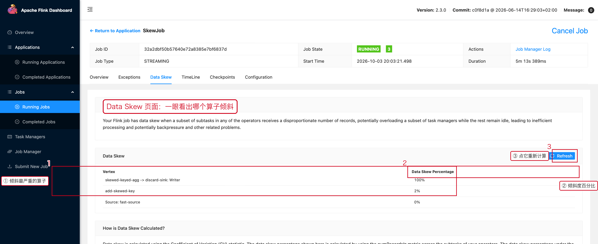
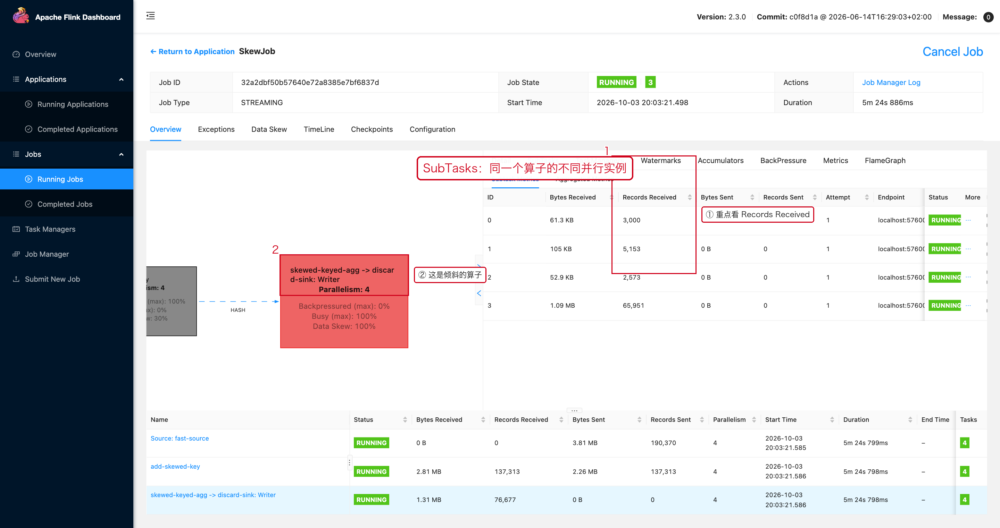

# 02 并行度与数据倾斜

> 目标：遇到"任务慢"时，先分清是**并行度不够**还是**数据倾斜**。
> 这两种情况的处理方式完全相反，判错的代价是白扩容、白花钱。

---

## 1. 先用一张表分清两种情况

| 现象 | 并行度不足 | 数据倾斜 |
|---|---|---|
| Subtask 忙碌程度 | 所有 Subtask 都忙 | 少数 Subtask 忙，其余空闲 |
| Records In 分布 | 各 Subtask 接近 | 个别 Subtask 高出 10 倍以上 |
| 加并行度有用吗 | 有用 | 通常没用，热点还是落在一个实例 |
| 治理手段 | 提高并行度 / 加资源 | 拆热点 Key / 打散 salt / 二次聚合 |

---

## 2. Flink 2.x 自带的 Data Skew 页面

不需要自己算，Flink 2.x 的 Job 页面里有一个专门的 **Data Skew** 页签。

**操作路径**

```text
Job 页面顶部页签：Overview / Exceptions /【Data Skew】/ TimeLine / Checkpoints / Configuration
```



这张图来自 `SkewJob`：90% 的记录都使用同一个 Key `hot`。

1. **`skewed-keyed-agg -> discard-sink: Writer` 的 Data Skew = 74%**，是全场最高。
2. **`Data Skew Percentage` 列**就是各算子的倾斜程度，从高到低扫一眼即可。
3. **Refresh**：这个页面是按下按钮后现算的，刚提交作业时点一下刷新。

页面底部的说明写得很清楚：倾斜度是用 **变异系数（CV）** 基于
`numRecordsIn` 统计出来的；而 Overview 页签上显示的实时倾斜度用的是
`numRecordsInPerSecond`，**两者数值不一致是正常的**（实时值抖动更大）。

---

## 3. 用 SubTasks 页面看"到底差多少"

Data Skew 页面告诉你"哪个算子倾斜"，SubTasks 页面告诉你"差多少、谁最忙"。

**操作路径**

```text
Job 页面 → 点 JobGraph 上的算子节点 → 右侧抽屉 →【SubTasks】页签
```



同一个算子 4 个并行实例的真实数据：

| SubTask | Records Received | 占比 |
|---|---:|---:|
| 0 | 2,046 | 8% |
| 1 | 3,512 | 14% |
| 2 | 1,753 | 7% |
| 3 | **18,112** | **71%** |
| 合计 | 25,423 | 100% |

**判断标准**

```text
最大 / 最小 ≈ 1 ～ 2 倍      → 正常波动
最大 / 最小 ≈ 10 倍以上      → 数据倾斜，必须先治理再考虑扩容
```

上表 18112 / 1753 ≈ 10.3 倍，属于典型倾斜。

---

## 4. 倾斜会让"背压"看起来很奇怪

倾斜的算子在 BackPressure 页面上的表现是：**整体状态显示 OK，但个别 Subtask 忙满**。


- 3 号 Subtask：`Busy 100%`、`Idle 0%` —— 干活的只有它。
- 0/1/2 号 Subtask：`Busy 2%~4%`、`Idle 96%~98%` —— 基本在等数据。
- 顶部状态仍然是 `OK`，因为 Back Pressure Status 看的是"被下游顶住的比例"，
  而不是"忙不忙"。

> **只看顶部那个 `OK` 会漏掉倾斜。必须往下看每一行 Subtask。**

---

## 5. 倾斜的三个常见来源

### 5.1 热点 Key

```java
// 某个用户 / 某个商品的事件量远大于其它 Key，
// 该 Key 的所有数据都会落到同一个 Subtask。
stream.keyBy(Order::getUserId);
```

### 5.2 NULL / 默认值 Key

```java
// 大量 null 会被归一成同一个字符串，全进同一个 Key。
.keyBy(x -> x.getCategory() == null ? "UNKNOWN" : x.getCategory())
```

### 5.3 常量 Key

```java
// 最极端的倾斜：并行度设成 100 也只有 1 个实例在干活。
.keyBy(x -> "constant")
```

---

## 6. 治理：热点 Key 打散 + 二次聚合

核心思路是把一个热点 Key 人为拆成 N 个：

```text
原始：user_id = 10001        → 全部进同一个 Subtask
打散：10001_0 / 10001_1 / ... → 分散到 N 个 Subtask
收口：再按 user_id 做一次聚合，把中间结果合并
```

```java
DataStream<Event> salted = input
        .keyBy(event -> {
            // 只对确认存在热点的 Key 拆分，salt 越多越分散，
            // 但后续二次聚合的代价也越高。
            int salt = Math.floorMod(event.getUserId().hashCode(), 8);
            return event.getUserId() + "_" + salt;
        })
        .process(new SaltedProcessFunction());

// 二次聚合：把 10001_0 ... 10001_7 的结果合并回 10001
salted.keyBy(Event::realUserId)
      .process(new MergeProcessFunction());
```

**注意**：打散会改变业务语义，只有在"聚合可结合"（求和、计数、去重集合可合并）
时才能用；`COUNT(DISTINCT)` 这类要按需改造。

---

## 7. 并行度怎么设才合理

```text
Source 并行度  ≈ Kafka Partition 数（再多也消费不到更多分区）
中间算子       → 按 CPU / Key 分布定，热点算子单独调
Sink 并行度    → 按外部系统能承受的并发定
```

**不是所有算子都要同一个并行度**：

```java
env.setParallelism(4);                       // 作业默认
stream.filter(...).setParallelism(2);        // 个别算子单独设置
stream.keyBy(...).process(...).setParallelism(8);
```

而且并行度不是越大越好：并行度提高会带来更多网络连接、更多小的 Checkpoint 文件、
更多调度开销。**先把倾斜解决掉，再谈扩容。**

---

## 8. 排查结论速查

```text
并行度不足    → 所有 Subtask 都忙        → 加并行度 / 加 Slot
数据倾斜      → 少数 Subtask 极忙        → 拆热点 Key + 二次聚合
Source 分区少 → Source 无法继续扩展吞吐  → 增加 Kafka Partition
Sink 瓶颈     → 反压从 Sink 向上游传播   → 扩 Sink / 批量写 / 异步
```

---

## 9. 本章截图对应的现场

| 截图 | 现场 | 复现类 |
|---|---|---|
| [07-02-dataskew.png](../assets/ui/07-02-dataskew.png) | 倾斜算子 Data Skew = 74% | `SkewJob` |
| [07-02-subtasks.png](../assets/ui/07-02-subtasks.png) | 单实例 18112 条 vs 1753 条 | `SkewJob` |
| [07-03-backpressure-skew.png](../assets/ui/07-03-backpressure-skew.png) | 状态 OK 但单实例 Busy 100% | `SkewJob` |
