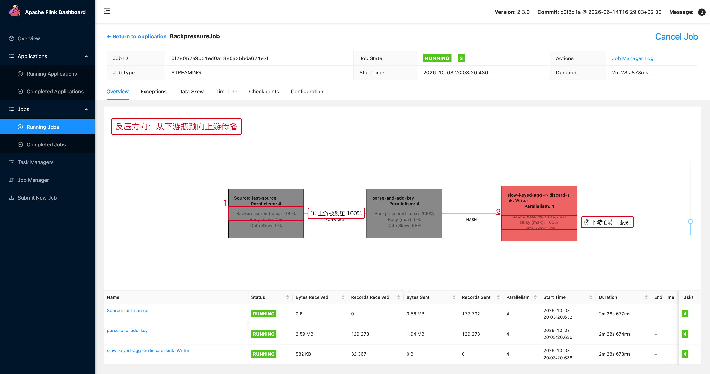
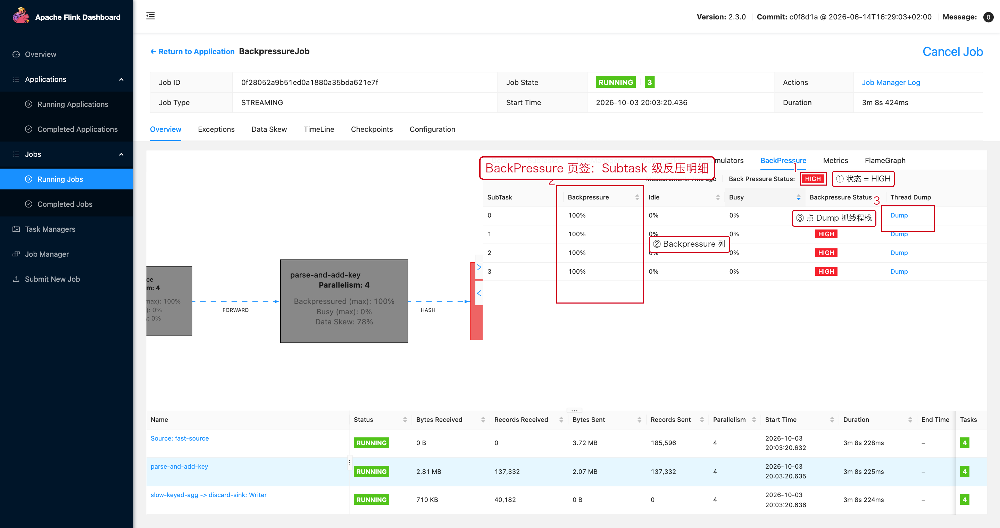
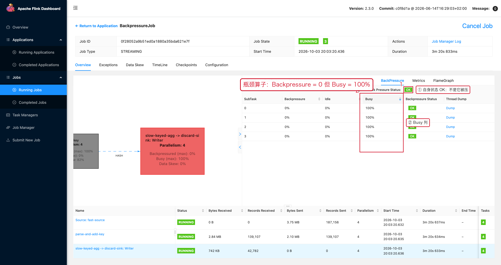
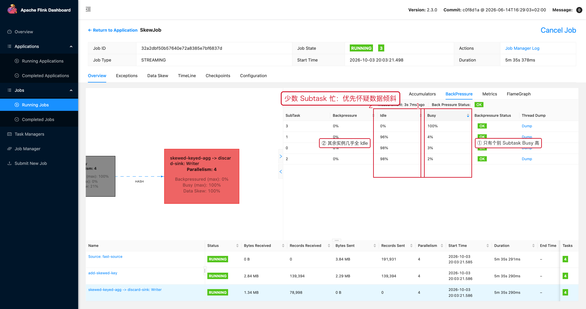

# 03 反压

> 目标：在 Flink Web UI 上真正看懂反压——**点哪里、看哪个数字、什么算高、高了之后查谁**。
> 本文所有截图都来自本机真实运行的 Flink 2.3.0 集群（复现类：`BackpressureJob` / `SkewJob`）。

---

## 1. 一句话结论

```text
反压 = 下游处理不过来，压力沿数据流反方向向上游传播。
所以：谁 Busy 高谁就是瓶颈，谁 Backpressured 高谁只是在等。
```

```text
正常：      Source → Map → Aggregate → Sink
反压传播：  Source ← Map ← Aggregate ← Sink
```

---

## 2. 操作路径：从 Job 页面走到反压明细

这是本文最该记住的一段，一共 4 步：

```text
① Job 页面（Overview）→ 在 JobGraph 上找 Backpressured 高的算子
② 点击这个算子节点 → 右侧弹出算子抽屉
③ 在抽屉顶部页签里点【BackPressure】
④ 等几秒采样完成 → 看顶部状态 + 逐行 Subtask 明细
```

### 第 1 步：在 JobGraph 上定位



每个算子节点上直接写了三行：

```text
Backpressured (max): 100%     ← 它被别人顶住的时间占比（取最严重的实例）
Busy (max): 0%                ← 它自己真正干活的时间占比
Data Skew: 0%                 ← 它的并行实例之间是否均衡
```

图中：

- 红框 ① 上游 `Source: fast-source`：`Backpressured = 100%`
- 红框 ② 下游 `slow-keyed-agg`：`Backpressured = 0%`、`Busy = 100%`

**箭头方向就是反压的反方向**：压力从右下往左上顶。

另外，JobGraph 上的节点是**按颜色**区分状态的（官方文档原文）：

```text
蓝色  = 完全空闲（Idle）
黑色  = 完全被反压（Backpressured）
红色  = 完全忙碌（Busy）
三者之间的状态用过渡色表示
```

所以不看数字也能一眼看出：

```text
上游一片黑 + 下游一个红点  →  反压现场，红点就是瓶颈
```

### 第 2~4 步：算子抽屉 → BackPressure 页签

点算子节点后，右侧抽屉顶部有 8 个页签：

```text
Detail / SubTasks / TaskManagers / Watermarks / Accumulators /【BackPressure】/ Metrics / FlameGraph
```


---

## 3. 反压到底长什么样：三张真实截图

### 3.1 所有 Subtask 都被压满（`HIGH`）



这张图对应上游算子 `parse-and-add-key`：

| SubTask | Backpressure | Idle | Busy | Backpressure Status |
|---|---:|---:|---:|---|
| 0 | 100% | 0% | 0% | **HIGH** |
| 1 | 100% | 0% | 0% | **HIGH** |
| 2 | 100% | 0% | 0% | **HIGH** |
| 3 | 100% | 0% | 0% | **HIGH** |

怎么读这四列：

1. **`Backpressure`**：这个实例有多少时间是被下游顶住、写不出去的。
2. **`Idle`**：有多少时间没数据可读。
3. **`Busy`**：有多少时间真的在处理。
4. **`Backpressure Status`**：把 Backpressure 比例翻译成 `OK / LOW / HIGH`。
   官方阈值：

```text
OK    0%  ～ 10%
LOW   >10% ～ 50%
HIGH  >50% ～ 100%
```

5. 最右边还有 **Dump**：点它可以直接抓这个 Subtask 的线程栈，
   看它到底卡在哪一行代码。

> **注意**：进入这个页签后 Flink 需要几秒钟采样（页面上会显示
> `Measurement: 6s ago`），刚点开的瞬间数字可能还没出来，刷新一下即可。

### 3.2 瓶颈算子的样子：Backpressure = 0，Busy = 100%



这是下游 `slow-keyed-agg`（每条记录 `Thread.sleep(15ms)`）：

- `Backpressure 0%`：它自己不被别人压。
- `Busy 100%`：四个实例都在满负荷算。
- 顶部状态是 `OK`。

**这张图非常关键，因为它说明"状态 OK ≠ 没问题"**：

```text
上游 HIGH + 下游 OK 且 Busy 高   → 下游就是瓶颈，去查下游为什么慢
```

### 3.3 只有少数 Subtask 忙：先怀疑数据倾斜



`Busy` 一列：3 号 100%，其余 2%~4%；`Idle` 一列：3 号 0%，其余 96%~98%。

这时的结论不是"下游慢"，而是"**数据都跑到一个实例上了**"，
应该去看 [02 数据倾斜](./02-并行度与数据倾斜.md)，而不是加并行度。

---

## 4. 指标高低 → 含义 → 动作

| 观察 | 含义 | 下一步动作 |
|---|---|---|
| 上游 `Backpressured` 高 + 下游 `Busy` 高 | 下游是瓶颈 | 进下游算子的 Thread Dump / FlameGraph / Metrics |
| 所有 Subtask 都 `HIGH` | 全下游处理能力不足 | 查 Sink / 外部系统 / CPU / GC |
| 少数 Subtask `HIGH`，其余 `Idle` 高 | 数据倾斜 | 拆热点 Key，不要先加并行度 |
| `Busy` 低、`Idle` 低、`Backpressured` 高 | 算子本身几乎不干活，纯等待 | 几乎可以确定是下游问题 |
| 全部 `Idle` 高 | 上游没数据 | 查 Source / Kafka 分区 / Watermark |

---

## 5. 反压该往下游查什么

### 5.1 常见的外部系统瓶颈

```java
// 一条记录一次 JDBC 写入：把 Sink 线程变成瓶颈的最快方式。
jdbc.executeUpdate(sql);

// 主处理线程里同步等网络返回：
// 单次请求延迟直接限制整个 Subtask 的吞吐。
Result result = hbaseTable.get(get);
```

生产上的常见改法：

```text
批量写入（batch size / batch interval）
异步 IO（AsyncDataStream）
本地缓存 + 连接池
合理设置超时与最大并发
```

### 5.2 具体到这个演示现场

`slow-keyed-agg` 每条记录 `Thread.sleep(15ms)`，4 个并行实例的理论上限是
`4 / 0.015 ≈ 267 条/秒`；而 Source 是全速产生数据，于是：

```text
Source 产生 > 消费能力 → 缓冲区写满 → 上游全部 100% Backpressured
```

现实里把 `Thread.sleep` 换成"慢 UDF""慢序列化""同步查库"是完全一样的道理。

---

## 6. 反压时不要直接做的事

### 6.1 不要先调大 Network Buffer

Buffer 只能改善"网络抖动"这一类问题，**不能提高下游的处理能力**。
下游算不过来，再大的 Buffer 也只是把积压推迟一点。

### 6.2 不要把 Unaligned Checkpoint 当成反压药

Unaligned Checkpoint 让 Barrier 可以在积压数据里"超车"，
它能缓解**强反压下的 Checkpoint 变慢**，但**不会让慢 Sink 变快**。

先解决"谁慢"，再去解决"Checkpoint 因为反压而变慢"。

### 6.3 不要在没看 Subtask 明细前就加并行度

如果明细里是"1 个忙、3 个闲"，加并行度只会让更多实例一起闲。

---

## 7. 推荐排查顺序

```text
① JobGraph：找 Backpressured 高的算子（状态一眼可见）
② BackPressure 页签：确认 HIGH，并看是全部还是个别
③ 全部 HIGH  → 沿数据流往下游走，找 Busy 高的算子
   个别 HIGH  → 数据倾斜，转 02
④ 在下游算子上看 Metrics（Records In/Out、Latency）
⑤ 抓 Thread Dump / 看 FlameGraph，定位到具体代码行
⑥ 看外部系统（DB / MQ / ES）的自身指标
⑦ 最后才考虑内存、网络 Buffer、并行度、Checkpoint 参数
```

---

## 8. 本章截图对应的现场

| 截图 | 现场 | 复现类 |
|---|---|---|
| [07-03-jobgraph.png](../assets/ui/07-03-jobgraph.png) | 上游 100% 反压 + 下游 100% Busy | `BackpressureJob` |
| [07-03-backpressure-high.png](../assets/ui/07-03-backpressure-high.png) | 4/4 Subtask 全部 HIGH | `BackpressureJob` |
| [07-03-backpressure-bottleneck.png](../assets/ui/07-03-backpressure-bottleneck.png) | 瓶颈算子 OK + Busy 100% | `BackpressureJob` |
| [07-03-backpressure-skew.png](../assets/ui/07-03-backpressure-skew.png) | 单个 Subtask 忙、整体 OK | `SkewJob` |
| [08-08-step4-operator.png](../assets/ui/08-08-step4-operator.png) | 算子抽屉的 8 个页签 | 任意作业 |
