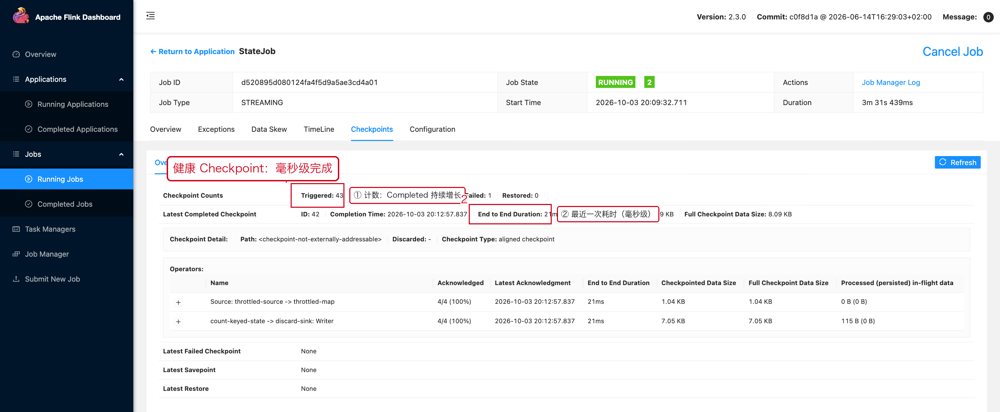
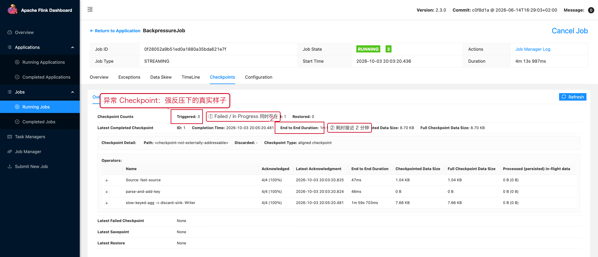
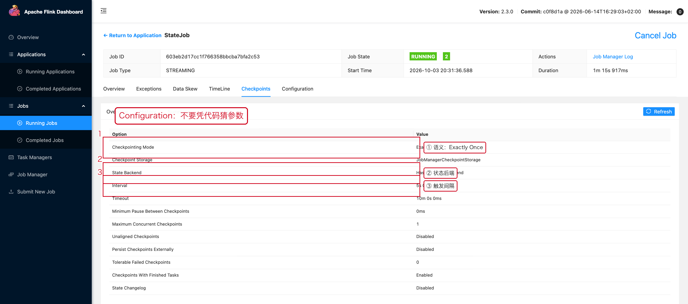

# 04 Checkpoint 性能

> 目标：用 Checkpoints 页面的 **Overview / History / Summary / Configuration** 四个页签，
> 判断 Checkpoint 是"正常""变慢"还是"失败"，并且知道慢在哪一段。

---

## 1. 一句话结论

```text
Checkpoint 慢，只有三种可能：
① Barrier 到不了（反压 / 网络）
② State 快照慢（State 太大 / 本地 IO / CPU）
③ 持久化慢（远端存储 / 文件数太多）
先看计数和 Duration，再看 Size，最后看配置。
```

---

## 2. 操作路径

```text
Job 页面 → 顶部页签【Checkpoints】
   ├── Overview      ← 计数 + 最近一次 + 各 Operator 明细
   ├── History       ← 每一次 Checkpoint 的完整表格
   ├── Summary       ← 最近若干次的 Min / Avg / Max + 分位数
   └── Configuration ← 当前实际生效的 Checkpoint 参数
```

---

## 3. 健康的 Checkpoint 长什么样

先建立一个"正常基线"，后面判断快慢才有参照物。

### 3.1 Overview：毫秒级完成



红框三处分别对应：

1. **计数行** `Triggered: 19 / In Progress: 0 / Completed: 18 / Failed: 1`。
   - `Completed` 持续增长、`In Progress` 通常为 0 → 正常。
   - 那 1 个 `Failed` 是作业刚启动时的一次失败（启动瞬间任务还没全部 RUNNING），
     属于常见噪声，**不要只看 Failed 计数就下结论**。
2. **`End to End Duration: 17ms`**：这是最近一次成功 Checkpoint 的整体耗时。
3. **`Checkpointed Data Size: 8.09 KB`**：State 快照大小，几千字节量级。

### 3.2 Summary：判断"是否稳定退化"

这一页是排查"性能慢慢变差"的核心工具。


它把最近若干次 Checkpoint 的 `End to End Duration` 和
`Checkpointed Data Size` 汇总成：

```text
Minimum / Average / Maximum
50% / 90% / 99% / 99.9% 分位数
```

**怎么用它判断"稳定退化"：**

| Min / Avg / Max 的关系 | 结论 | 动作 |
|---|---|---|
| 三者接近（如 12ms / 25ms / 40ms） | 稳定，偶尔抖动正常 | 记录基线，继续观察 |
| Max 远大于 Avg，但 Avg 稳定 | 偶发长尾（外部存储抖动、GC） | 查 GC 日志、远端存储 |
| Avg 逐天/逐周抬升，Max 同步抬升 | **稳定退化** | 查 State 是否持续增长、Key 是否只增不减 |
| Avg 稳定但 Size 持续增长 | State 泄漏风险 | 查 TTL、查 Window/Timer 是否长期堆积 |

> **记住一句话：只盯单次 Duration 没意义，要看 Min/Avg/Max 的"走势"。**

---

## 4. 异常 Checkpoint 长什么样

下面这组截图来自 `BackpressureJob`：上游 100% 反压，慢算子每条 sleep 15ms。

### 4.1 Overview：Duration 从毫秒级跳到 51 秒



```text
Triggered: 3   In Progress: 1   Completed: 1   Failed: 1
Latest Completed Checkpoint
  End to End Duration: 51s 112ms
  Checkpointed Data Size: 8.70 KB
  Full Checkpoint Data Size: 8.70 KB
```

**关键反差**：State 只有 8.70 KB（几乎没有数据），Duration 却要 51 秒。

```text
State 很小 + Duration 很大  →  几乎一定不是"快照慢"，
                               而是 Barrier 在数据流里排队（反压导致）。
```

这就是"**State 大小和 Duration 不成比例**"这个判断口诀的用法。

### 4.2 History：找出是哪一次不健康


| ID | Status | Acknowledged | End to End Duration | Checkpointed Data Size |
|---:|---|---|---:|---:|
| 2 | IN_PROGRESS | **8/12 (67%)** | 4m 36s（还在跑） | 1.04 KB |
| 1 | COMPLETED | 12/12 | **51s 112ms** | 8.70 KB |

读法：

1. **`Acknowledged` 迟迟到不了满**（8/12）：说明有 4 个 Subtask 还没把 Barrier 处理完。
2. **`Duration` 与 `Acknowledged` 要一起看**：
   Duration 大 + Acknowledged 不满 = Barrier 被卡住；
   Duration 大 + Acknowledged 满 = 快照或持久化慢。
3. **`Processed (persisted) in-flight data` 出现 `65.5 KB`**：
   说明对齐期间有数据被溢写处理过，这是强反压的典型痕迹。

### 4.3 判别流程图

```text
Checkpoint 慢
├── Acknowledged 一直不满
│   └── Barrier 到不了 → 看 BackPressure / 网络 / 慢算子
├── Acknowledged 满了但 Duration 大
│   ├── Checkpointed Data Size 很大 → State 快照慢 → 看 07-05
│   └── Size 不大 → 持久化慢 → 看远端存储 / 文件数 / 网络
└── 规律性超时 → 看 Configuration 里的 timeout / interval
```

---

## 5. Configuration：确认"实际生效"的参数

不要凭代码里写的值做判断，要看这里实际的运行时配置。



一个健康作业的真实配置：

```json
{
  "mode": "exactly_once",
  "interval": 5000,
  "timeout": 600000,
  "min_pause": 0,
  "max_concurrent": 1,
  "externalization": { "enabled": false, "delete_on_cancellation": true },
  "state_backend": "HashMapStateBackend",
  "checkpoint_storage": "JobManagerCheckpointStorage",
  "unaligned_checkpoints": false,
  "tolerable_failed_checkpoints": 0,
  "aligned_checkpoint_timeout": 0,
  "state_changelog_enabled": false
}
```

重点核对四项：

| 参数 | 含义 | 典型问题 |
|---|---|---|
| `interval` | 触发间隔 | 间隔 < Duration 会导致 Checkpoint 一个接一个 |
| `timeout` | 单次超时 | 反压场景下疯狂失败，往往就是这个值太小 |
| `max_concurrent` | 并发数 | 默认 1，调大能加速但更吃资源 |
| `state_backend` | 状态后端 | 大 State 用 HashMap 容易 OOM，RocksDB 更适合大状态 |

---

## 6. 常见调优动作（按优先级）

### 6.1 先解决反压

反压不解决，任何 Checkpoint 参数都是在和物理规律较劲。先按
[03 反压](./03-反压.md) 找到瓶颈。

### 6.2 用最小间隔避免"连环触发"

```java
CheckpointConfig config = env.getCheckpointConfig();

// 上一个 Checkpoint 完成后至少等待 10 秒再开始下一个（单位毫秒）。
config.setMinPauseBetweenCheckpoints(10_000L);
```

判断依据：

```text
interval = 60s，duration = 80s  →  必然连环触发，必须加 minPause 或调大 interval
```

### 6.3 大 State 用增量 Checkpoint

RocksDB 场景下增量 Checkpoint 只上传变化部分，能显著降低
`Checkpointed Data Size`。是否适用取决于状态后端与恢复要求。

### 6.4 强反压下的 Unaligned Checkpoint

当反压严重且 Checkpoint 已经无法在超时内完成时，
Unaligned Checkpoint 可以让 Barrier 越过积压数据：

```java
config.enableUnalignedCheckpoints();
```

但请注意顺序：**它是缓解手段，不是原因修复**。

---

## 7. 本章截图对应的现场

| 截图 | 现场 | 复现类 |
|---|---|---|
| [07-04-ckpt-ok-overview.png](../assets/ui/07-04-ckpt-ok-overview.png) | 19 次触发 / 18 次成功 / 17ms | `StateJob` |
| [07-04-ckpt-ok-summary.png](../assets/ui/07-04-ckpt-ok-summary.png) | Min 12ms / Avg 25ms | `StateJob` |
| [07-04-ckpt-slow-overview.png](../assets/ui/07-04-ckpt-slow-overview.png) | 8.7KB State 却要 51 秒 | `BackpressureJob` |
| [07-04-ckpt-slow-history.png](../assets/ui/07-04-ckpt-slow-history.png) | Acknowledged 8/12、Duration 51s | `BackpressureJob` |
| [07-04-ckpt-config.png](../assets/ui/07-04-ckpt-config.png) | 实际生效参数 | `StateJob` |
