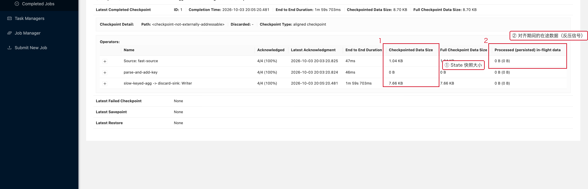

# 05 State 性能

> 目标：把"State 变大"这件事**从线上指标倒推回代码**——
> 哪一个算子、哪一个 Subtask、是哪一类 Key 在无限增长。

---

## 1. 一句话结论

```text
State 的问题只有三个来源：
① 太大（无限增长、没有上限）
② 访问太频繁（每次都要读写大对象）
③ 生命周期没设计（该过期的没过期、该合并的没合并）
```

---

## 2. 从哪里看 State 到底有多大

Flink Web UI 上 State 的大小藏在 **Checkpoints 页面**里——因为 State 只在
快照那一刻才有"体积"这个概念。

**操作路径**

```text
Job 页面 →【Checkpoints】→ Overview 页签
   → 上半部分"Latest Completed Checkpoint"
   → 下半部分"Checkpoint Detail → Operators" 表格
```



这张表格把一次 Checkpoint 拆到 Operator 粒度：

1. **`Checkpointed Data Size`**：这个 Operator 这次快照写了多少字节。**这是定位 State 大户的第一列。**
2. **`Processed (persisted) in-flight data`**：Barrier 对齐期间被处理的在途数据。
   这个值很大说明**反压严重**，而不是 State 大。
3. **`Name`**：先找到体积最大的 Operator，再回到代码看它维护了什么状态。

> **关键习惯：永远不要把 `Checkpointed Data Size` 大和
> `Processed in-flight data` 大混为一谈，前者是 State，后者是反压。**

---

## 3. State 无限增长的两种经典写法

### 3.1 错误示例：把历史全存下来

```java
// 每个用户保存全部历史行为。
ListState<Event> history;

// 每来一条就追加，且没有任何上限、没有 TTL。
history.add(event);
```

只要用户数和每用户事件数都在涨，State 就一定涨；Checkpoint 变慢、
恢复变慢都是必然结果。

### 3.2 正确姿势：给状态一个"上限"

```text
只保留最近 N 条
或者
只保留最近 T 时间（配合 State TTL）
或者
只保留聚合结果（能用 Reduce / Aggregate 就不要存明细）
```

```java
// 只保留最近 100 条：超了就丢最早的一条。
history.add(event);
if (size > 100) {
    history.update(trimOldest(history.get()));
}
```

---

## 4. State 类型选择速查

| 需求 | 推荐 State 类型 |
|---|---|
| 一个值（计数、最近一次时间） | `ValueState` |
| 最近 N 个元素 | `ListState` + 长度控制 |
| Key-Value 明细 | `MapState` |
| 聚合结果（求和、最值） | `ValueState` / `AggregateFunction` + `ReducingState` |
| 临时去重集合 | `MapState` / `ValueState` |

**能用聚合就不用明细**：存一个 `long` 和存 10 万条明细，
在 Checkpoint 上的差距是几个数量级。

---

## 5. State TTL：能解决什么、不能解决什么

TTL 适合"状态随时间自然失效"的场景：

```text
用户最近一次登录时间
临时去重标记
短期缓存
Session 辅助状态
```

```java
StateTtlConfig ttl = StateTtlConfig
        .newBuilder(Duration.ofHours(24))
        .setUpdateType(StateTtlConfig.UpdateType.OnCreateAndWrite)
        .setStateVisibility(StateTtlConfig.StateVisibility.NeverReturnExpired)
        .cleanupInRocksdbCompactFilter(1_000L)   // RocksDB 场景下很关键
        .build();

ValueStateDescriptor<Long> descriptor = new ValueStateDescriptor<>("lastLogin", Long.class);
descriptor.enableTimeToLive(ttl);
```

> **TTL 不是定时任务。**
> 状态过期后不一定立刻从物理存储中删除；在 RocksDB 上，
> 清理主要发生在 compaction 阶段，所以**必须配置 `cleanupInRocksdbCompactFilter`**，
> 否则 TTL 只是"逻辑过期"，物理文件照样涨。

---

## 6. 避免把大对象整体放进 State

```java
// 不建议：每次只改一个字段，却要反复读写整个大对象。
ValueState<UserProfile> profileState;
```

拆成多个小状态，按访问频率拆开：

```java
ValueState<Long>    lastLogin;
ValueState<Integer> score;
ValueState<String>  level;
```

这样做的好处：

```text
序列化/反序列化的数据量下降
频繁更新的字段与很少变动的字段解耦
RocksDB 读写放大降低
```

---

## 7. State 与 Checkpoint、恢复时间是联动的

```text
State 增长
   ↓
Checkpoint 数据量增长
   ↓
Checkpoint Duration 增长       ← 见 07-04
   ↓
故障恢复时要读取的 State 变大
   ↓
恢复时间变长（这段时间任务是不接数据的）
```

所以 State 优化不能只看运行时 QPS，必须同时观察：

```text
checkpointedDataSize 的走势
endToEndDuration 的走势
恢复时间（从 Checkpoint 到 RUNNING）
```

---

## 8. 大 State 排查顺序

```text
① Checkpoints → Overview → Operators 表格
② 找 Checkpointed Data Size 最大的 Operator
③ 进该 Operator 的 SubTasks，看是否只有个别 Subtask 大（= 数据倾斜）
④ 回到代码，列出这个 Operator 里所有 State
⑤ 检查每个 State 是否有 上限 / TTL / cleanupInRocksdbCompactFilter
⑥ 检查 Key 数量是否只增不减（用户维度、设备维度、订单维度）
⑦ 最后才考虑换 State Backend、加磁盘、调内存
```

---

## 9. 本章截图对应的现场

| 截图 | 现场 | 复现类 |
|---|---|---|
| [07-05-state-size.png](../assets/ui/07-05-state-size.png) | 按 Operator 拆分的 Checkpointed Data Size | `BackpressureJob` |
| [07-04-ckpt-ok-summary.png](../assets/ui/07-04-ckpt-ok-summary.png) | 小 State（5~8 KB）下的稳定快照 | `StateJob` |
