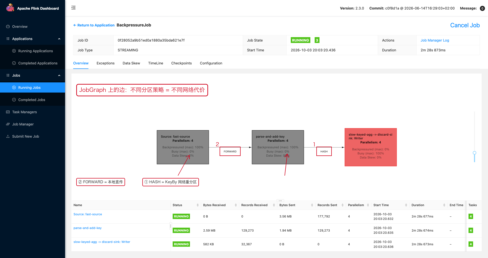
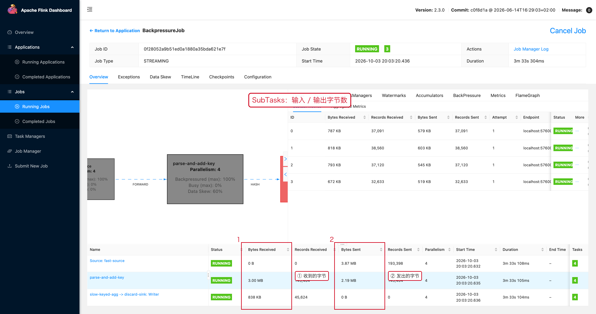

# 06 Network 与 Shuffle

> 目标：从 JobGraph 的**边标签**看出数据在哪里发生了重分区，
> 再从 SubTasks 的字节数确认网络流量，最后判断"该不该动它"。

---

## 1. 一句话结论

```text
每次 keyBy / rebalance / shuffle 都是一次跨网络的数据重分布。
网络参数只能治"网络本身"，治不了"上游产生太多无意义数据"。
```

---

## 2. 在 JobGraph 上看"边"

JobGraph 上两个算子之间的连线会标出分区策略：

```text
FORWARD    → 一对一转发，基本不走网络
REBALANCE  → 轮询分发
HASH       → 按 Key 哈希分发（就是 KeyBy）
BROADCAST  → 广播到所有下游
```



这张图里：

- 红框 ② `FORWARD`：`Source → parse-and-add-key`，本地直传，**没有网络代价**。
- 红框 ① `HASH`：`parse-and-add-key → slow-keyed-agg`，由 `keyBy` 触发，
  **每条记录都要按 Key 哈希后发到下游某个 Subtask**。

> `HASH` 边就是 Shuffle。你的 JobGraph 里 `HASH` 越多，
> 网络与序列化的成本就越高。

---

## 3. 用 SubTasks 页面量化网络流量

**操作路径**

```text
Job 页面 → 点算子节点 → 抽屉【SubTasks】页签
```



| 列 | 含义 | 用途 |
|---|---|---|
| `Bytes Received` | 这个实例从上游收到了多少字节 | 反推输入数据量 |
| `Records Received` | 收到了多少条 | 判断倾斜（见 07-02） |
| `Bytes Sent` | 向下游发出了多少字节 | 反推网络压力 |
| `Records Sent` | 发出了多少条 | 配合 Records Received 判断放大倍数 |

**判断口诀**

```text
Bytes Sent ÷ Records Received 异常大  →  单条记录被放大（序列化膨胀、重复输出）
Bytes Sent 远大于上游 Bytes Received  →  有算子产生了数据放大（flatMap / 炸开）
各 Subtask 的 Bytes Sent 差距悬殊     →  上游分区不均
```

---

## 4. 什么时候该怀疑网络

```text
CPU 不高，但吞吐上不去
Backpressured 高，但下游 Busy 也不高
Alignment Duration 高（见 07-04）
大量数据经过 REBALANCE / HASH
不同 TaskManager 之间流量巨大
```

**注意区分两种"网络慢"：**

| 类型 | 表现 | 处理 |
|---|---|---|
| 真的带宽打满 | 网卡吞吐接近上限、TaskManager 间流量巨大 | 减少 Shuffle、升带宽、调整部署亲和性 |
| 逻辑上不该有这么多数据 | 网络流量大是因为上游放大了数据 | 改业务逻辑，而不是调网络参数 |

---

## 5. 减少无意义的 Shuffle

```java
// 没有业务需要时，不要反复改分区策略。
// 每一次重新分区都可能带来额外的网络与序列化成本。
stream
    .rebalance()
    .shuffle()
    .rebalance();
```

同样地：

```text
数据已经均匀         → 不要再 Rewrite 一次 rebalance
不需要按 Key 聚合    → 不要为了"看起来并行"去 keyBy
能用 forward 的链路  → 保持算子并行度一致，避免自动变成 rebalance
```

**一个容易被忽略的点**：上下游算子并行度不一致时，
Flink 会自动插入 `REBALANCE`（或 `FORWARD` 退化成 `REBALANCE`），
你以为只是"调了个并行度"，实际上是加了一次 Shuffle。

---

## 6. KeyBy 就是一次重要的重分区

```java
// 相同 Key 的数据被路由到同一个下游并行实例。
stream.keyBy(Event::getUserId);
```

要同时考虑三件事：

```text
Key 分布         → 是否倾斜（07-02）
网络流量         → 每条记录都要跨网络
下游并行度       → 决定了拆成多少份
```

---

## 7. 不要用网络参数掩盖业务问题

Network Buffer 增大只能提高"缓冲能力"，不能解决：

```text
热点 Key
慢数据库
慢 Sink
CPU 饱和
单个 Subtask 处理逻辑过重
```

如果网络流量本身就来自"重复的 rebalance"或者"数据放大"，
调 Buffer 只会让积压更晚被发现。

---

## 8. 排查顺序

```text
① JobGraph 上找吞吐下降的那个算子
② 看它的入边和出边是 FORWARD 还是 HASH / REBALANCE
③ SubTasks 页面看 Bytes Received / Bytes Sent / Records Sent
④ 判断是"带宽问题"还是"数据放大问题"
⑤ 若是放大：回去看 flatMap / 炸开 / 重复输出
⑥ 若是分区不均：转 07-02 数据倾斜
⑦ 最后才考虑网络 Buffer 与部署调整
```

---

## 9. 本章截图对应的现场

| 截图 | 现场 | 复现类 |
|---|---|---|
| [07-06-shuffle.png](../assets/ui/07-06-shuffle.png) | `FORWARD` 与 `HASH` 两条边 | `BackpressureJob` |
| [07-06-subtask-io.png](../assets/ui/07-06-subtask-io.png) | 每个 Subtask 的收发字节数 | `BackpressureJob` |
