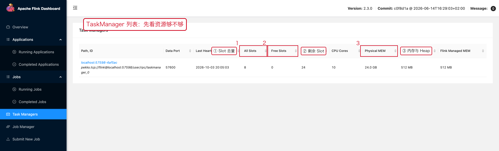
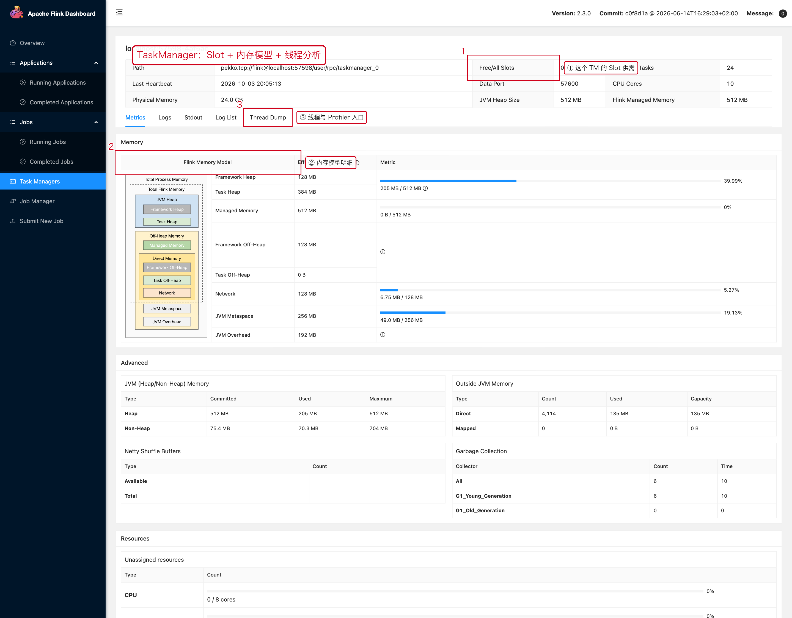

# 07 JVM 与资源

> 目标：分清"资源不够"和"算子写得慢"这两类完全不同的性能问题，
> 并且在 OOM 时先判断是**哪一块内存**爆了。

---

## 1. 一句话结论

```text
看到 OOM 不要直接加内存；
看到慢不要直接加 TaskManager。
先把"资源问题"和"计算问题"分开。
```

---

## 2. TaskManager 列表：先看资源总量

**操作路径**

```text
左侧导航【Task Managers】
```



红框三处就是资源判断的三组数：

1. **`All Slots` / `Free Slots`**：这个 TaskManager 一共提供几个 Slot、还剩几个。
   总 Slot = TaskManager 数 × 每个 TM 的 `taskmanager.numberOfTaskSlots`。
2. **`Physical MEM`**：机器物理内存，用来判断容器配额是否合理。
3. **`JVM Heap Size` / `Flink Managed MEM`**：Flink 自己的两个关键分区。

一次真实抓取的数据：

```text
All Slots        8
Free Slots       4          ← 说明已有作业占用 4 个
Assigned Tasks   12
CPU Cores        10
Physical MEM     24.0 GB
JVM Heap Size    512 MB
Flink Managed MEM 512 MB
```

**判断**

```text
Free Slots = 0 且作业在排队 → 资源不足，先扩 TaskManager，不要改代码
Free Slots 充足但作业仍慢   → 不是资源问题，回到 07-03 查反压
```

---

## 3. TaskManager Metrics：看清内存模型

**操作路径**

```text
左侧导航【Task Managers】→ 点某个 TaskManager ID → 顶部页签【Metrics】
```



这张页面上有三件值得注意的事：

1. **`Free / All Slots`**：这个 TM 的服务能力。
2. **`Memory` 区块（Flink Memory Model）**：把内存按 Flink 模型逐项列出，
   包括 Framework Heap、Task Heap、Managed Memory、Network Memory、
   Metaspace、JVM Overhead 等。**这是回答"到底是哪块内存爆了"的地方。**
3. **顶部页签**：`Metrics / Logs / Stdout / Log List / Thread Dump / Profiler`。
   CPU 高的时候，从这里进 Thread Dump 或 Profiler。

---

## 4. OOM 的六种来源

```text
JVM Heap             → 用户对象、缓存、大集合
Off-Heap / Direct    → Netty、DirectByteBuffer、自定义 off-heap 缓存
Managed Memory       → RocksDB 等状态后端
Metaspace            → 类加载器泄漏（频繁提交/卸载作业时常见）
Network Memory       → 网络缓冲
Container / Process  → 容器内存上限（K8s OOMKilled 的常见原因）
```

Flink 的内存配置是"进程总内存"模型，
所以经常出现：

```text
JVM Heap 没满
  但仍然
Container OOMKilled
```

因为**进程内存 ≠ JVM Heap**。看到容器被杀，先看 `taskmanager.memory.process.size`
和容器的 `requests/limits`，而不是加 `-Xmx`。

---

## 5. OOM 排查顺序

```text
① 看异常完整堆栈（是 java.lang.OutOfMemoryError 还是容器被杀）
② 判断是哪一类：heap / direct / native / metaspace / container
③ 看 TaskManager Logs（不是只看 JobManager）
④ 看 State / RocksDB 是否突然增长（07-05）
⑤ 看是否对象创建异常（大量临时对象、字符串拼接、JSON 解析）
⑥ 看并发外部请求是否过高
⑦ 最后才调内存
```

---

## 6. GC 问题：CPU 高但吞吐上不去的常见原因

典型现象：

```text
CPU 高
吞吐下降
处理延迟波动明显
Full GC 频繁
```

优先怀疑的方向：

```text
大量临时对象（每条记录都 new 集合 / new 字符串）
JSON 解析与序列化
字符串拼接
集合频繁创建
用户代码里的大缓存
```

排查入口：

```text
TaskManager → Thread Dump / Profiler
JVM 参数里打开 GC 日志
```

---

## 7. 资源不足 vs 算子慢：两种问题不要混

| 现象 | 资源问题 | 算子问题 |
|---|---|---|
| Slot | Free Slots = 0 或作业卡在 SCHEDULED | Slot 充足 |
| BackPressure | 可能出现（因为任务拿不到资源） | 明显且集中在某算子 |
| Busy | 各算子都不忙 | 个别算子 Busy 100% |
| 处理方式 | 扩 TaskManager / 调内存 | 改代码 / 换实现 |

```text
Job 需要 8 个 Slot，集群只有 4 个
    → 作业处于"资源无法满足"的状态，
      这不是"算子性能差"，加并行度只会更糟。
```

---

## 8. 本章截图对应的现场

| 截图 | 现场 | 复现类 |
|---|---|---|
| [07-07-tm-list.png](../assets/ui/07-07-tm-list.png) | 8 Slot / 4 Free / 512MB Heap | 任意作业 |
| [07-07-tm-memory.png](../assets/ui/07-07-tm-memory.png) | Flink Memory Model 明细 | 任意作业 |
