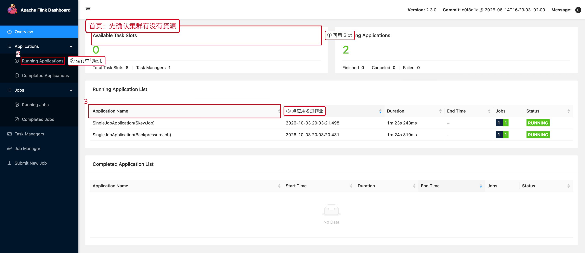
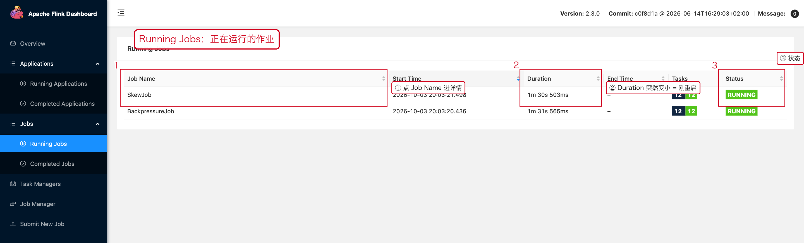
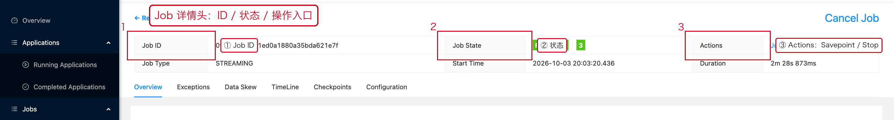
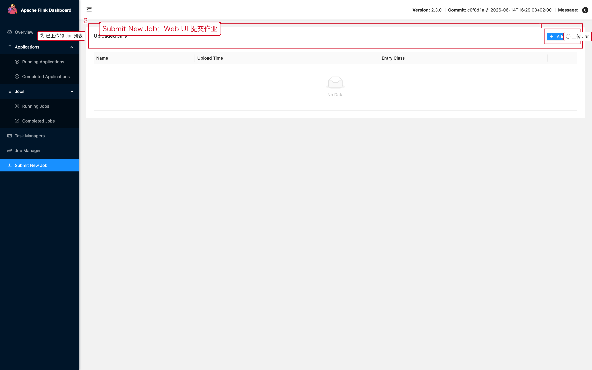
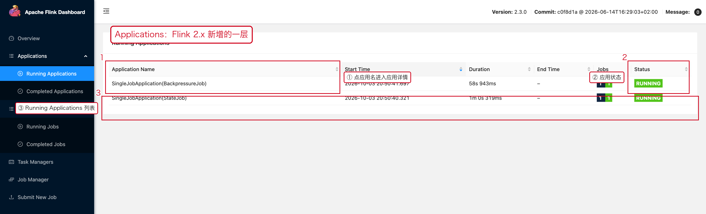
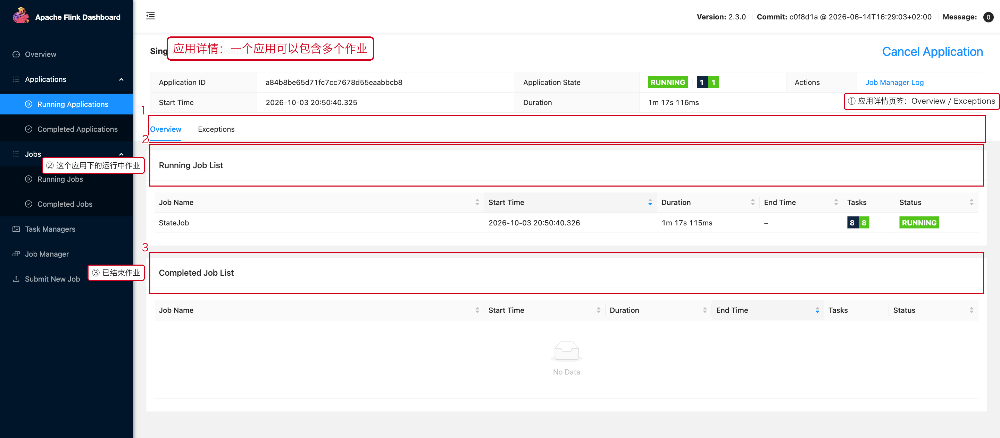
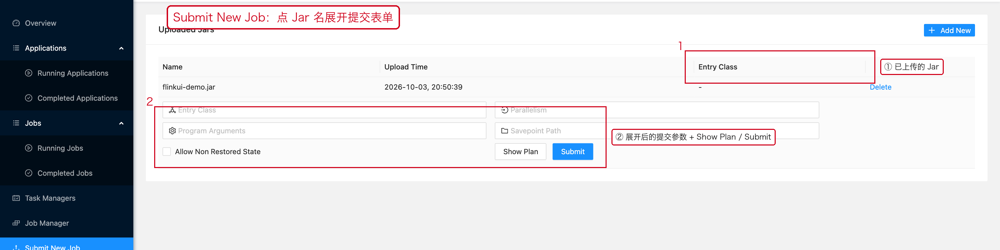

# 01 任务查看与提交

> 目标：知道"看任务"和"提交任务"分别走哪些入口，以及提交之后**第一眼应该确认什么**。

---

## 1. Web UI 与 CLI 的分工

```text
Web UI：看运行状态、JobGraph、BackPressure、Checkpoint、Metrics、日志
CLI   ：提交、停止、Savepoint、恢复、批量脚本
```

两者不是二选一：**日常看状态用 Web UI，改动用 CLI（或 CI）**。

---

## 2. 集群首页：先确认有没有资源



三处红框的阅读顺序：

1. **`Available Task Slots`** = 4：集群还有 4 个 Slot 空闲。
2. **`Running Applications`** = 1：当前有 1 个应用在跑；右侧 `Failed` 计数也要看。
3. **`Running Application List`**：点 `Application Name` 进入应用，再点具体作业进入 Job 页面。

> Flink 2.x 引入了 **Application** 这一层。一个 Application 可以包含多个 Job，
> 所以路径多了一跳：`Overview → Application → Job`。

---

## 3. 作业列表：Running Jobs



| 列 | 看什么 |
|---|---|
| `Job Name` | **点它进入 Job 详情页** |
| `Start Time` / `Duration` | 判断是否刚重启过（Duration 突然变小） |
| `Tasks` | 形如 `12 12`，表示正在运行 / 总数 |
| `Status` | `RUNNING` / `RESTARTING` / `FAILED` |

**Duration 突然变小 = 作业刚重启过**，这是最容易漏掉的一个信号。

---

## 4. Job 详情页头部：四件事



1. **`Job ID`**：后续所有 CLI 操作（cancel / stop / savepoint / 恢复）都要用它。
2. **`Job State`**：`RUNNING` 才是正常；`RESTARTING` 表示正在故障恢复；`FAILED` 表示重试次数用尽。
3. **`Actions`**：`Trigger Savepoint`、`Stop Job` 等操作的入口。
4. **`Job Manager Log`**：直接跳到 JobManager 日志。

下方的 `Job Type`（STREAMING / BATCH）、`Start Time`、`Duration` 用来核对"这个作业是不是我要看的那个"。

---

## 5. Web UI 提交 Jar

**操作路径**

```text
左侧导航【Submit New Job】→【Add New】选择 Jar → 上传 → 在列表里点该 Jar 提交
```



上传成功后，Jar 会出现在 `Uploaded Jars` 列表里（图中红框 ②），
可以在同一页面选择 `Entry Class` 和并行度后提交。

---

## 6. CLI 查看与提交

查看当前集群中的作业：

```bash
# -r 表示只列出正在运行的作业。
./bin/flink list -r -m <jobmanager-host>:8081
```

```text
------------------ Running/Restarting Jobs -------------------
03.10.2026 17:35:19 : 20fd0e6d19508b6271e8e05d0c7f3227 : BackpressureJob (RUNNING)
--------------------------------------------------------------
```

提交：

```bash
# -d：detached，提交后不等待作业结束。
# -c：指定入口类。
# -p：作业默认并行度。
./bin/flink run -d -c demo.BackpressureJob -p 4 /path/to/your-job.jar
```

提交后**立刻回来确认状态**，而不是假设它起来了：

```bash
./bin/flink list -r -m <jobmanager-host>:8081
```

---

## 7. 提交前检查清单

```text
[ ] Jar 是否正确（本地能跑通）
[ ] 依赖是否打齐（provided / shaded 没搞混）
[ ] 入口类是否正确
[ ] 目标环境配置文件是否正确
[ ] 外部系统地址 / 认证信息是否可访问
[ ] Checkpoint / Savepoint 路径是否可写
[ ] 并行度是否合理（对比 Kafka Partition 数）
[ ] 集群 Free Slot 是否够（不够会一直 SCHEDULED）
```

---

## 8. 本章截图对应的现场

| 截图 | 现场 | 复现方式 |
|---|---|---|
| [08-01-cluster-overview.png](../assets/ui/08-01-cluster-overview.png) | 1 个应用运行中，4 个空闲 Slot | `BackpressureJob` |
| [08-01-jobs-running.png](../assets/ui/08-01-jobs-running.png) | Running Jobs 列表 | `SkewJob` |
| [08-01-job-detail.png](../assets/ui/08-01-job-detail.png) | Job 详情头部 | `BackpressureJob` |
| [08-01-submit.png](../assets/ui/08-01-submit.png) | 已上传的 `flinkui-demo.jar` | Web UI 上传 |

---

## 9. Flink 2.x 的 Applications 一层

在 Flink 2.x 里，`Overview → Applications` 是一个独立的层级：**一个应用 = 一次提交，可以包含多个作业**。
用 `flink run -d` 提交的单作业会显示成 `SingleJobApplication(<JobName>)`。



点应用名进入应用详情，可以看到这个应用下的全部作业：



```text
① 页签：Overview / Exceptions
② Running Job List    应用下正在运行的作业
③ Completed Job List  应用下已结束的作业
```

**排查意义**：如果上游一次提交了多个作业（例如多个 INSERT 的 SQL 作业），
异常可能发生在同一个应用里的另一个作业上——只看单个 Job 会漏掉。

---

## 10. Submit New Job 的完整表单

上传 Jar 之后，**点 Jar 文件名**会展开提交表单：



| 字段 | 作用 |
|---|---|
| `Entry Class` | 入口类；Jar 里有多个 main 时必须指定 |
| `Parallelism` | 作业默认并行度 |
| `Savepoint Path` | 从指定 Savepoint 恢复 |
| `Allow Non Restored State` | 允许丢弃快照里无法映射的状态（**慎用**） |
| `Show Plan` | 只解析作业图、不提交，先确认 JobGraph 是否符合预期 |
| `Submit` | 真正提交 |

> 页面底部的 `Plan Visualization` 会在 Show Plan 之后把作业图渲染出来。
