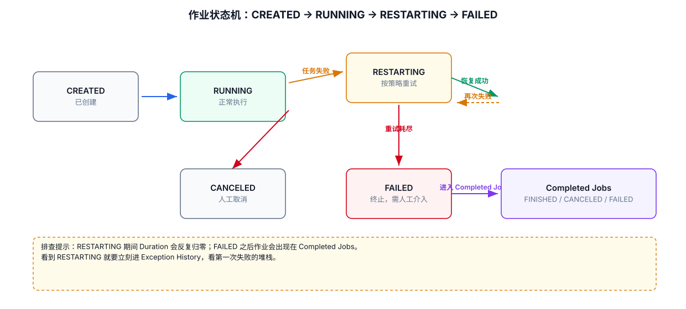
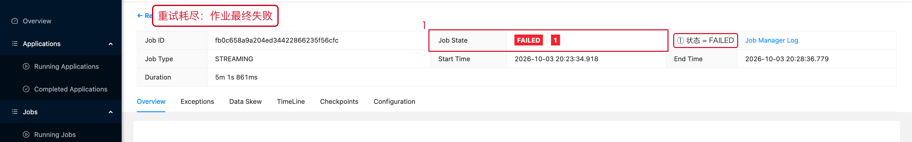
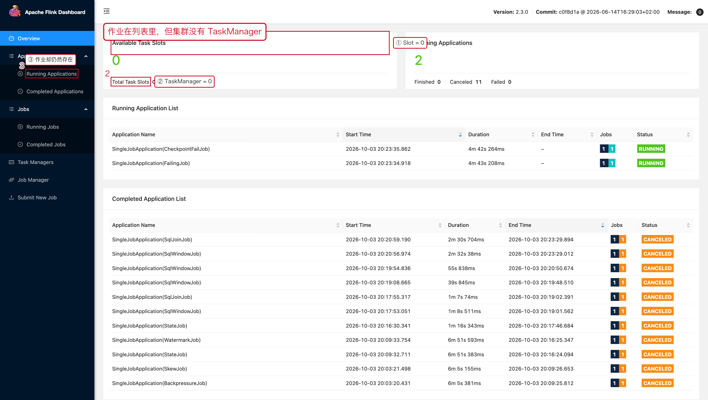
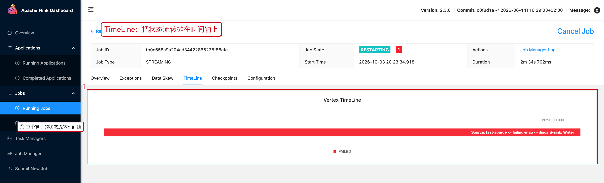
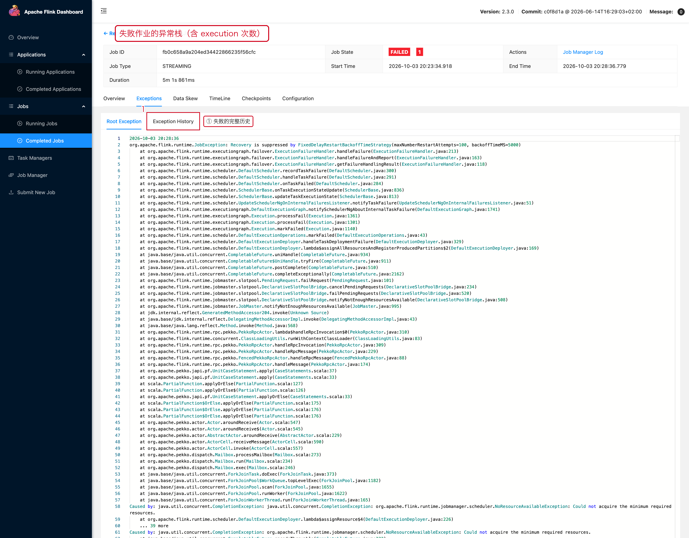

# 02 停止、重启与失败恢复

> 目标：分清 `Cancel` / `Stop` / 自动重启三件事，
> 并且能从 Web UI 上正确读懂"作业在反复重启"这种状态。

---



## 1. 三种操作，别搞混

| 操作 | 语义 | 什么时候用 |
|---|---|---|
| `Cancel` | 直接取消，不保证状态落盘 | 调试、明确的丢弃场景 |
| `Stop`（with savepoint） | 先做一次 Savepoint，再有序停止 | **生产发布 / 升级** |
| 自动重启（Failover） | 失败后按重启策略自动恢复 | 不需要人工干预，但要查根因 |

```text
生产升级：Stop + Savepoint   ← 而不是 Cancel
```

---

## 2. Cancel

```bash
# 仅取消作业。
./bin/flink cancel <job-id>
```

Web UI 上对应的是 Job 详情页右上角的 **Cancel Job**：


> 取消后作业会进入 **Completed Jobs** 列表，`Status = CANCELED`。
> 是否还能恢复，取决于你有没有外部化的 Checkpoint / Savepoint。

---

## 3. Stop with Savepoint

```bash
# 原子地触发 Savepoint 并停止 Job。
./bin/flink stop \
  --savepointPath hdfs:///flink/savepoints \
  <job-id>
```

成功时输出：

```text
Suspending job "0653b1655c399346c9bf99d67d3c5976" with a CANONICAL savepoint.
Triggering stop-with-savepoint for job 0653b1655c399346c9bf99d67d3c5976.
```

**真实案例：这个操作在强反压下会失败。**

我们对一个"热点 Key 打满"的作业执行 stop-with-savepoint，得到的是：

```text
The program finished with the following exception:

org.apache.flink.util.FlinkException: Could not stop with a savepoint job "...".
Caused by: java.util.concurrent.TimeoutException
```

原因不是 Flink 有 bug，而是：**Savepoint 也需要 Barrier 在数据流里走一遍**，
强反压时 Barrier 迟迟对不齐，客户端的默认等待时间先到了。

**正确做法**：先按 [07-03 反压](../07-性能优化/03-反压.md) 缓解反压，
再执行 Stop；或者加大客户端等待时间 / 改用 detached 方式触发。

---

## 4. "作业在反复重启"长什么样

一个会周期性抛异常的作业（`FailingJob`）在 Web UI 上表现为：


- `Job State` 在 `RUNNING` 和 `RESTARTING` 之间来回跳。
- `Duration` 会反复归零。
- `Exceptions` 页面里的 `Exception History` 会不断增加条目。

**这类状态最容易被误判为"任务在跑"**，因为它大部分时间显示 RUNNING。

---

## 5. 失败后先看什么

```text
Job FAILED / RESTARTING
    ↓
Exceptions 页签：看【最近的】还是【第一次的】异常
    ↓
失败的 Operator / Subtask 编号
    ↓
是否连续失败（Exception History 的时间间隔）
    ↓
归类：外部系统 / 用户代码 / 资源 / State 恢复
```

> **看第一次失败，不要只看最后一次。**
> 后面的失败常常是前面失败引发的连锁反应。

---

## 6. 重试次数耗尽：FAILED

当重启策略的 `attempts` 用尽，作业会真正停下来：



此时作业会出现在 **Completed Jobs** 列表里：


重新提交前，**必须先把根因修掉**，否则只是再失败一次。

---

## 7. TaskManager 挂掉之后

典型恢复路径：

```text
TaskManager 异常
   ↓
JobManager 感知
   ↓
Task Failover / Job Restart
   ↓
重新调度
   ↓
从最近可用的 Checkpoint 恢复
```

如果恢复后一直卡在 `SCHEDULED`，优先检查 **Task Slot 和 TaskManager 是否重新注册**。

### 一个非常容易误判的场景：作业显示 RUNNING，但集群没有 TaskManager



红框 ① ②：`Total Task Slots = 0`、`Task Managers = 0`。
红框 ③：应用计数里仍然有 1 个 Running。

这不是"作业还活着"，而是：

```text
作业的 JobGraph 还在 JobManager 里（所以状态不是 FAILED/CANCELED），
但没有 TaskManager 可以提供 Slot，任务无法真正执行。
```

**处理顺序**：

```text
① 先恢复 TaskManager / 资源
② 再看作业是否自动恢复
③ 不要在这个状态下改业务代码
```

顺着 TaskManager 的日志查为什么没起来（OOM？容器被杀？配置错误？），
对应 08-07 日志与异常。

---

## 8. 自动重启不是"故障消失"

```text
Restarting
  ↓ 几秒后再次失败
Restarting
  ↓
循环
```

这种循环通常意味着：

```text
用户代码固定报错（同样的输入必然触发）
配置错误
外部系统持续不可用
资源不足
State 无法恢复（Savepoint / Checkpoint 与代码不兼容）
```

**判断方法**：看 `Exceptions → Exception History` 里的时间间隔。

```text
间隔 ≈ 重启策略的 delay  →  任务一启动就挂，属于"启动即失败"
间隔 明显更大            →  是运行一段时间后才挂，要看业务数据
```

---

## 9. 本章截图对应的现场

| 截图 | 现场 | 复现类 |
|---|---|---|
| [08-02-restarting.png](../assets/ui/08-02-restarting.png) | 作业在 RUNNING/RESTARTING 之间抖动 | `FailingJob` |
| [08-02-job-failed.png](../assets/ui/08-02-job-failed.png) | 重试耗尽，Job State = FAILED | `FailingJob` |
| [08-02-completed-list.png](../assets/ui/08-02-completed-list.png) | 失败作业进入 Completed 列表 | `FailingJob` |
| [08-02-no-taskmanager.png](../assets/ui/08-02-no-taskmanager.png) | TaskManager = 0，作业仍在列表 | 手动停掉 TaskManager |
---

## 10. TimeLine 与异常历史：把「重启循环」摊开看

`TimeLine` 页签把每个算子的状态变化画在时间轴上，
`RUNNING / FAILED / RESTARTING` 的交替一眼可见：



`Exceptions → Exception History` 则给出每次失败的完整堆栈，
注意看 `execution #` 这个数字——它就是「第几次执行」：



**配合使用**：TimeLine 回答「重启得有多频繁」，Exception History 回答「每次为什么失败」。
