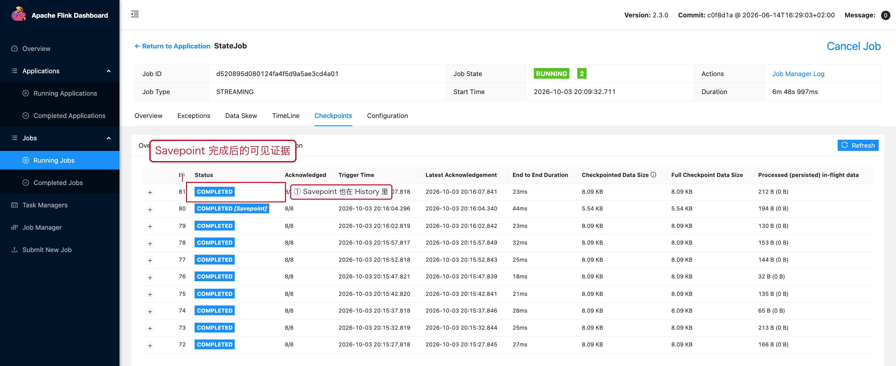
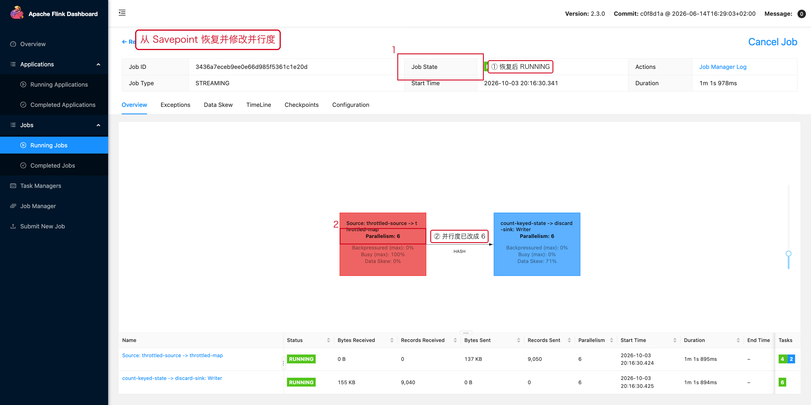

# 03 Savepoint

> 目标：跑通"触发 Savepoint → 修改并行度 → 从 Savepoint 恢复"这条完整链路，
> 并知道它为什么会失败。

---

## 1. Savepoint 用于什么

```text
升级代码
修改并行度
迁移集群
Stop / Resume
某些拓扑变更
```

与 Checkpoint 的区别：

```text
Checkpoint：自动触发，主要服务于"故障恢复"
Savepoint ：人工触发，主要服务于"运维动作"
```

---

## 2. 触发 Savepoint

```bash
# 方式一：只做 Savepoint，Job 继续运行。
./bin/flink savepoint <job-id> file:///tmp/flinkui/savepoints -m localhost:8081
```

真实输出：

```text
Triggering savepoint for job 41e19b08c3c9aa988c73dcde50664ad7.
Waiting for response...
Savepoint completed. Path: file:/tmp/flinkui/savepoints/savepoint-41e19b-f09bc9b609b4
You can resume your program from this savepoint with the run command.
```

```bash
# 方式二：原子地"Savepoint + 停止"，生产升级用这个。
./bin/flink stop --savepointPath hdfs:///flink/savepoints <job-id>
```

> 如果 State 很大，客户端可能等很久，可以加 `-detached` 先触发、稍后再查结果。

---

## 3. Savepoint 在 Web UI 上长什么样

Savepoint 完成之后，**它会作为一条记录出现在作业的 Checkpoint History 里**：



红框 ① ② 就是这条记录：`Status = COMPLETED`，
`Acknowledged = 8/8`（所有并行实例都确认了快照）。

所以"我的 Savepoint 到底成没成"不一定非要翻日志，在 UI 里也能看到。

---

## 4. Savepoint 产物

```text
/tmp/flinkui/savepoints/
└── savepoint-41e19b-f09bc9b609b4/
    └── _metadata          ← 元数据：算子 UID、状态分配、并行度等
```

**整个目录要作为一个整体处理**，不要只拷贝 `_metadata`，
也不要手工修改里面的文件。

---

## 5. 从 Savepoint 恢复（且修改并行度）

```bash
# -s 指定 Savepoint 路径
# 最后一个参数 6 是"新并行度"
./bin/flink run -d \
  -s file:///tmp/flinkui/savepoints/savepoint-41e19b-f09bc9b609b4 \
  -c demo.StateJob \
  /path/to/job.jar 6
```

恢复成功后，Job 详情页与 Checkpoints 页面会体现出来：



```text
Checkpoints → counts.restored = 2      ← 说明状态是从 Savepoint 恢复来的
JobGraph 上算子的 Parallelism = 6      ← 并行度已经从 4 改成 6
```

前提是：

```text
Operator State / Keyed State 能够按新的并行度重新分配
（Keyed State 依赖 Key Group，天然支持 rescale；
  用 ListState 且语义上"每个实例一份"的 Operator State，
  则需要自己实现 redistribute 逻辑）
```

---

## 6. 为什么 Operator UID 很重要

```java
stream
        .keyBy(Event::getUserId)
        .process(new UserProcessFunction())
        // UID 是 Savepoint 与算子之间的唯一对应关系，必须长期稳定。
        .uid("user-process");
```

没有显式 UID 时，Flink 会根据算子在拓扑中的位置自动生成 UID；
**代码一改（哪怕只是插入一个新算子），自动 UID 就可能改变，Savepoint 就恢复不了。**

所以有状态算子的 `uid(...)` 一旦上线就不要改。

---

## 7. 恢复失败的常见原因

```text
UID 对不上（最常见）
State 类型 / Schema 不兼容（加了字段没给默认值）
算子被删除
新增算子没有处理状态关系
Savepoint 路径不可访问 / 权限不足
依赖类找不到（Jar 里少了类）
Flink / Connector / Serializer 版本不匹配
```

**排查顺序**：先看 JobManager 日志里的 `Cannot map savepoint state to job`，
再对照代码里的 `.uid(...)` 列表逐个核对。

---

## 8. 什么时候 Savepoint 会"卡住"

Savepoint 和 Checkpoint 走的是同一套 Barrier 机制，所以：

```text
强反压 → Barrier 对齐慢 → Savepoint 慢甚至客户端超时
```

真实案例见 [02 停止、重启与失败恢复](./02-停止重启与失败恢复.md#3-stop-with-savepoint)：
在一个热点 Key 打满的作业上执行 stop-with-savepoint，
客户端直接报 `TimeoutException`。

**结论：Savepoint 之前，先确认作业没有严重反压。**

---

## 9. 本章截图对应的现场

| 截图 | 现场 | 复现类 |
|---|---|---|
| [08-03-savepoint-history.png](../assets/ui/08-03-savepoint-history.png) | History 中的 Savepoint 记录 | `StateJob` + `flink savepoint` |
| [08-03-restored.png](../assets/ui/08-03-restored.png) | 从 Savepoint 恢复、并行度改为 6 | `StateJob` + `flink run -s` |
