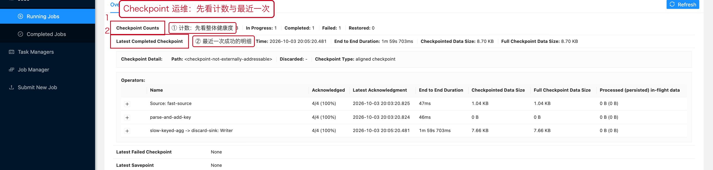
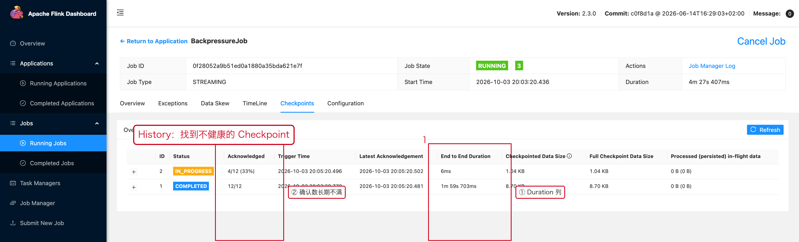
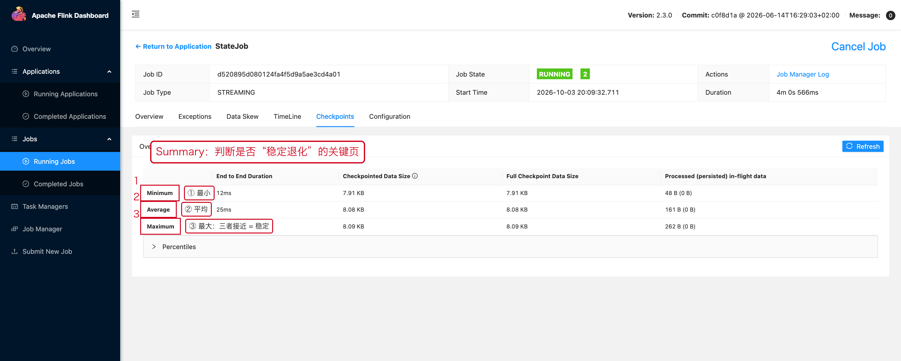
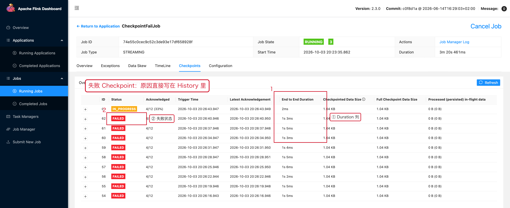
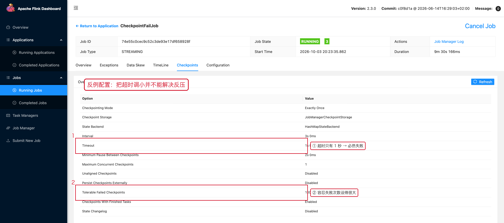

# 04 Checkpoint 运维

> 目标：Checkpoint 出问题时，用 Web UI 的固定动作把它定位到
> "Barrier 慢 / 快照慢 / 持久化慢"三类之一，而不是盲目调 timeout。
>
> 性能视角的方法论见 [07-04 Checkpoint 性能](../07-性能优化/04-Checkpoint性能.md)，
> 本文侧重**运维动作**。

---

## 1. 打开 Checkpoints 页面

```text
Job 页面 → 顶部页签【Checkpoints】
   ├── Overview      先看计数与最近一次
   ├── History       逐次对比
   ├── Summary       判断是否稳定退化
   └── Configuration 确认实际生效参数
```

---

## 2. 第一眼：计数



```text
Triggered / In Progress / Completed / Failed / Restored
```

**怎么读：**

| 组合 | 含义 |
|---|---|
| `Completed` 持续增长 | 正常 |
| `In Progress` 长期为 1 且不归零 | 有 Checkpoint 一直完不成，去看 History 的 Duration |
| `Failed` 持续增长 | 失败在持续发生，不要只看数字，要找到具体原因 |
| `Restored > 0` | 这个作业从某个 Checkpoint / Savepoint 恢复过 |

> **单个 Failed 可能是启动瞬间的噪声**（任务还没全部 RUNNING 就触发了 Checkpoint）。
> 关键是看它**是否持续增长**。

---

## 3. 第二眼：最近的 Completed 与 Failed


```text
End to End Duration: 51s 112ms      ← 最近一次成功用了多久
Checkpointed Data Size: 8.70 KB     ← 快照本身多大
```

**这两个数一起看才有意义：**

```text
Size 小 + Duration 大  →  Barrier 被卡住（反压），不是快照慢
Size 大 + Duration 大  →  快照/持久化慢，去看 07-05 State 性能
Size 小 + Duration 小  →  健康
```

---

## 4. 第三眼：History 逐次对比

**操作路径**：`Checkpoints →【History】`



重点看三列：

```text
Acknowledged            → 有几个并行实例确认了。长期不满 = Barrier 卡住
End to End Duration     → 整体耗时
Checkpointed Data Size  → 快照大小
```

**定位到具体 Operator**：回到 Overview 页签下半部分的 `Operators` 表格，
能看到是哪个算子的 ACK 慢、Duration 大、Data Size 大。

---

## 5. 第四眼：Summary 判断"稳定退化"



这一页是回答"**是不是在慢慢变坏**"的标准工具：

```text
Min / Avg / Max 三者接近        → 稳定
Max 远离 Avg，Avg 稳定          → 偶发长尾（GC / 远端存储抖动）
Avg 逐周抬升                    → 稳定退化，去查 State 增长
```

如果同时 `Average Duration` 和 `Average Data Size` 一起涨，
基本可以直接断定是 **State 在增长** → 转 [07-05 State 性能](../07-性能优化/05-State性能.md)。

---

## 6. Checkpoint 长时间 In Progress 怎么办

```text
① 先看是否 BackPressure（JobGraph + BackPressure 页签）
② 是否只有个别 Subtask 慢（倾斜）
③ Acknowledged 是否长期不满
④ Checkpointed Data Size 是否突然变大
⑤ 远端存储（HDFS / S3 / OSS）是否变慢
⑥ 最后才看 timeout 与 interval 参数
```

---

## 7. 失败之后不要立刻做的事

### 7.1 不要直接把 timeout 调大

```text
Timeout 变大
  ↓
失败次数变少
  ↓
但 Checkpoint 依然慢，恢复点依然稀疏
  ↓
根因仍在
```

先用第 4、5 节的方法确认慢在哪一段，再决定是调 timeout、
调 interval，还是解决反压 / State。

### 7.2 不要把 Checkpoint 和 Savepoint 混为一谈

| | Checkpoint | Savepoint |
|---|---|---|
| 触发 | 自动 | 人工 |
| 用途 | 故障恢复 | 升级 / 迁移 / 调并行度 |
| 保留 | 由外部化配置决定 | 长期保留 |

---

## 8. 外部化 Checkpoint

作业被 Cancel 之后还要能恢复，需要外部化 Checkpoint：

```yaml
execution.checkpointing.externalized-checkpoint-retention: RETAIN_ON_CANCELLATION
```

```text
RETAIN_ON_CANCELLATION  → Cancel 后保留（生产常用）
DELETE_ON_CANCELLATION  → Cancel 后删除（默认）
```

> 不要不看文档就把这段配置复制到所有集群；
> 枚举值在 `Checkpoints → Configuration` 里能看到实际生效结果。

---

## 9. 本章截图对应的现场

| 截图 | 现场 | 复现类 |
|---|---|---|
| [08-04-ckpt-counts.png](../assets/ui/08-04-ckpt-counts.png) | 计数 + Latest Completed | `BackpressureJob` |
| [07-04-ckpt-slow-history.png](../assets/ui/07-04-ckpt-slow-history.png) | 51 秒的 Checkpoint 与 8/12 的 ACK | `BackpressureJob` |
| [07-04-ckpt-ok-summary.png](../assets/ui/07-04-ckpt-ok-summary.png) | 健康的 Min / Avg / Max | `StateJob` |

---

## 10. 失败 Checkpoint 的真实样子

除了「慢」，Checkpoint 还有一类问题是**直接失败**。下面是真实抓到的现场：
34 次触发、34 次失败，History 里每次都写着同一句失败原因。



再去看 Configuration，就能理解为什么会必然失败——超时被设成了 1 秒，
而作业处于强反压状态，Barrier 根本来不及对齐：



这个组合的后果是：**作业看起来一直在 RUNNING，但一个 Checkpoint 都没成功**，
一旦真的需要故障恢复，没有任何可用恢复点。

**正确顺序**：先按 07-03 解决反压，再考虑把 timeout 调回合理区间。
