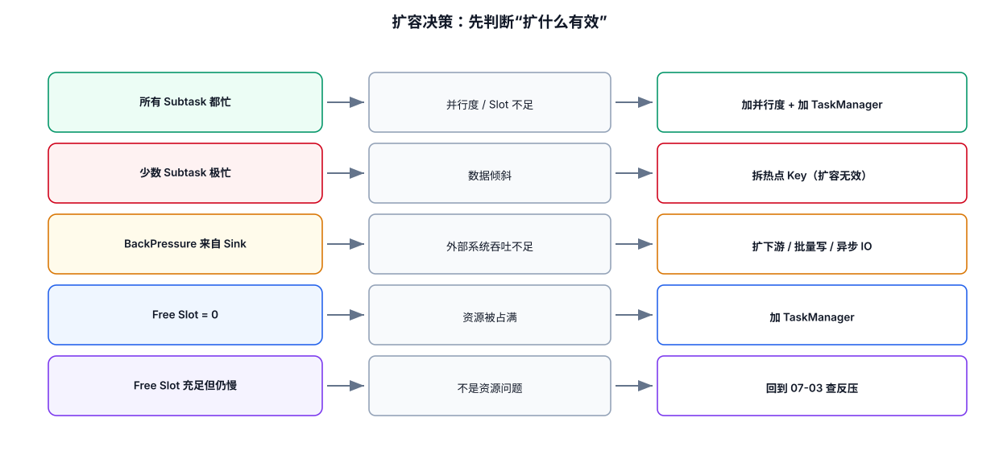
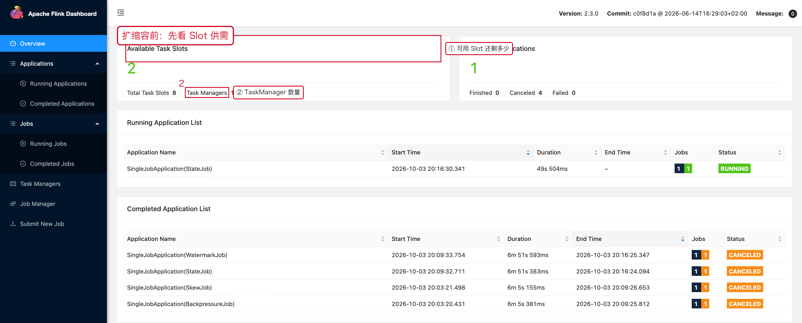
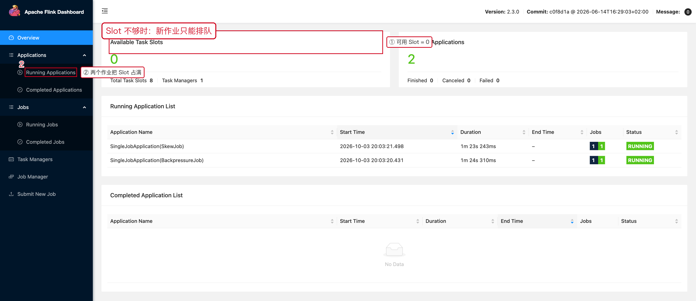

# 05 扩缩容与资源检查

> 目标：扩容之前先判断**扩什么有效**——
> 是 Slot 不够、并行度不够，还是外部系统吞吐不够。
> 扩容错方向，钱花了吞吐不动。

---



## 1. 一句话结论

```text
扩容前先分清三种"不够"：
① Slot 不够        → 加 TaskManager（资源层面）
② 并行度不够       → 调并行度（作业层面）
③ 外部系统不够     → 扩 Sink / 改批量（下游层面）
只有 ① 和 ② 是 Flink 侧能解决的。
```

---

## 2. 扩容前先看 Slot 供需



图里 `Available Task Slots = 2`、`Task Managers = 1`，说明：

```text
总 Slot 8，已被占用 6（还原自 Savepoint 的作业并行度改成 6 之后）
```

**判断**

```text
Free Slots > 0 但作业慢      → 不是 Slot 问题，去查反压
Free Slots = 0 且作业排队    → Slot 不够，扩 TaskManager
```

---

## 3. Slot 被占满长什么样



红框 ①：`Available Task Slots = 0`。
红框 ②：两个作业把 8 个 Slot 全部占满。

此时再提交新作业，它会一直停在 `SCHEDULED`，
**不是代码问题，也不是配置问题**。

---

## 4. 加 TaskManager ≠ 提高吞吐

```text
Job Parallelism = 4
TaskManager     = 10
```

这时增加 TaskManager，作业的并行实例数**仍然是 4**，
吞吐不会有任何变化。

资源链路要按顺序对齐：

```text
TaskManager 数量
   ×  每个 TM 的 numberOfTaskSlots
   =  可提供的 Slot 总数
         ↓
      Job Parallelism
         ↓
      实际 Subtask 数量
```

**所以扩容的正确顺序是**：确认瓶颈 → 决定目标并行度 → 再算需要多少 Slot。

---

## 5. 从 Savepoint 改并行度扩容（完整流程）

```bash
# 1. 先做 Savepoint 并停掉老作业
./bin/flink stop \
  --savepointPath file:///tmp/savepoints \
  <old-job-id>

# 2. 用新并行度恢复
./bin/flink run -d \
  -s file:///tmp/savepoints/savepoint-xxxx \
  -c com.example.YourJob \
  /path/to/job.jar 8
```

恢复之后，在 JobGraph 上确认并行度真的生效了：

```text
每个算子节点上的 Parallelism 行
TaskManager 列表里的 Free Slots 数量变化
```

> **前提**：并行度能改的前提是状态可以 rescale。
> Keyed State 天然支持；自己实现的 Operator State 需要提供 redistribute 逻辑。

---

## 6. 扩容前必须确认的清单

```text
[ ] TaskManager 数量 / 每 TM 的 Slot 数 / 总 Slot
[ ] 当前 Job 默认并行度
[ ] 各算子的实际并行度（不必相同）
[ ] Kafka Partition 数量            ← 决定 Source 并行度上限
[ ] Sink 侧能承受的并发（DB 连接数 / 写入配额）
[ ] State 大小与本地磁盘容量
[ ] Checkpoint 远端存储的带宽与 IOPS
```

特别是 Kafka：

```text
Source 并行度 > Kafka Partition 数  →  多出来的实例分不到分区，纯浪费
```

**Flink 不能凭空创建 Kafka Partition。**

---

## 7. 缩容的风险

缩容不只是"少几个实例"：

```text
单个 TaskManager 承担更多 Subtask
CPU 竞争增加
State / RocksDB 本地资源压力增加
单个实例的网络流量增加
Checkpoint / Recovery 行为改变
```

所以缩容同样要：

```text
选择业务低峰期
先做 Savepoint
缩容后立刻观察 BackPressure / Checkpoint / CPU
保留回滚能力（老 Savepoint 先别删）
```

---

## 8. 扩容决策速查

```text
所有 Subtask 都忙              → 需要加并行度 / 加 Slot
少数 Subtask 极忙              → 先解决数据倾斜（07-02），扩容无效
BackPressure 来自 Sink         → 先扩 Sink / 外部系统
Free Slot = 0                  → 加 TaskManager
Free Slot 充足但作业仍卡在 SCHEDULED → 检查资源配置是否匹配（内存/CPU 标签）
```

---

## 9. 本章截图对应的现场

| 截图 | 现场 | 复现方式 |
|---|---|---|
| [08-05-slots.png](../assets/ui/08-05-slots.png) | 8 Slot 中用掉 6 个 | `StateJob` 恢复为并行度 6 |
| [08-05-slots-full.png](../assets/ui/08-05-slots-full.png) | 两个作业占满 8 个 Slot | `BackpressureJob` + `SkewJob` |

---

## 10. Rescales 页签：自动扩缩容历史

`Job → Rescales` 记录的是**自适应调度器**触发的扩缩容历史：


```text
Latest Completed Rescale   最近一次成功的扩缩容
Latest Failed Rescale      失败的扩缩容
Latest Ignored Rescale     被忽略的扩缩容请求
```

注意：**手工改并行度（Stop + Savepoint → 用新并行度恢复）不会出现在这里**，
那是两个作业实例之间的变化；Rescales 记录的是同一个作业实例内部的自动调整。
