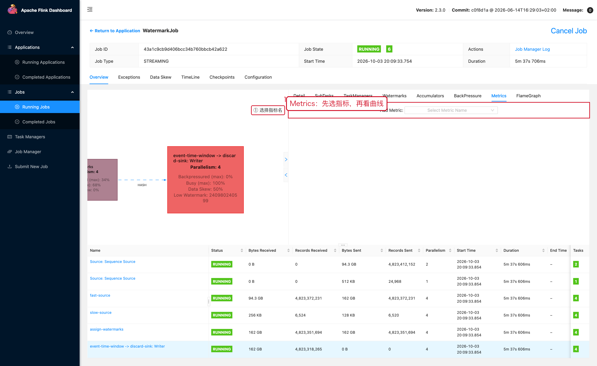

# 06 Metrics 与 Web UI 排查

> 目标：会用 **Metrics 页签**和 **Watermarks 页签**这两个容易忽略的入口，
> 并用 REST API 把同样的数据接到监控系统。

---

## 1. 完整排查路径

```text
Cluster Overview
   ↓
Application / Job
   ↓
JobGraph（找算子）
   ↓
算子抽屉：Detail / SubTasks / Watermarks / BackPressure / Metrics
   ↓
TaskManager：Metrics / Logs / Thread Dump / Profiler
```

---

## 2. Metrics 页签：自己加指标

**操作路径**

```text
Job 页面 → 点算子节点 → 抽屉 →【Metrics】页签
```



这里的 `Add Metric: Select Metric Name` 是一个下拉选择器：

1. 点开它，输入关键字过滤指标名。
2. 选中后，指标会以曲线形式加到图表里。
3. 图表右上角可以切换时间范围。

**常用的指标名：**

| 分类 | 指标 | 用途 |
|---|---|---|
| 吞吐 | `numRecordsIn` / `numRecordsOut` | 判断是否真的在消费数据 |
| 速率 | `numRecordsInPerSecond` / `numRecordsOutPerSecond` | 实时吞吐曲线 |
| 忙碌度 | `busyTimeMsPerSecond` | 见 07-01 |
| 反压 | `backPressuredTimeMsPerSecond` | 见 07-03 |
| 空闲 | `idleTimeMsPerSecond` | 判断是否无数据 |
| 事件时间 | `currentInputWatermark` / `currentOutputWatermark` | 见第 4 节 |
| Checkpoint | `lastCheckpointSize` / `lastCheckpointDuration` | 单指标快速看 |

> 指标名随 Operator / Metric Group 不同而变化，
> **以当前 Job 的下拉列表里实际能选到的为准**。

---

## 3. 用 REST API 取同样的数据

Web UI 上的一切都能用 REST 拿到，监控接的就是这一层。

```bash
# 第一步：列出这个 Job 上的所有指标名
curl "http://<jobmanager>:8081/jobs/<job-id>/metrics"

# 第二步：按名字取值（可以一次取多个，用逗号分隔）
curl "http://<jobmanager>:8081/jobs/<job-id>/metrics?get=lastCheckpointSize,lastCheckpointDuration"
```

返回：

```json
[
  {"id": "lastCheckpointSize", "value": "8282"},
  {"id": "lastCheckpointDuration", "value": "26"}
]
```

常用的、**不加算子前缀就能取到**的作业级指标：

```text
lastCheckpointSize
lastCheckpointDuration
lastCheckpointExternalPath
lastCheckpointRestoreTimestamp
numberOfCompletedCheckpoints
numberOfFailedCheckpoints
```

算子和 Subtask 级指标要带作用域，形如：

```text
<operator_id>.<subtask_index>.numRecordsIn
```

---

## 4. Watermarks 页签：排查"窗口为什么不触发"

这是最常被忽略、但在事件时间作业里最有用的一页。

**操作路径**

```text
Job 页面 → 点算子节点 → 抽屉 →【Watermarks】页签
```


页面内容：

```text
Timezone: Asia/Shanghai
SubTask | Watermark | Datetime of Watermark Timestamp
```

红框 ③ 是重点：**不要只看一行，要对比所有 Subtask**。

**怎么判断：**

| 现象 | 含义 | 下一步 |
|---|---|---|
| 所有 Subtask 的 Watermark 一起前进 | 正常 | 看窗口是否按预期触发 |
| **个别 Subtask 明显落后** | 这一路输入拖住了整个窗口 | 查这个 Subtask 的上游 |
| 全部都不前进 | 没有任何输入推进事件时间 | 查 Source 是否在发数据、时间戳字段是否正确 |
| 显示 `No Watermark` | 作业没有使用事件时间 | 确认是否漏了 `assignTimestampsAndWatermarks` |

> **Watermark 取的是所有输入的"最小值"。**
> 所以只要有一路输入不推进，整个窗口就不会触发——
> 这解释了"明明有数据，窗口就是不输出"的绝大多数情况。

**个别的 Subtask 落后，常见原因：**

```text
该路 Source 有慢 Partition
某个分区是 Idle，但没有正确标记（withIdleness）
事件时间戳字段本身有问题（单位错、时区错、时间倒流）
上游有数据倾斜
```

修复方式之一是让 Flink 主动忽略长时间没数据的分区：

```java
WatermarkStrategy.<Event>forBoundedOutOfOrderness(Duration.ofSeconds(5))
        .withTimestampAssigner((event, ts) -> event.getEventTime())
        // 20 秒没有数据的分区不再参与 Watermark 的最小值计算。
        .withIdleness(Duration.ofSeconds(20));
```

---

## 5. "看到异常但不知道去哪查"对照表

| 现象 | 去哪里 |
|---|---|
| Job 状态异常 | 顶部 `Exceptions` 页签 |
| 吞吐异常 | `JobGraph`（看 Busy/BackPressure）+ 算子 `Metrics` |
| 反压 | 算子抽屉 `BackPressure` |
| Checkpoint | 顶部 `Checkpoints` 页签 |
| Watermark / 窗口不触发 | 算子抽屉 `Watermarks` 或 `Metrics` |
| CPU 高 | TaskManager → `Thread Dump` / `Profiler` |
| 内存高 | TaskManager → `Metrics`（Memory 区块）+ `Logs` |
| 数据倾斜 | 顶部 `Data Skew` 页签 |

---

## 6. 本章截图对应的现场

| 截图 | 现场 | 复现类 |
|---|---|---|
| [08-06-metrics.png](../assets/ui/08-06-metrics.png) | Metrics 页签的指标选择器 | `WatermarkJob` |
| [08-06-watermarks.png](../assets/ui/08-06-watermarks.png) | 逐 Subtask 的 Watermark | `WatermarkJob` |
