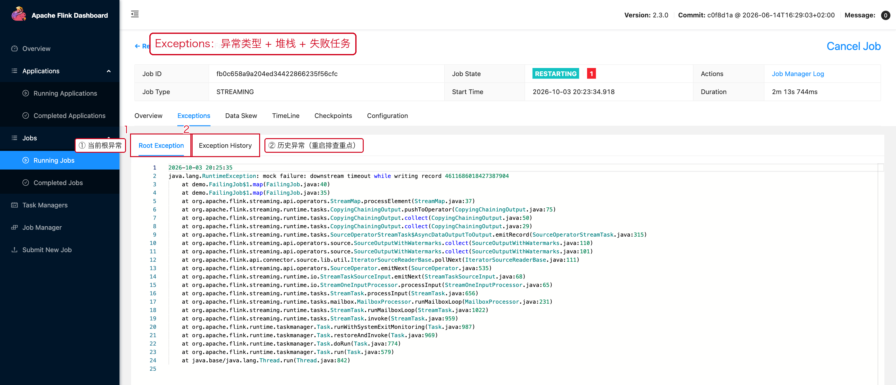
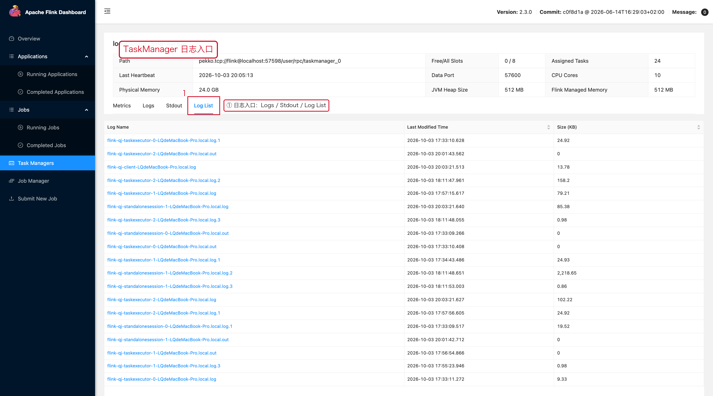
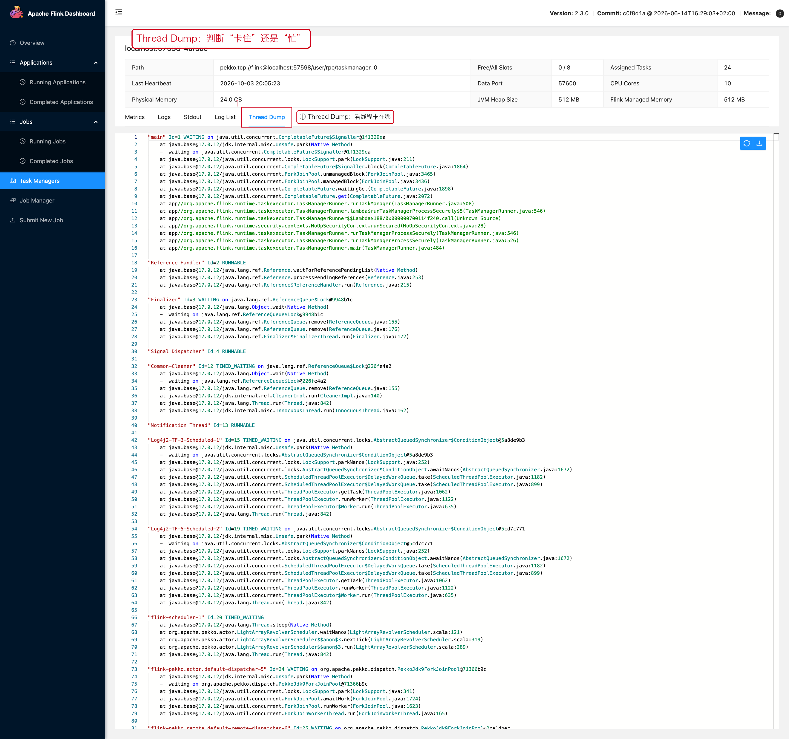

# 07 日志与异常

> 目标：知道 Web UI 上有**四个**看问题的入口
> （Exceptions / JobManager Log / TaskManager Logs / Thread Dump），
> 并且能把它们按时间对齐。

---

## 1. 一句话结论

```text
只看 JobManager 日志是不够的。
真正抛异常的是 Task 线程，它的日志在 TaskManager 上。
```

---

## 2. Exceptions 页签：异常入口

**操作路径**

```text
Job 页面 → 顶部页签【Exceptions】
```

页面里有两个子页签：

```text
Root Exception      当前作业的根异常（作业正常运行时显示 No Root Exception）
Exception History   历史异常列表（反复重启的作业特别有用）
```



一条真实的异常历史记录长这样：

```text
taskName      : Source: fast-source -> failing-map -> discard-sink: Writer (1/2) - execution #17
exceptionName : java.lang.RuntimeException
stacktrace    : mock failure: downstream timeout while writing record 3000
                at demo.FailingJob$1.map(FailingJob.java:...)
```

**四个要素一定要看全**：

```text
① 异常类型      RuntimeException / OutOfMemoryError / TimeoutException ...
② 失败的 Task   哪个算子、第几个并行实例（1/2 = 并行度 2 的第 1 个）
③ execution #   第几次执行，用于判断"重启了多少次"
④ 堆栈          定位到具体代码行
```

> **REST 方式**：`curl http://<jobmanager>:8081/jobs/<job-id>/exceptions`
> 返回的 JSON 里 `exceptionHistory.entries` 就是这张列表。

---

## 3. JobManager Log

Job 详情页右上角有 **Job Manager Log** 链接，直接跳到 JobManager 的日志页。

适合查：

```text
作业调度过程（SCHEDULED → DEPLOYING → RUNNING）
Slot 分配失败 / 资源不足
Checkpoint 触发与完成记录
Savepoint 触发与结果
```

不适合查用户代码抛出的业务异常——那些在 TaskManager 上。

---

## 4. TaskManager 日志

**操作路径**

```text
左侧导航【Task Managers】→ 点某个 TaskManager → 顶部页签
   Metrics /【Logs】/ Stdout / Log List / Thread Dump / Profiler
```



| 页签 | 看什么 |
|---|---|
| `Logs` | TM 主日志（log4j 输出），异常堆栈通常在这里 |
| `Stdout` | 用户代码里的 `System.out.println` 等标准输出 |
| `Log List` | 日志文件列表（按时间滚动的历史文件） |
| `Thread Dump` | 当前所有线程的栈，用来判断"卡在哪" |
| `Profiler` | CPU / 分配 / 锁 采样 |

---

## 5. Thread Dump：判断"卡住"还是"忙"

**操作路径**：`TaskManager →【Thread Dump】`



**怎么用：**

```text
线程 RUNNABLE 且栈顶是自己的代码     → CPU 型瓶颈
线程 WAITING / TIMED_WAITING 在 IO   → 同步 IO 瓶颈
大量线程 BLOCKED 在同一把锁上        → 锁竞争
栈里出现外部 SDK 的调用              → 外部系统慢
```

结合 07-03 里 BackPressure 页面右侧的 **Dump** 链接，
可以直接抓**某个具体 Subtask** 的线程栈，定位精度更高。

---

## 6. 典型异常分类与处理方向

| 分类 | 典型异常 | 处理方向 |
|---|---|---|
| 用户代码 | `NullPointerException` / `ClassCastException` / `IllegalArgumentException` | 定位 Operator / Subtask，改代码 |
| 外部系统 | `TimeoutException` / `Connection refused` / `Connection reset` / `Too many connections` | 查 DB / Kafka / HBase / Redis 自身状态与配额 |
| State / Checkpoint | State handle 无法读取 / `Checkpoint failed` / `Serializer incompatible` | 进 Checkpoints 页面 + 看恢复阶段日志 |
| 资源 | `OutOfMemoryError` / `ContainerKilled` / `TaskManager lost` / `NoResourceAvailableException` | 先看 TaskManager / 集群资源 |

特别是最后一条，真实报文长这样：

```text
org.apache.flink.runtime.jobmanager.scheduler.NoResourceAvailableException:
    Could not acquire the minimum required resources.
Caused by: ... Could not acquire the minimum required resources.
```

它说的是**集群没给它 Slot**，不是业务代码有问题。

---

## 7. 多套日志的时间对齐

```text
异常发生时间
   ↓
JobManager 日志（调度视角）
   ↓
TaskManager 日志（执行视角）
   ↓
外部系统日志（依赖视角）
```

排查时建议随手记下这几个键，用来把日志串起来：

```text
JobID
TaskManager ID
Subtask Index
Operator Name
失败时间（精确到秒）
Checkpoint ID（如果是 Checkpoint 相关）
```

---

## 8. 本章截图对应的现场

| 截图 | 现场 | 复现类 |
|---|---|---|
| [08-07-exceptions.png](../assets/ui/08-07-exceptions.png) | Exceptions 页面的两个子页签 | `FailingJob` |
| [08-07-tm-loglist.png](../assets/ui/08-07-tm-loglist.png) | TaskManager 的日志入口 | 任意作业 |
| [08-07-threaddump.png](../assets/ui/08-07-threaddump.png) | Thread Dump 页面 | 任意作业 |

---

## 9. JobManager 的日志与指标

除了 TaskManager，**JobManager 自己也有 7 个页签**：

```text
Metrics / Configuration / Logs / Stdout / Log List / Thread Dump / Profiler
```

JobManager 的日志里有：作业调度过程、Slot 分配、Checkpoint 触发与完成、
Savepoint 结果、作业状态切换。**Task 抛出的业务异常不在这里**。


`Configuration` 页签列的是**集群实际生效**的配置项，排查「配置到底有没有生效」时最权威：


JobManager 的 `Log List` 会把所有日志文件按时间列出来，用于确认日志有没有异常增长：


