# 08 Web UI 操作与排查手册

> 目标：把 Flink Web UI **每一个菜单、每一个页面、每一个功能块**都过一遍，
> 并给出「这个页面用来看什么、对应哪篇文档」。
>
> 本文所有截图都是真实 Flink 2.3.0 Web UI（1920 宽整页截图）。
> 红色方框和数字标号指出该页面要重点看的东西。

---

## 0. Web UI 全貌：8 个菜单 + 4 层页面

```text
左侧导航（全局）
├── Overview                       集群总览
├── Applications                   应用（Flink 2.x 新增）
│   ├── Running Applications
│   └── Completed Applications
├── Jobs
│   ├── Running Jobs
│   └── Completed Jobs
├── Task Managers                  TaskManager 列表
├── Job Manager                    JobManager 自身
└── Submit New Job                 提交作业

第二层：Job 详情页 7 个页签
Overview / Exceptions / Data Skew / TimeLine / Checkpoints / Configuration / Rescales

第三层：算子抽屉（在 JobGraph 上点算子）8 个页签
Detail / SubTasks / TaskManagers / Watermarks / Accumulators / BackPressure / Metrics / FlameGraph

第四层：进程页（TaskManager / JobManager）各 6~7 个页签
Metrics / Configuration / Logs / Stdout / Log List / Thread Dump / Profiler
```

> 本文按「先全局、再逐页」的顺序走一遍，最后给一张**页面 → 文档**索引表。

---

## 1. Overview：集群总览

**路径**：`#/overview`


三处红框分别是：

```text
① Available Task Slots   集群还剩多少算力
② Running Applications   有多少应用在跑，Failed 计数是多少
③ Running Application List  点应用名进入应用详情
```

**什么时候用**：任何排查的第一步。`Free Slot = 0` 就先别怀疑代码。

对应文档：[08-01 任务查看与提交](./01-任务查看与提交.md)、[08-05 扩缩容与资源检查](./05-扩缩容与资源检查.md)。

---

## 2. Applications：Flink 2.x 新增的一层

**路径**：`#/application/running`、`#/application/completed`


```text
① Application Name  点它进入应用详情
② Status            RUNNING / FINISHED / CANCELED / FAILED
③ 列表本身          一个应用 = 一次提交，可能包含多个 Job
```

进入某个应用后是应用详情页：


```text
① 页签：Overview / Exceptions
② Running Job List    这个应用下正在跑的作业
③ Completed Job List  已结束的作业
```

> **为什么要有这一层**：在 Flink 2.x 里，「作业」是最小执行单元，「应用」是一次提交的容器。
> 用 `flink run -d` 提交的单作业会显示成 `SingleJobApplication(<JobName>)`。

对应文档：[08-01 任务查看与提交](./01-任务查看与提交.md)。

---

## 3. Jobs：Running / Completed

**路径**：`#/job/running`、`#/job/completed`

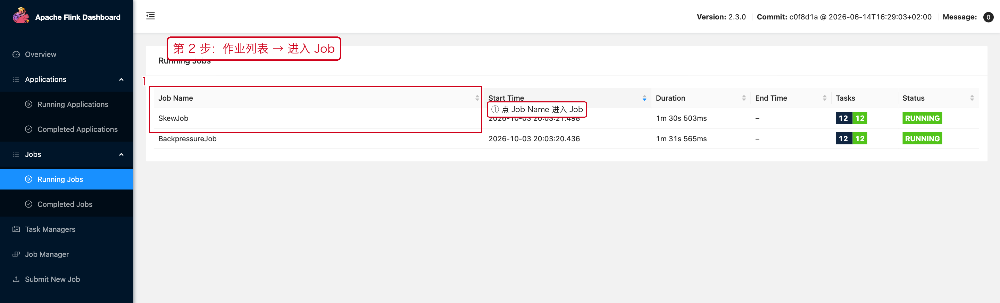

| 列 | 看什么 |
|---|---|
| `Job Name` | 点它进入 Job 详情 |
| `Start Time` / `Duration` | **Duration 突然变小 = 刚重启过** |
| `Tasks` | 形如 `8 8`，运行中 / 总数 |
| `Status` | RUNNING / RESTARTING / FAILED |

结束态的作业在 Completed Jobs：

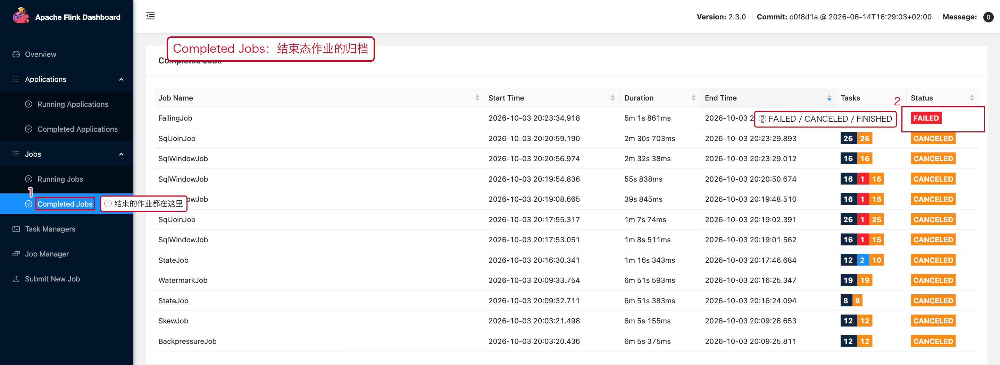

对应文档：[08-02 停止、重启与失败恢复](./02-停止重启与失败恢复.md)。

---

## 4. Job 详情页的 7 个页签

点作业名进入 Job 页面，顶部页签就是排查总目录：

| 页签 | 路径 | 用来看什么 | 对应文档 |
|---|---|---|---|
| `Overview` | `#/job/running/<jid>/overview` | JobGraph + 算子指标 + 顶点表格 | [07-01](../07-性能优化/01-性能指标与排查顺序.md) |
| `Exceptions` | `.../exceptions` | 根异常与异常历史 | [08-07](./07-日志与异常.md) |
| `Data Skew` | `.../dataskew` | 数据倾斜百分比 | [07-02](../07-性能优化/02-并行度与数据倾斜.md) |
| `TimeLine` | `.../timeline` | 状态流转时间线 | [08-02](./02-停止重启与失败恢复.md) |
| `Checkpoints` | `.../checkpoints` | 计数 / History / Summary / Configuration | [08-04](./04-Checkpoint.md) |
| `Configuration` | `.../configuration` | 这个作业实际生效的参数 | 见下 |
| `Rescales` | `.../rescales` | 自动扩缩容历史 | 见下 |

### 4.1 Overview：JobGraph

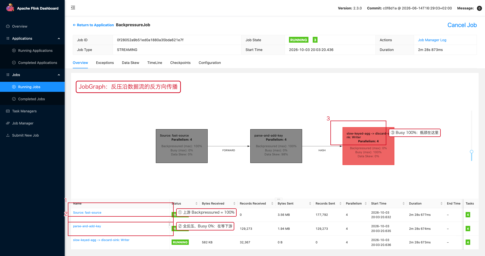

### 4.2 Configuration：作业级生效参数

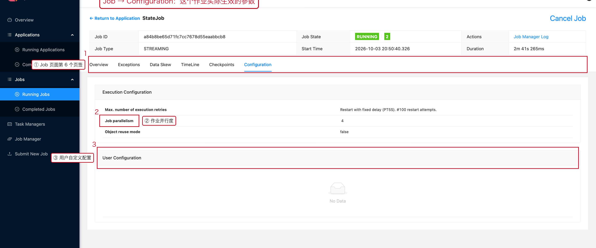

```text
① Job 页面第 6 个页签
② Execution Configuration：重试策略、作业并行度、对象复用
③ User Configuration：代码里通过 Configuration 设置的键值
```

**用途**：确认「代码里写的并行度」和「实际生效的并行度」是否一致；
排查「为什么重试了 100 次」时先看这里。

### 4.3 Rescales：自动扩缩容历史

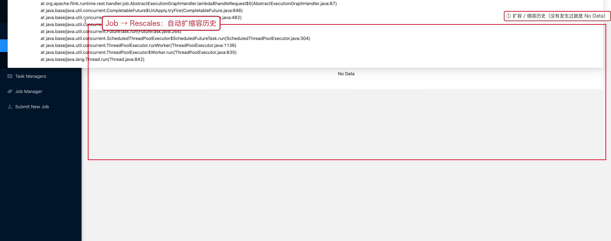

自适应调度器（Adaptive Scheduler）触发扩缩容时，这里会记录
`Latest Completed Rescale / Latest Failed Rescale / Latest Ignored Rescale`。
手工改并行度（Stop + Savepoint 再恢复）**不会**出现在这里。

对应文档：[08-05 扩缩容与资源检查](./05-扩缩容与资源检查.md)。

---

## 5. 算子抽屉的 8 个页签

在 JobGraph 上**点任意算子节点**，右侧弹出抽屉：

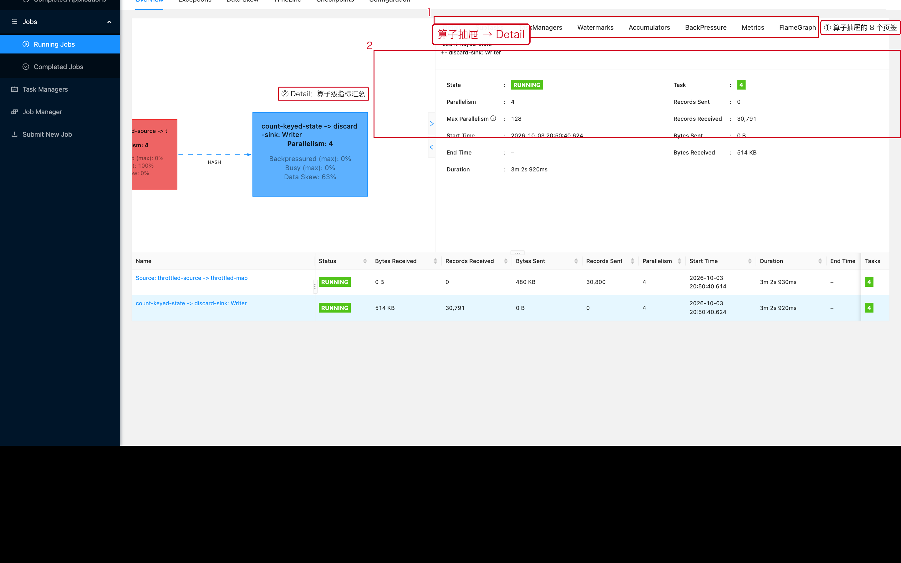

| 页签 | 用来看什么 | 对应文档 |
|---|---|---|
| `Detail` | 算子级指标汇总（状态、并行度、Records、Bytes） | 本文 |
| `SubTasks` | **每个并行实例**的输入/输出与忙碌度 | [07-02](../07-性能优化/02-并行度与数据倾斜.md) |
| `TaskManagers` | 这个算子的实例分布在哪些 TM 上 | 本文 |
| `Watermarks` | 逐 Subtask 的事件时间水位 | [08-06](./06-Metrics与Web UI排查.md) |
| `Accumulators` | 自定义计数器（算子级 / 实例级） | 本文 |
| `BackPressure` | 反压状态与逐实例明细 | [07-03](../07-性能优化/03-反压.md) |
| `Metrics` | 自选指标画曲线 | [08-06](./06-Metrics与Web UI排查.md) |
| `FlameGraph` | CPU 火焰图 | 本文 |

### 5.1 TaskManagers：实例分布

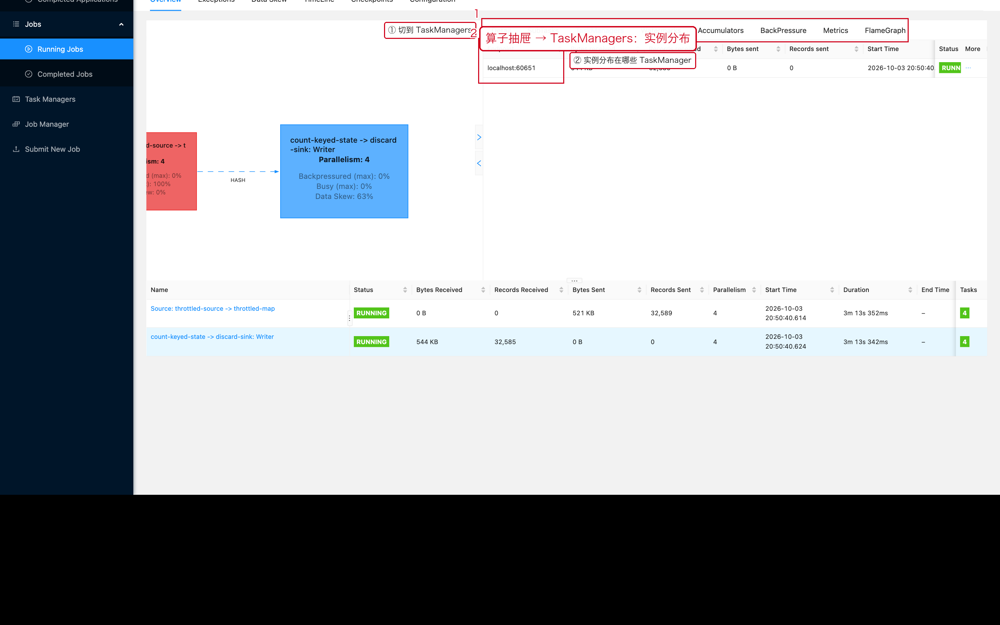

用途：判断是不是**只有某一个 TaskManager 上的实例有问题**（机器级故障、磁盘慢、网络抖动）。

每一行最右边有一个 `More` 省略号菜单，里面是跳转入口：

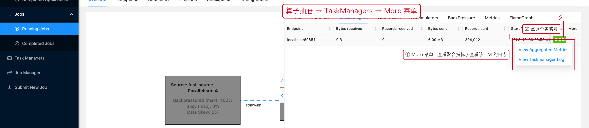

```text
① 菜单项
   View Aggregated Metrics  查看该 TaskManager 上的聚合指标
   View Taskmanager Log     直接跳到这台机器上的日志
② 触发入口：More 列的省略号
```

**价值**：当某个算子的延迟只集中在个别机器上时，
一步跳到那台 TM 的指标和日志，不用在多个页面之间来回找。

### 5.2 Accumulators：自定义计数器


代码里通过 `RuntimeContext.addAccumulator(...)` 或 `getLongCounter(...)` 注册的计数器会出现在这里。
**排查业务逻辑问题时，自定义计数器比通用指标有用得多**（比如「被过滤掉的脏数据条数」）。

### 5.3 FlameGraph：CPU 火焰图

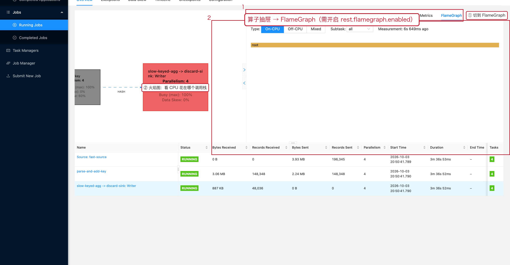

火焰图默认**关闭**，需要在配置里打开：

```yaml
rest:
  flamegraph:
    enabled: true
```

用途：`Busy` 高但不知道为什么高时，用它看 CPU 花在哪个调用栈。

---

## 6. TaskManager 页面（7 个页签）

**路径**：`#/task-manager` → 点某个 TM ID

顶部信息区包含 `Path / Free·All Slots / Assigned Tasks / Last Heartbeat /
Data Port / CPU Cores / Physical Memory / JVM Heap Size / Flink Managed Memory`。

| 页签 | 用来看什么 | 对应文档 |
|---|---|---|
| `Metrics` | 内存模型、JVM Heap/Non-Heap、Direct、GC | [07-07](../07-性能优化/07-JVM与资源.md) |
| `Logs` | TM 主日志（异常堆栈通常在这里） | [08-07](./07-日志与异常.md) |
| `Stdout` | 用户代码的 `System.out` 输出 | 本文 |
| `Log List` | 按文件查看历史日志 | 本文 |
| `Thread Dump` | 当前所有线程栈 | [08-07](./07-日志与异常.md) |
| `Profiler` | CPU / 分配 / 锁 / Wall-Clock 采样 | 本文 |

### 6.1 Stdout

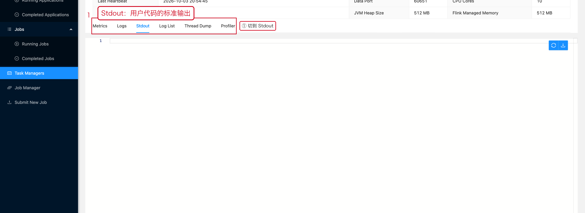

### 6.2 Log List 与单个日志文件

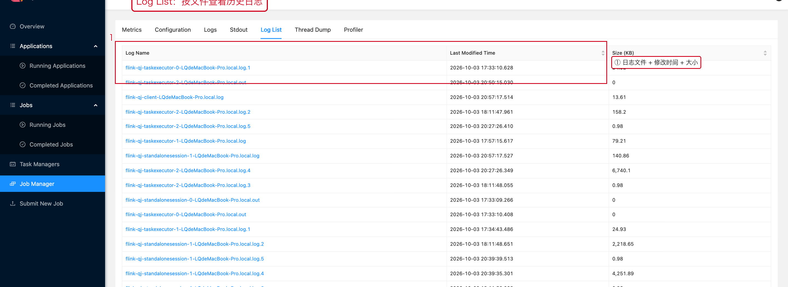

点文件名进入日志详情（带行号、可搜索、可下载）：

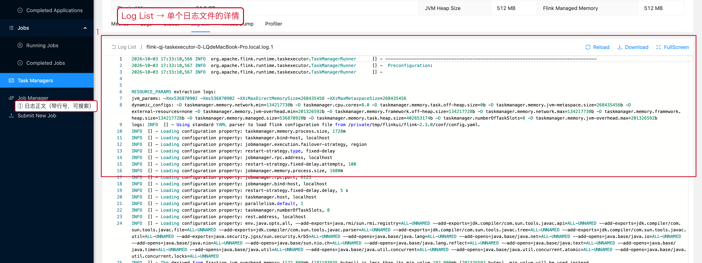

### 6.3 Profiler：对进程做采样

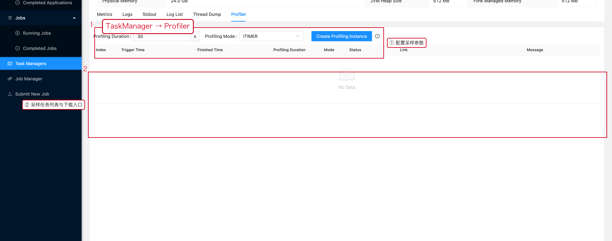

```text
① Profiling Duration + Profiling Mode + Create Profiling Instance
② 采样任务列表：完成后可以下载 HTML 火焰图
```

Profiler 默认**关闭**，需要：

```yaml
rest:
  profiling:
    enabled: true
```

```text
CPU 高        → CPU profiling
怀疑锁竞争    → Lock profiling
怀疑对象分配  → Allocation profiling
线程一直等待  → Wall-Clock profiling
```

> 采样本身有开销，生产环境要控制时长，并把它当作实验性手段。

---

## 7. JobManager 页面（7 个页签）

**路径**：`#/job-manager`

JobManager 是主控进程，它的指标、日志与 TaskManager 是两套东西。

### 7.1 Metrics

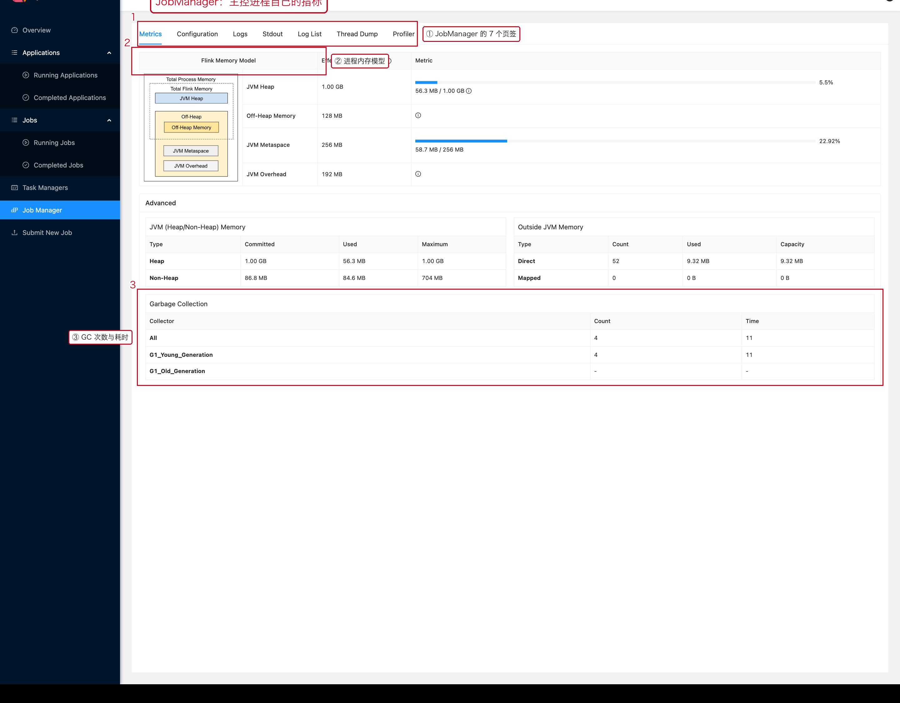

```text
① 页签栏：Metrics / Configuration / Logs / Stdout / Log List / Thread Dump / Profiler
② Flink Memory Model：Framework Heap / Off-Heap / Metaspace / JVM Overhead
③ Garbage Collection：GC 次数与耗时
```

**什么时候看**：作业提交不上、JobMaster 频繁切换、调度变慢时，
先确认 JobManager 自己有没有被内存或 GC 拖住。

### 7.2 Configuration：集群级配置快照

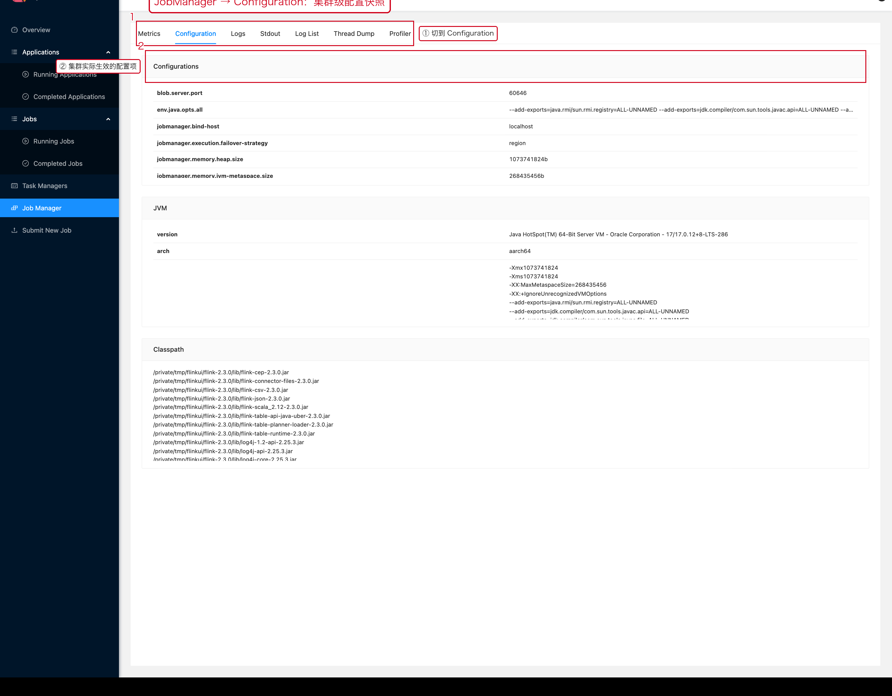

这里列出的是**集群实际生效**的配置（`jobmanager.*`、`taskmanager.*`、`env.*` 等），
不是你在代码里写的值。排查「配置到底有没有生效」时最权威。

### 7.3 Logs / Stdout / Log List / Thread Dump

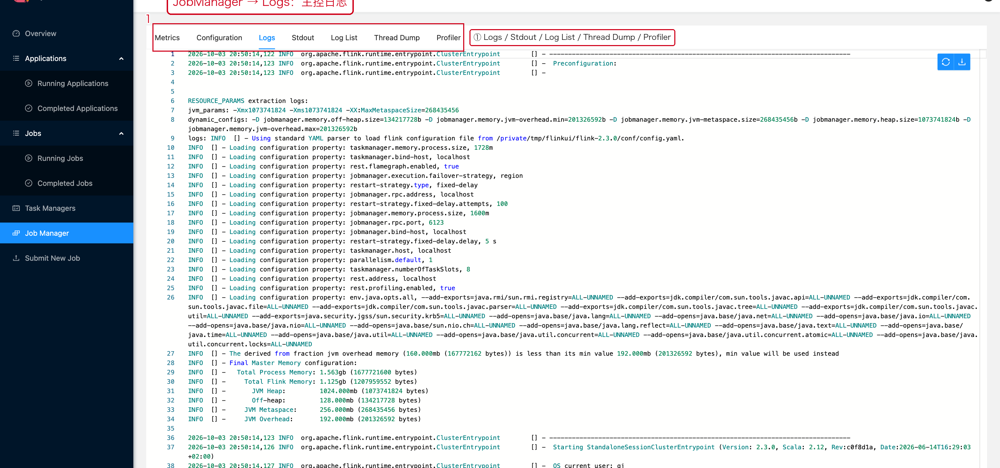

JobManager 的日志里有：作业调度、Slot 分配、Checkpoint 触发、Savepoint 结果、
作业状态切换。**Task 抛出的业务异常不在这里**，要去 TaskManager。

### 7.4 Profiler

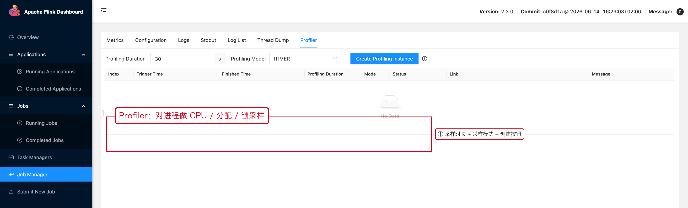

和 TaskManager 的 Profiler 用法一致，只是采样对象换成了 JobManager 进程。

---

## 8. Submit New Job

**路径**：`#/submit`


```text
① 已上传的 Jar（Add New 上传，Delete 删除）
② 展开后的参数：Entry Class / Parallelism / Savepoint Path /
   Allow Non Restored State /【Show Plan】/【Submit】
```

两个有用的按钮：

```text
Show Plan  → 只解析作业图、不真正提交，可以先看 JobGraph 是否符合预期
Submit     → 真正提交
```

> 页面底部还有 `Plan Visualization` 区块，执行 Show Plan 后会把作业图渲染出来。

对应文档：[08-01 任务查看与提交](./01-任务查看与提交.md)。

---

## 9. 完整页面索引表

| 层级 | 页面 / 功能块 | 路径 | 文档 |
|---|---|---|---|
| 全局 | 集群总览 | `#/overview` | [08-01](./01-任务查看与提交.md) |
| 全局 | Running Applications | `#/application/running` | [08-01](./01-任务查看与提交.md) |
| 全局 | Completed Applications | `#/application/completed` | [08-01](./01-任务查看与提交.md) |
| 全局 | 应用详情（Overview / Exceptions） | `#/application/running/<appId>/…` | [08-01](./01-任务查看与提交.md) |
| 全局 | Running Jobs | `#/job/running` | [08-01](./01-任务查看与提交.md) |
| 全局 | Completed Jobs | `#/job/completed` | [08-02](./02-停止重启与失败恢复.md) |
| 全局 | Task Managers | `#/task-manager` | [07-07](../07-性能优化/07-JVM与资源.md) |
| 全局 | Job Manager | `#/job-manager` | 本文第 7 节 |
| 全局 | Submit New Job | `#/submit` | 本文第 8 节 |
| Job | Overview（JobGraph） | `.../overview` | [07-01](../07-性能优化/01-性能指标与排查顺序.md) |
| Job | Exceptions | `.../exceptions` | [08-07](./07-日志与异常.md) |
| Job | Data Skew | `.../dataskew` | [07-02](../07-性能优化/02-并行度与数据倾斜.md) |
| Job | TimeLine | `.../timeline` | [08-02](./02-停止重启与失败恢复.md) |
| Job | Checkpoints（Overview/History/Summary/Configuration） | `.../checkpoints` | [08-04](./04-Checkpoint.md) |
| Job | Configuration | `.../configuration` | 本文第 4.2 节 |
| Job | Rescales | `.../rescales` | 本文第 4.3 节 |
| 算子 | Detail | `.../overview/<vid>/detail` | 本文第 5 节 |
| 算子 | SubTasks | `.../overview/<vid>/subtasks` | [07-02](../07-性能优化/02-并行度与数据倾斜.md) |
| 算子 | TaskManagers | `.../overview/<vid>/taskmanagers` | 本文第 5.1 节 |
| 算子 | Watermarks | `.../overview/<vid>/watermarks` | [08-06](./06-Metrics与Web UI排查.md) |
| 算子 | Accumulators | `.../overview/<vid>/accumulators` | 本文第 5.2 节 |
| 算子 | BackPressure | `.../overview/<vid>/backpressure` | [07-03](../07-性能优化/03-反压.md) |
| 算子 | Metrics | `.../overview/<vid>/metrics` | [08-06](./06-Metrics与Web UI排查.md) |
| 算子 | FlameGraph | `.../overview/<vid>/flamegraph` | 本文第 5.3 节 |
| 进程 | TM Metrics | `#/task-manager/<id>/metrics` | [07-07](../07-性能优化/07-JVM与资源.md) |
| 进程 | TM Logs / Stdout / Log List | `#/task-manager/<id>/logs …` | [08-07](./07-日志与异常.md) |
| 进程 | TM Thread Dump | `#/task-manager/<id>/thread-dump` | [08-07](./07-日志与异常.md) |
| 进程 | TM Profiler | `#/task-manager/<id>/profiler` | 本文第 6.3 节 |
| 进程 | JM Metrics / Configuration | `#/job-manager/metrics` `#/job-manager/config` | 本文第 7 节 |
| 进程 | JM Logs / Stdout / Log List / Thread Dump / Profiler | `#/job-manager/…` | 本文第 7 节 |

---

---

## 10. 一次完整排查：照着点 5 步

前面按页面逐个讲完了，这里把它压成一条**照着点就行**的路径。

### 第 1 步：集群总览，确认有没有资源


```text
Free Slot = 0 且作业在排队  →  先扩 TaskManager，到此为止
Free Slot 充足              →  继续第 2 步
```

### 第 2 步：作业列表，进 Job


先看 `Duration`：**突然变小 = 刚重启过**，那就该直奔 Exceptions。

### 第 3 步：JobGraph，定位算子

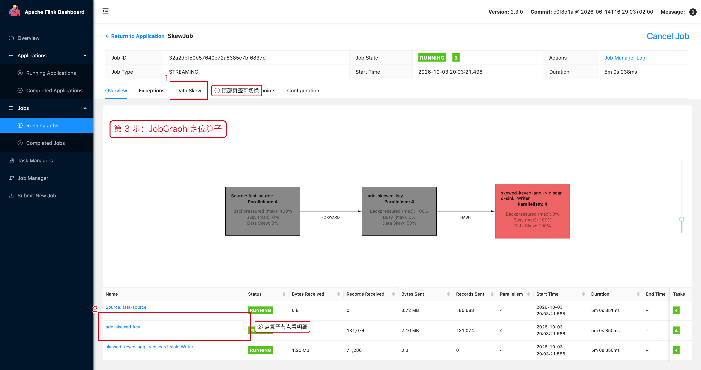

```text
Backpressured (max)  谁在被压
Busy (max)           谁在忙 —— 忙的那个就是瓶颈
Data Skew            谁在倾斜
```

节点颜色也是信号：**蓝色=空闲，黑色=完全反压，红色=完全忙碌**。

### 第 4 步：点开算子，选页签

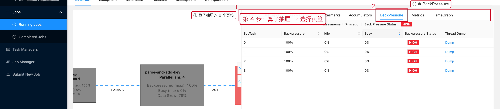

反压问题点 `BackPressure`，倾斜问题点 `SubTasks`，
窗口不触发点 `Watermarks`，CPU 高切 `FlameGraph`。

### 第 5 步：读 Subtask 级结果

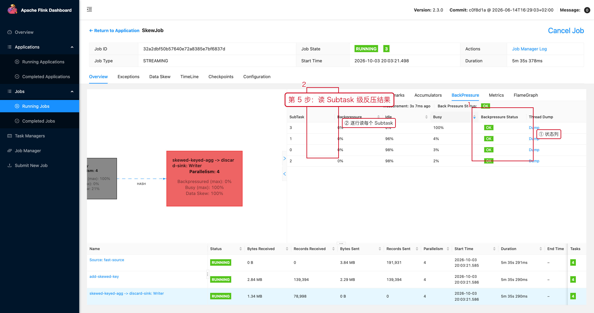

```text
Backpressure 高 + Busy 低             →  在等下游
Backpressure 低 + Busy 高             →  它自己就是瓶颈
Backpressure 低 + Busy 低 + Idle 高   →  它在等上游
个别实例忙、其余空闲                   →  数据倾斜
```

---

## 11. 按症状查的入口表

| 症状 | 入口 |
|---|---|
| 作业慢 | JobGraph 的 `Busy` / `BackPressured` |
| 延迟高 | 算子 `Metrics` 的 `numRecordsInPerSecond` + `BackPressure` |
| 窗口不触发 | 算子 `Watermarks` |
| 数据不均 | `Data Skew` 页签 + `SubTasks` |
| Checkpoint 慢 / 失败 | `Checkpoints` 的 History / Summary / Configuration |
| 反复重启 | `Exceptions` 的 Exception History + `TimeLine` |
| CPU 高 | TaskManager `Thread Dump` / `Profiler` / `FlameGraph` |
| 内存高 | TaskManager `Metrics` 的 Memory 区块 |
| 作业起不来 | 集群 `Overview` 的 Slot + `Exceptions` |
| 调度变慢 / 提交不上 | `Job Manager → Metrics` 的 GC 与内存 |
| 配置没生效 | `Job Manager → Configuration` + Job 的 `Configuration` |

---

## 12. 排查口诀

```text
先 Overview  → 再 Application → 再 Job → 再 Operator → 再 Subtask
→ 再 Metrics / BackPressure / Watermarks → 最后 Logs / Thread Dump / Profiler

不要反过来：从一个巨大的日志文件里找所有问题，几乎不可能。
```

---

## 13. 生产事故记录模板

| 字段 | 记录内容 |
|---|---|
| JobID / Job Name |  |
| 开始时间 / 异常时间 |  |
| 现象 | 用户/上游看到的是什么 |
| Cluster | TaskManager 数量、Task Slots |
| 异常 Operator / Subtask | 谁在报错 |
| BackPressure | 哪些实例 HIGH |
| Busy / Idle | 瓶颈算子的取值 |
| Watermark | 是否落后 |
| Checkpoint | Duration / Size / Failed 计数 |
| Exception | 异常类型与关键堆栈 |
| 初步原因 |  |
| 已执行操作 |  |
| 执行后指标变化 |  |
| 最终根因 |  |
