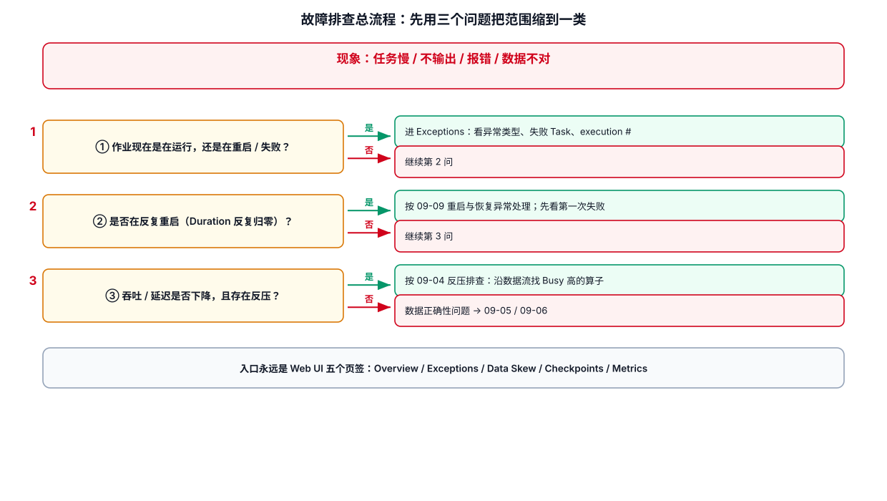
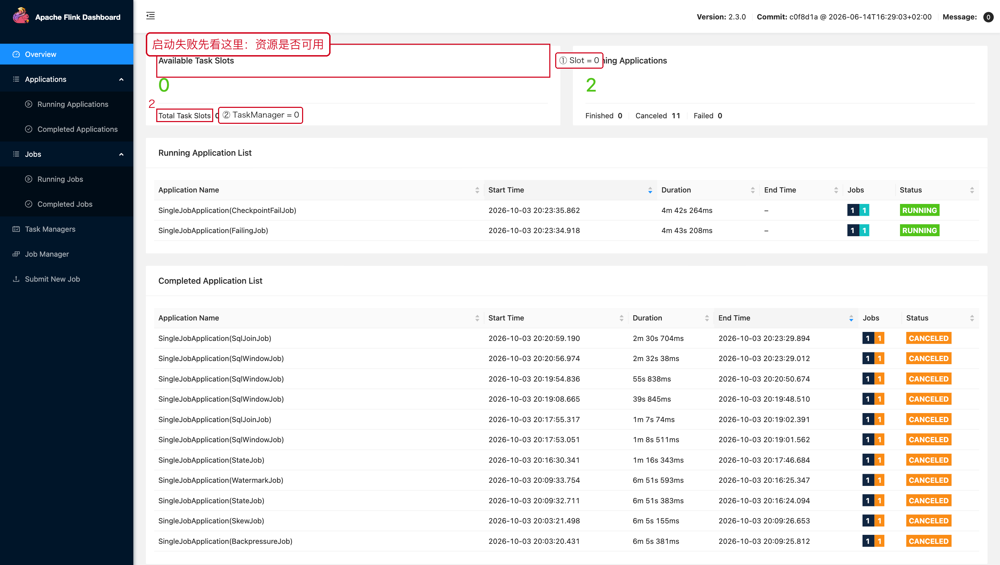
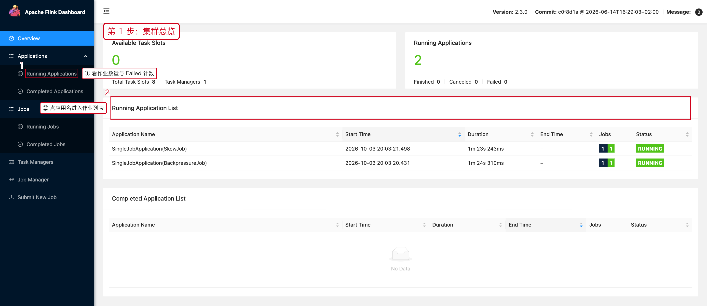

# 01-故障排查总流程

> 目标：生产任务出现异常时，先建立证据，再定位到算子、Subtask、外部系统或代码。



## 1. 第一原则：先描述现象，不先猜原因

常见现象：

| 现象 | 第一批要看的指标 |
|---|---|
| 吞吐下降 | Records In/Out、Busy、BackPressure |
| 延迟升高 | BackPressure、Watermark、Source Lag |
| Checkpoint 失败 | Duration、Alignment、Start Delay、State Size |
| 任务频繁重启 | Restart Count、Exception、Failure Rate |
| 数据重复 | Source Offset、Checkpoint、Sink 语义、业务主键 |
| 数据丢失 | Source 起始位置、过滤条件、迟到数据、Sink 提交 |
| OOM | JVM、Managed Memory、State Size、GC |
| 某个 Subtask 特别慢 | Subtask 级吞吐、Busy、BackPressure、输入分布 |

## 2. 推荐排查顺序

本文顶部的流程图给出了完整分支；落到日常操作，可以压缩成这一句：

**先判断作业是「在跑」「在重启」还是「已结束」，再决定看哪一类指标。**

三种分支分别对应：

| 分支 | 第一入口 | 继续看的页面 |
|---|---|---|
| 在跑但慢 | JobGraph 的 Busy / BackPressured | BackPressure → SubTasks → Metrics |
| 在反复重启 | Exceptions → Exception History | TaskManager Logs |
| 已结束 | Completed Jobs → 该作业详情 | Exceptions + JobManager Log |


## 3. 先回答四个问题

### 3.1 什么时候开始异常？

记录：

```text
异常开始时间：2026-10-03 10:15
异常结束时间：2026-10-03 10:37
发布时间：2026-10-03 09:58
```

先判断是否与发布、扩容、数据突增、依赖系统异常重合。

### 3.2 是整个任务异常，还是单个 Operator？

如果只有一个 Operator 的吞吐下降，优先查算子自身。

如果多个下游 Operator 同时异常，先查上游、网络、Source 或公共外部依赖。

### 3.3 是所有 Subtask 异常，还是少数 Subtask 异常？

```text
所有 Subtask 都慢
→ 资源不足 / 下游瓶颈 / 全局配置 / 外部系统整体异常

少数 Subtask 慢
→ 数据倾斜 / 热点 Key / 分区不均 / 局部异常
```

### 3.4 指标变化是原因还是结果？

例如：

```text
Sink 变慢
→ 上游产生 BackPressure
→ 上游 Busy 变高
→ Checkpoint Alignment 变长
```

此时“上游 BackPressure 高”可能只是结果，真正根因是 Sink。

## 4. 排查记录模板

```text
【现象】
任务延迟持续升高，Kafka 消费 Lag 增长。

【时间】
10:15 开始，10:37 恢复。

【影响】
user_behavior 实时特征延迟约 8 分钟。

【UI 证据】
Operator A：BackPressure LOW
Operator B：BackPressure HIGH
Operator B Subtask 3 的 Records Out 明显低于其他 Subtask。

【进一步检查】
发现 user_id=xxx 为热点 Key。

【根因】
KeyBy 后数据倾斜。

【处理】
拆分热点 Key，并将热点计算与普通 Key 分流。

【验证】
各 Subtask 吞吐恢复接近；Lag 在 6 分钟内下降至正常范围。
```

## 5. 不要做的事

### 不要一看到 CPU 高就直接扩容

先判断 CPU 高是否由真正的计算热点造成。

### 不要一看到 Checkpoint 慢就直接调大 timeout

先看：

- Start Delay
- Alignment Duration
- End to End Duration
- State Size
- Async Duration

Checkpoint 慢可能是反压、State 大、存储慢或资源不足。

### 不要先重启再分析

重启可能把现场指标和异常上下文清掉。除非已经确认需要快速恢复业务，否则先记录现场。

## 6. 关联文档

- `07-性能优化/01-性能指标与排查顺序.md`
- `07-性能优化/03-反压.md`
- `07-性能优化/04-Checkpoint性能.md`
- `09-故障排查/03-Checkpoint失败.md`
- `09-故障排查/04-反压与吞吐下降.md`

---

## 7. 配套 Web UI 证据



启动失败时先看集群资源



所有排查都从集群总览开始

