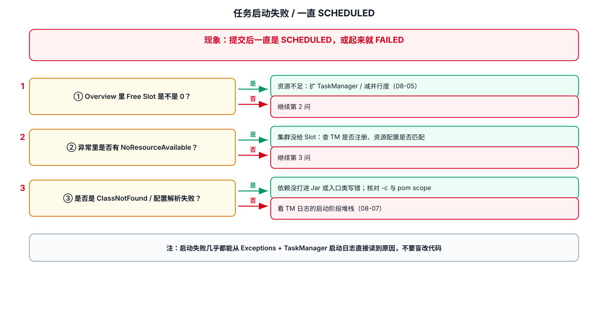

# 02-任务启动失败



## 1. 先区分失败阶段

不同阶段对应的排查位置不同。

## 2. 常见异常类型

### 2.1 ClassNotFoundException / NoClassDefFoundError

典型原因：Connector 或依赖没有打进作业 JAR，或者集群侧类路径与本地不同。

检查：

```bash
# 查看最终 JAR 内容
jar tf target/your-job.jar | grep -E 'kafka|jdbc|hbase'

# 查看 Maven 依赖树
mvn dependency:tree
```

### 2.2 NoSuchMethodError

通常不是“缺类”，而是**同一个类存在多个版本**。

重点检查：

```bash
mvn dependency:tree | grep flink
mvn dependency:tree | grep kafka
```

不要通过随意升级一个依赖解决。先找出冲突路径。

### 2.3 Connector 初始化失败

例如 Kafka：

```text
无法连接 Broker
认证失败
Topic 不存在
反序列化失败
```

排查顺序：

```text
Broker 地址
→ 网络 / DNS
→ SASL / SSL
→ Topic
→ ACL
→ Serializer
```

## 3. TaskManager 部署失败

重点看：

```text
TaskManager 数量
Task Slot 数量
资源是否满足
容器是否启动
Pod / JVM 是否 OOM
```

如果 JobGraph 已生成，但任务长时间处于 `SCHEDULED`，不要继续查业务代码；先看资源调度和 Slot。

## 4. 初始化阶段异常代码

常见危险写法：

```java
public class MyFunction extends RichMapFunction<Event, Result> {

    // 错误倾向：在构造函数中访问运行时资源
    private final ExternalClient client = createClient();
}
```

更安全的方式：

```java
public class MyFunction extends RichMapFunction<Event, Result> {

    private transient ExternalClient client;

    @Override
    public void open(OpenContext context) {
        // 1. 等算子真正运行后再创建外部客户端
        // 2. 每个 Subtask 创建自己的客户端实例
        client = createClient();
    }

    @Override
    public Result map(Event event) {
        // 3. 复用 open() 创建的客户端
        return client.query(event.getId());
    }

    @Override
    public void close() {
        // 4. 释放连接、线程池等资源
        if (client != null) {
            client.close();
        }
    }
}
```

## 5. 排查 checklist

```text
[ ] Exception 第一行是什么
[ ] Caused by 最底层是什么
[ ] 是依赖问题还是业务初始化问题
[ ] 是所有 Subtask 都失败还是单个失败
[ ] 是否刚发布新版本
[ ] 是否变更了 Connector 配置
[ ] 是否变更了集群资源
[ ] 外部系统是否可访问
```

## 6. 经验

`Caused by` 往往比第一行异常更重要。日志排查时继续向下寻找最底层异常，而不是停在 `JobException`、`ExecutionException` 等包装异常。

---

## 7. 配套 Web UI 证据


TaskManager / Slot = 0 的现场

