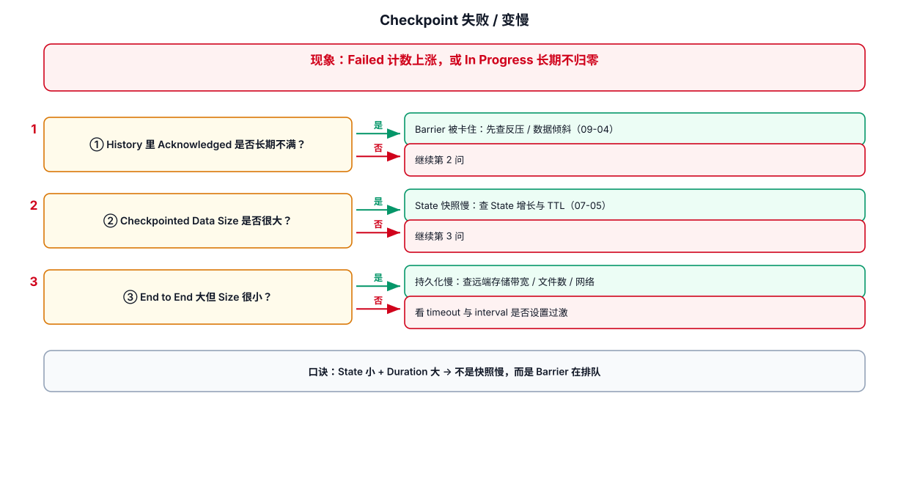
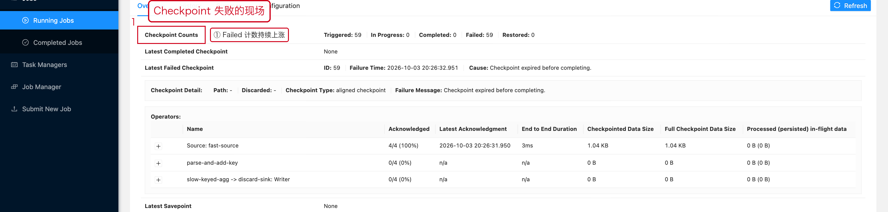

# 03-Checkpoint失败



## 1. 先看四个时间

在 Checkpoint 页面重点关注：

```text
Start Delay
Alignment Duration
Sync Duration
Async Duration
```

不同阶段异常对应的方向不同。

## 2. Start Delay 很高

### 含义

Checkpoint 已经触发，但某些 Subtask 很晚才开始参与。

优先排查：

- TaskManager 负载
- CPU 调度
- 算子是否长时间阻塞
- 是否存在长时间单条记录处理

## 3. Alignment Duration 很高

通常优先考虑 BackPressure。

Checkpoint barrier 已到达部分输入，但还在等待其他输入。

排查：

```text
Checkpoint Detail
→ Operator
→ Subtask
→ Alignment Duration
→ BackPressure
```

Flink 官方文档也指出，在强 BackPressure 下，Barrier 的传播和对齐可能成为 Checkpoint End-to-End Duration 的主要组成部分。见：
https://nightlies.apache.org/flink/flink-docs-release-2.3/docs/ops/state/checkpointing_under_backpressure/

## 4. Async Duration 很高

重点查 State Backend / Checkpoint Storage。

例如：

```text
State 大
↓
快照大
↓
上传 / 写入慢
↓
Async Duration 高
```

同时检查：

- Checkpoint storage 网络
- 对象存储 / HDFS 延迟
- TaskManager 磁盘 IO
- State 是否异常增长

## 5. End to End Duration 持续接近 Timeout

不要只看最近一次。

看趋势：

```text
Checkpoint History
→ Duration 是否持续增长
→ State Size 是否增长
→ Alignment 是否同步增长
```

如果三者一起涨，通常需要回到 State、数据量、BackPressure 方向排查。

## 6. Timeout 的处理顺序

```text
先确认是否偶发
    ↓
看持续时间趋势
    ↓
看 Alignment
    ↓
看 State Size
    ↓
看 Async Duration
    ↓
确认外部存储
    ↓
最后再考虑调 timeout
```

## 7. 调参示例

```java
StreamExecutionEnvironment env =
        StreamExecutionEnvironment.getExecutionEnvironment();

// 1. 每 60 秒触发一次 Checkpoint
env.enableCheckpointing(60_000L);

CheckpointConfig config = env.getCheckpointConfig();

// 2. 单次 Checkpoint 最长允许执行 5 分钟
//    不要把 timeout 当作性能优化手段，只用于合理覆盖正常抖动。
config.setCheckpointTimeout(300_000L);

// 3. 两次 Checkpoint 完成之间至少间隔 30 秒
//    防止大型 Checkpoint 连续运行，持续占用资源。
config.setMinPauseBetweenCheckpoints(30_000L);
```

## 8. 一个重要误区

如果 Checkpoint 因 BackPressure 很慢，单纯增大 timeout 只能让失败更晚发生，不能消除 BackPressure。

可以根据场景考虑：

- 消除 BackPressure 根因
- 减少 in-flight buffer
- Buffer Debloating
- Unaligned Checkpoint

但 Unaligned Checkpoint 不是万能开关；如果 State Storage IO 本身就是瓶颈，它可能进一步增加 IO。官方文档对此有明确说明：
https://nightlies.apache.org/flink/flink-docs-release-2.3/docs/ops/state/checkpointing_under_backpressure/

---

## 9. 配套 Web UI 证据



Failed 计数持续上涨


History 里直接写着失败原因

