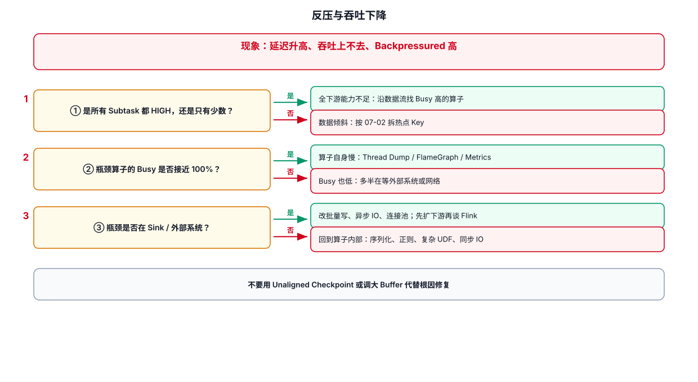

# 04-反压与吞吐下降



## 1. 先判断：真的有 BackPressure 吗

观察：

如果下游处理能力下降，上游通常会逐渐受到反压。

## 2. 全链路都慢

优先排查：

```text
Source 数据量突增
→ 全局资源不足
→ CPU / Network / IO
→ Sink 外部系统变慢
```

## 3. 一个 Operator 慢

进入 Operator 的 Subtasks 页面。

```text
全部 Subtask 慢
→ 算子本身 / 外部系统

只有少数 Subtask 慢
→ Key 倾斜 / 分区不均
```

## 4. Source 端 BackPressure

Source 自身一般是数据生产端，但 Source Subtask 出现异常时需要看：

- Source connector fetch latency
- Kafka Lag
- Broker 状态
- 反序列化
- Source 自身 CPU

注意“消费 Lag 高”和“Flink BackPressure 高”不是同一个概念。

## 5. Sink 导致的典型链路

```text
Kafka
 ↓
map
 ↓
keyBy
 ↓
process
 ↓
JDBC Sink 变慢
 ↓
Sink BackPressure
 ↓
process BackPressure
 ↓
上游逐层传播
```

因此发现最上游 BackPressure，不代表问题就在最上游。

## 6. 数据倾斜场景

例如：

```java
stream
    .keyBy(Event::getUserId)
    .process(...);
```

如果某个 user_id 产生大量数据，该 key 会固定进入一个 Key Group / Subtask。

表现通常是：

```text
Subtask 0：正常
Subtask 1：正常
Subtask 2：正常
Subtask 3：明显 Busy / BackPressure
```

处理方向：

- 热点 Key 拆分
- 两阶段聚合
- 改 Key 设计
- 热点数据单独处理
- 必要时调整并行度

## 7. 最小排查案例

```text
现象：Kafka Lag 持续增长

① 看 Source：Records In 是否突增？
② 看下游：哪个 Operator 开始出现 BackPressure？
③ 看该 Operator：所有 Subtask 还是少数 Subtask？
④ 如果少数：查 Key 分布
⑤ 如果全部：查算子计算 / 外部 IO
⑥ 如果 Sink：查目标数据库 / Kafka / HBase
```

## 8. 相关指标

重点记住：

```text
numRecordsIn
numRecordsOut
busyTimeMsPerSecond
backPressuredTimeMsPerSecond
idleTimeMsPerSecond
```

不要单看其中一个指标。Busy 高可能是正常高负载，也可能是 CPU 热点；BackPressure 高更应该结合上下游看。

---

## 9. 配套 Web UI 证据


JobGraph 上看反压与 Busy


BackPressure 页签的状态判读

