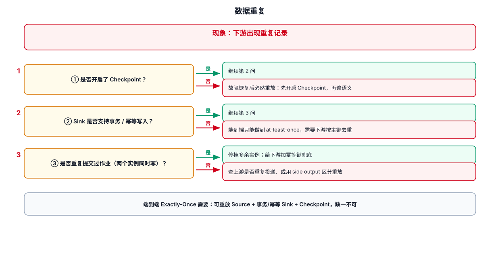
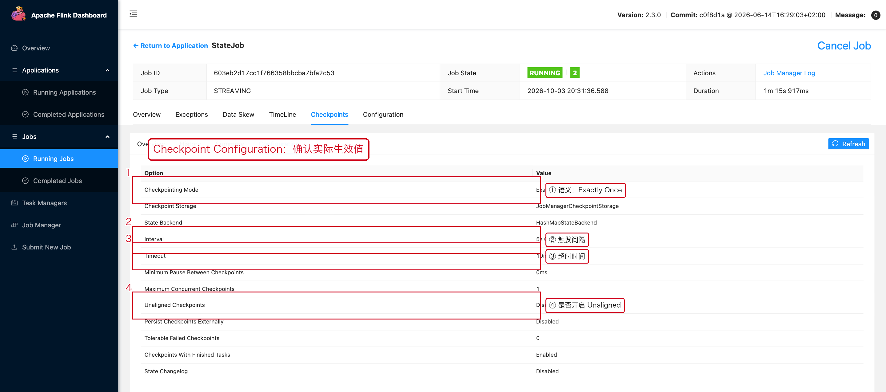

# 05-数据重复



## 1. 先判断是哪一层重复

重复可能发生在三个位置，先定位层级再谈修复：

| 层级 | 典型原因 | 判断方法 |
|---|---|---|
| 源头重复 | 上游重复投递、埋点重复上报 | 看 Source 输入条数是否本就重复 |
| 作业内重复 | 故障恢复重放、Checkpoint 未开启 | 看是否有重启记录 |
| 下游重复 | Sink 非幂等、重复提交 | 看下游是否按主键去重 |

判定流程见本文顶部示意图。


## 2. Source 重复读取

对于支持回放的 Source，例如 Kafka，需要结合：

- checkpoint 恢复位置
- offset
- restart
- 消费组
- 是否从 checkpoint / savepoint 恢复

Flink 的一致性恢复依赖 Source 能回退到与状态一致的位置。Kafka 具备这种能力。官方说明见：
https://nightlies.apache.org/flink/flink-docs-release-2.3/docs/concepts/stateful-stream-processing/

## 3. Sink 重复

即使 Flink 内部处理语义是 Exactly-Once，也不能自动把外部 Sink 变成 Exactly-Once。

需要单独分析：

```text
Flink processing semantics
        ≠
External system write semantics
```

例如 JDBC：

```text
INSERT
```

可能重复。

而：

```text
UPSERT / unique key / idempotent write
```

更容易实现重复写入后的业务幂等。

## 4. 业务主键去重

如果业务天然有 event_id：

```java
// event_id 是业务事件唯一标识。
// 与 Kafka offset 不同：offset 只表示 Kafka 中的位置。
stream
    .keyBy(Event::getEventId)
    .process(new DeduplicateProcessFunction());
```

不要把 Kafka offset 当成跨 Topic、跨系统的业务唯一 ID。

## 5. 排查步骤

```text
① 抽取一条重复记录
② 找 event_id / business_id
③ 查原始 Topic 是否本来就有两条
④ 查 Flink 是否发生重启
⑤ 查恢复位置
⑥ 查 Sink 是否重复提交
⑦ 查下游是否把 update / retract / upsert 误当 append
```

## 6. 一个常见错误

CDC 或 SQL Join 产生 Changelog 时，结果表可能包含：

```text
INSERT
UPDATE_BEFORE
UPDATE_AFTER
DELETE
```

如果下游只能接受 append，而没有正确处理 Changelog，就可能表现为“重复数据”。

所以出现重复时不要只查 Source。

---

## 7. 配套 Web UI 证据



先确认语义相关的 Checkpoint 配置

