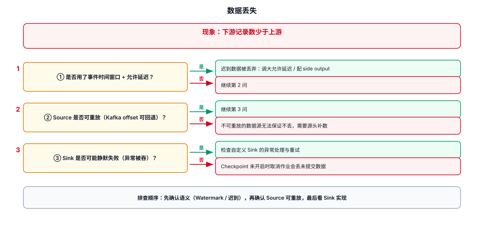
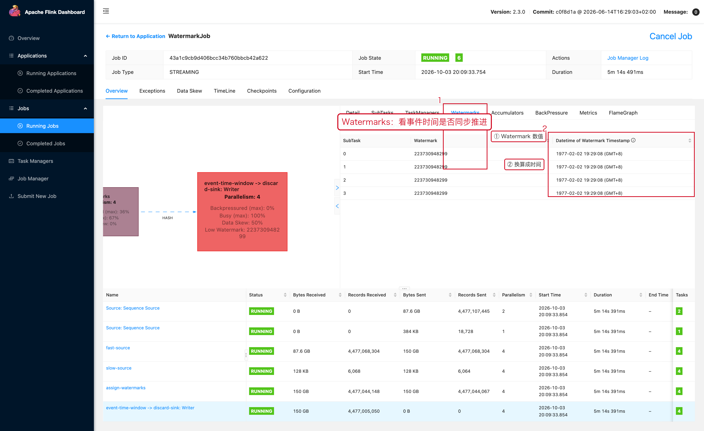

# 06-数据丢失



## 1. 先定义“丢失”

至少区分三种：

```text
源数据有
→ Flink 没读到

Flink 读到了
→ 中间被过滤 / 丢弃

Flink 输出了
→ Sink 没落下来
```

## 2. Source 没读到

检查：

```text
Kafka Topic
→ Partition
→ Starting Offset
→ Consumer Group
→ Checkpoint / Savepoint 恢复位置
```

不要直接看业务表判断。先从原始消息确认。

## 3. Filter 导致丢数据

典型代码：

```java
stream.filter(event ->
    event.getUserId() != null
    && event.getEventTime() != null
);
```

生产环境建议把丢弃原因输出到 Side Output 或监控，而不是静默丢弃。

```java
final OutputTag<String> invalidTag =
        new OutputTag<String>("invalid-data") {};
```

## 4. 迟到数据

Event Time Window 默认在 watermark 超过窗口结束后，迟到数据可能被丢弃；可以根据业务设置 Allowed Lateness 或 Side Output。官方窗口文档有明确说明：
https://nightlies.apache.org/flink/flink-docs-release-2.3/docs/dev/datastream/operators/windows/

因此要区分：

```text
真正没消费到
vs
已经消费但因为时间语义没有进入结果
```

## 5. Sink 丢数据

检查：

- Sink transaction
- flush / batch
- retry
- external system acknowledgement
- connector error
- 下游主键冲突

## 6. 推荐验证方法

建立一个端到端事件计数：

```text
Source count
→ valid count
→ invalid count
→ enriched count
→ sink accepted count
```

对于关键链路，每个阶段都能观察数量，定位会快很多。

---

## 7. 配套 Web UI 证据



迟到数据与 Watermark 的关系

