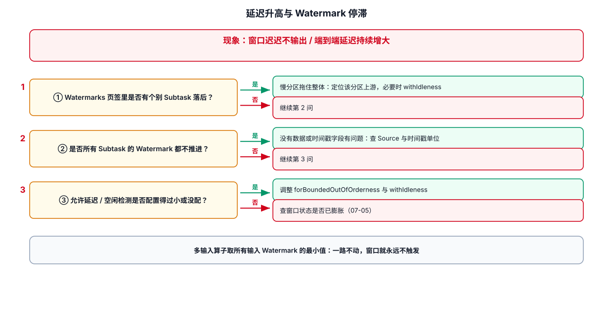

# 07-延迟升高与 Watermark 停滞



## 1. 先区分两种延迟

```text
Processing Delay
→ 数据进入系统后多久被处理

Event-time Delay
→ Watermark 距离当前业务事件时间有多远
```

业务告警说“实时数据慢”，不等于一定是 CPU 慢。

## 2. Watermark 不推进

Flink Web UI 可以通过 Task 的 Metrics 查看 `currentInputWatermark`。该值由输入水印中的最小值决定，因此最落后的上游会拖住下游事件时间。官方调试文档对此有明确说明：
https://nightlies.apache.org/flink/flink-docs-release-2.3/docs/ops/debugging/debugging_event_time/

排查：

```text
Window 结果不出
↓
看 currentInputWatermark
↓
看哪个 Subtask 的 watermark 最低
↓
看该 Subtask 对应 Source / Partition
↓
检查是否空闲 / 数据停止 / 时间戳异常
```

## 3. 常见原因

### 3.1 Source Partition 空闲

某个分区长时间没有事件，可能让整体 watermark 无法推进。

可以根据业务配置 idle timeout。

### 3.2 时间戳异常

例如一批数据带了：

```text
2020-01-01
```

而当前业务时间已经是 2026 年。

该数据可能让事件时间相关逻辑异常。

### 3.3 Source 并行度与分区分配

某个 Subtask 负责的 Partition 异常，也可能造成局部 Watermark 长时间落后。

## 4. 数据延迟但 Watermark 正常

这时重点转向：

- CPU
- BackPressure
- Sink
- Kafka Lag
- 外部数据库

不要继续只查 Event Time。

## 5. 排查命令思路

```text
业务延迟
↓
看 Kafka Lag
↓
看 Flink currentInputWatermark
↓
看 Operator Busy / BackPressure
↓
看 Sink latency
```

最终需要判断：

```text
消息没有及时进入 Flink
还是
进入了但没及时处理
还是
已经处理但窗口还没触发
```

---

## 6. 配套 Web UI 证据


逐 Subtask 对比 Watermark 是否同步

