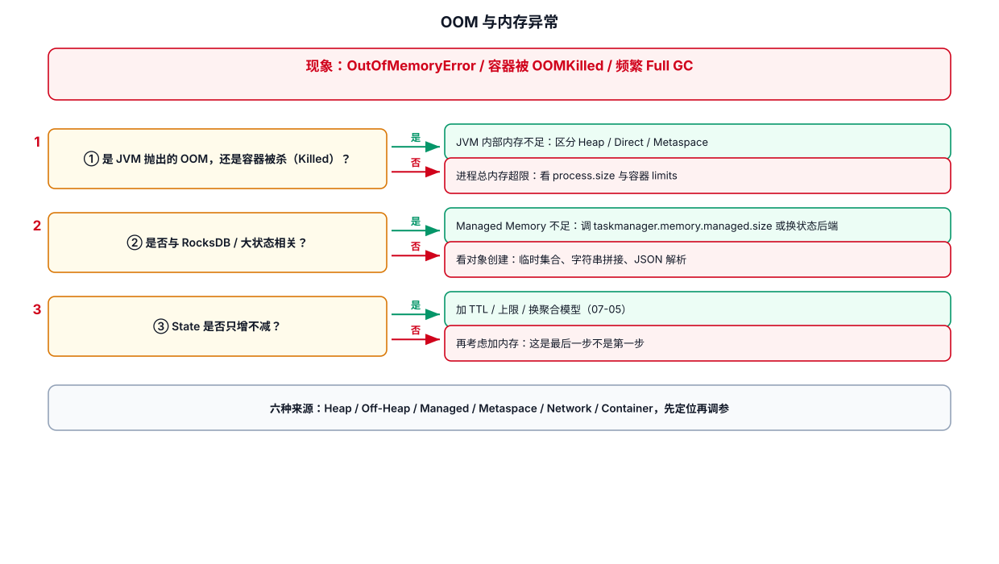

# 08-OOM与内存异常



## 1. 先判断是哪类 OOM

典型异常：

```text
java.lang.OutOfMemoryError: Java heap space
java.lang.OutOfMemoryError: Metaspace
Container killed / memory limit exceeded
Direct buffer memory
```

不同错误不能用同一个参数解决。

## 2. Heap OOM

优先查：

- 大对象
- 无界集合
- 错误缓存
- 巨量字符串
- 单条消息过大
- 自定义数据结构

例如危险代码：

```java
// 错误示例：随着任务运行不断增长，没有上限。
private final List<Event> cache = new ArrayList<>();
```

生产任务应该明确生命周期和上限。

## 3. State 增长导致内存压力

检查：

```text
Key 数量
State 大小
TTL
窗口长度
ListState 是否无限增长
MapState key 数量
```

State 管理和 Checkpoint 是关联的。Flink 会在 Checkpoint 时持久化 managed state，以支持故障恢复。见：
https://nightlies.apache.org/flink/flink-docs-release-2.3/docs/ops/state/checkpoints/

## 4. RocksDB / Managed Memory

使用 EmbeddedRocksDBStateBackend 时，不要只盯 JVM Heap。

需要一起看：

- Managed Memory
- RocksDB state size
- Process Memory
- Network Memory
- Container limit

Flink 官方的 State / Large State 调优文档指出，RocksDB 的内存消耗和 State 数量、managed memory 配置等因素有关。

## 5. 排查顺序

```text
① 看最底层 OOM 文本
② 看 TaskManager 哪个进程
③ 判断 Heap / Off-Heap / Container
④ 看 State Size
⑤ 看是否刚增加 State / Cache / Connector
⑥ 看是否存在单条巨型记录
⑦ 再调资源
```

## 6. 不要直接做

```text
-Xmx 从 4G → 16G
```

如果根因是无界状态或无限缓存，只是在延后崩溃时间。

---

## 7. 配套 Web UI 证据


TaskManager 的内存模型明细

