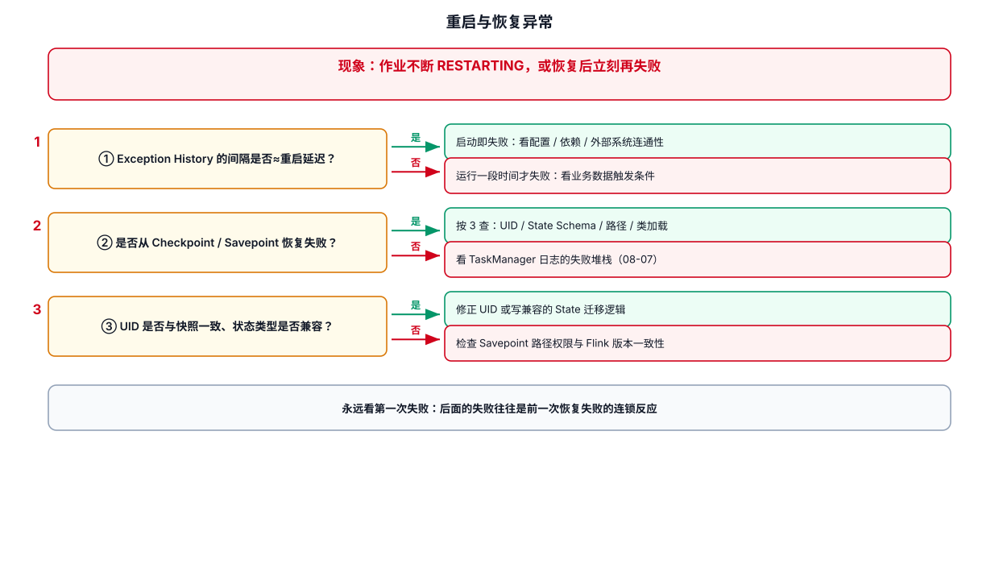
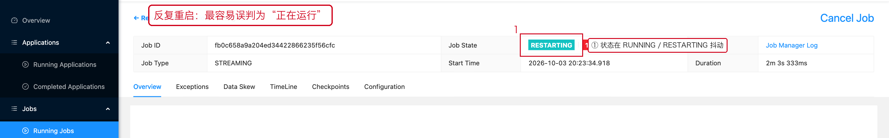
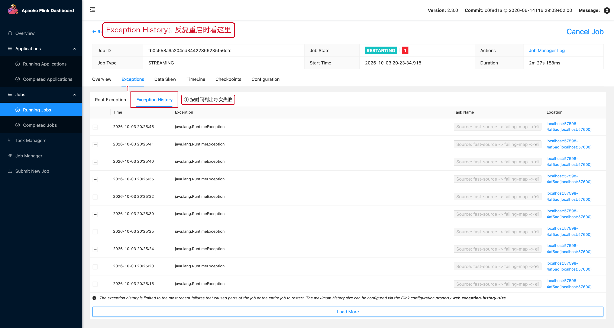

# 09-重启与恢复异常



## 1. 先确认重启原因

Flink 的典型恢复路径是：失败后重新启动 Operator，并从最近一次成功 Checkpoint 恢复状态和输入位置。Source 必须支持回退到定义好的位置才能实现完整恢复语义。官方状态流处理文档明确描述了这一点：
https://nightlies.apache.org/flink/flink-docs-release-2.3/docs/concepts/stateful-stream-processing/

## 2. 重启后数据为什么会重复

恢复时，Checkpoint 记录的是一致的状态与输入位置。

如果 Sink 不是幂等或事务性 Sink，恢复后的输出可能需要额外的去重或 Upsert 设计。

## 3. 重启次数持续增加

不要只看 `Restart Count`。

进一步看：

```text
Exception
→ 是否同一个 Operator
→ 是否同一个 Subtask
→ 是否固定时间后失败
→ 是否固定数据触发
```

如果总是处理到同一条业务数据时失败，优先怀疑数据兼容性、序列化或业务异常。

## 4. 恢复很慢

恢复时间主要受以下因素影响：

- State 大小
- State Backend
- Checkpoint / Savepoint 存储
- TaskManager 资源
- Network
- Source 回放量

恢复完成后如果消费能力不足，可能出现：

```text
恢复
↓
历史积压
↓
持续 BackPressure
↓
追赶速度不足
```

## 5. 恢复问题排查模板

```text
Job ID：
失败时间：
失败 Subtask：
Exception：
最近成功 Checkpoint：
Checkpoint State Size：
恢复耗时：
恢复后 Kafka Lag：
恢复后 Sink Throughput：
```

---

## 6. 配套 Web UI 证据



反复重启时的作业状态



Exception History 里看第一次失败

