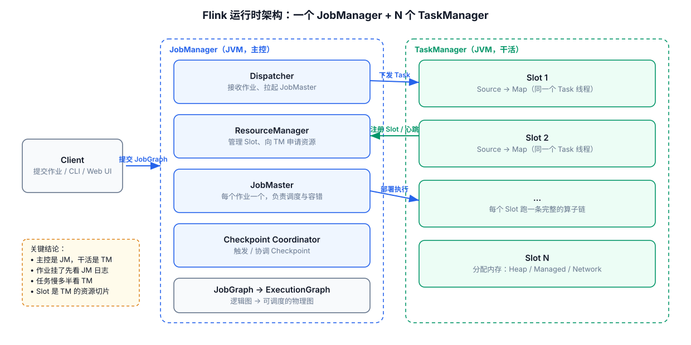

# 01-Flink运行时架构



## 1. 一张图记住运行链路

实际部署时还会有：

```text
JobManager
├── Dispatcher
├── JobMaster
└── ResourceManager

TaskManager
├── Task Slot
├── Task
└── Network / State / Memory
```

## 2. JobManager 干什么

主要负责：

- 作业协调
- 调度
- Checkpoint 协调
- Failure Recovery
- 管理 ExecutionGraph

不要把 JobManager 理解成“真正执行所有代码的节点”。真正处理数据的是 TaskManager 上的 Task。

## 3. TaskManager 干什么

TaskManager 是 Worker 进程，负责执行实际的 Operator Subtask，并提供：

- Task Slot
- Network Shuffle
- State 相关能力
- Memory

## 4. Operator / Subtask / Task

例如：

```java
stream
    .map(...)
    .filter(...)
    .keyBy(...)
    .process(...);
```

逻辑上存在多个 Operator。

如果并行度为 4：

```text
map      → 4 个 Subtask
filter   → 4 个 Subtask
process  → 4 个 Subtask
```

如果满足 Operator Chaining 条件，多个 Operator Subtask 可以被链到同一个 Task 中，以减少线程切换、数据传递和缓冲开销。官方架构文档对 Task、Subtask、Operator Chain 有明确说明：
https://nightlies.apache.org/flink/flink-docs-release-2.3/docs/concepts/flink-architecture/

## 5. Slot 不等于 CPU 核

Slot 是 Flink 的资源调度概念。

一个 TaskManager 可以有多个 Slot，一个 Slot 可以承载一个 Task；而一个 Task 内又可以包含多个 chained operators。

因此不要用：

```text
slot 数 = operator 数
```

来理解运行模型。

## 6. 为什么生产排障一定要找到 Subtask

因为：

```text
Job
→ Operator
→ Subtask
```

只有落到 Subtask，才能判断：

- 是否数据倾斜
- 是否某个 TaskManager 异常
- 某个 Subtask 是否明显慢
- 某个分区是否异常

---

## 7. 配套 Web UI 证据


Web UI 上的集群总览对应主控与资源

