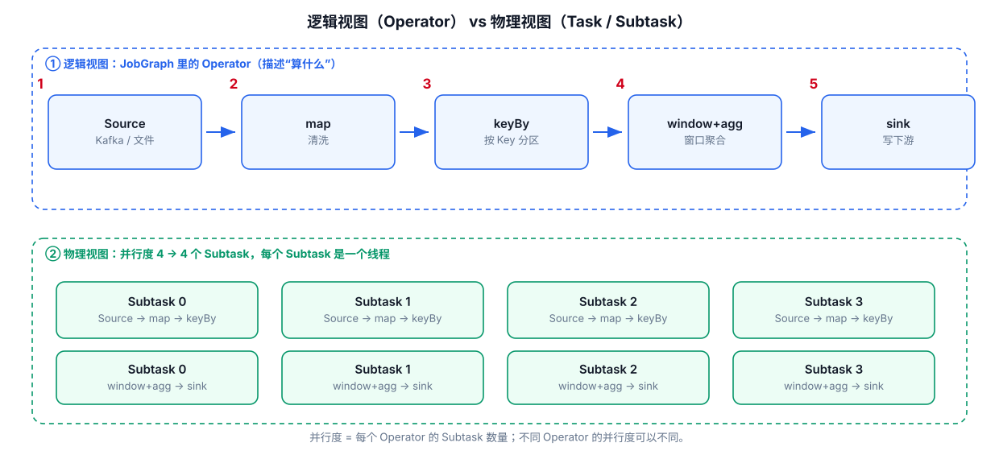
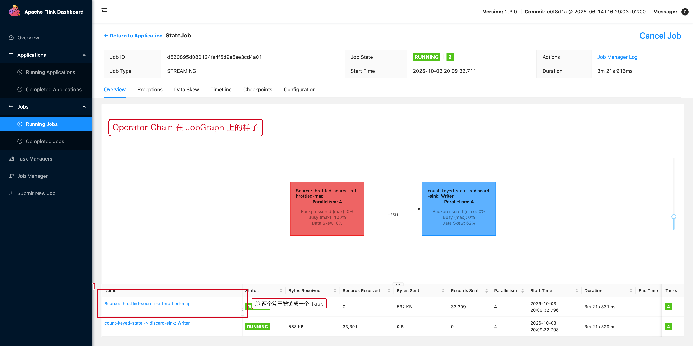

# 02-Operator与Task



## 1. Operator 是逻辑节点

用户代码中的：

```java
map(...)
filter(...)
process(...)
```

通常会形成逻辑 Operator。

## 2. Subtask 是 Operator 的并行实例

如果：

```java
stream.map(...).setParallelism(4);
```

则该 Operator 有 4 个 Subtask。

## 3. Task 是执行单元

通过 Operator Chaining，多个相邻 Operator 可以在一个 Task 中执行。

```text
Source Operator
      ↓
Map Operator
      ↓
Filter Operator
```

可能被 Chain 为：

```text
一个 Task
└── Source → Map → Filter
```

这样可以减少线程间通信和序列化/反序列化开销。

## 4. 什么情况下不能简单理解为 Chain

遇到：

- shuffle
- rebalance
- keyBy
- 不同并行度
- 某些特殊算子边界

会形成数据交换边界。

## 5. 为什么这些概念影响性能

如果 Operators 被 Chain：

```text
同线程直接传递
```

如果出现 Network Shuffle：

```text
Task A
 ↓
Network
 ↓
Task B
```

此时会引入：

- Network Buffer
- Serialization
- Queueing
- Data Transfer

因此一个任务的性能分析不能只看单个函数的执行时间，还要看 Operator Chain 和数据交换边界。

---

## 6. 配套 Web UI 证据



JobGraph 上的算子节点就是 Operator

